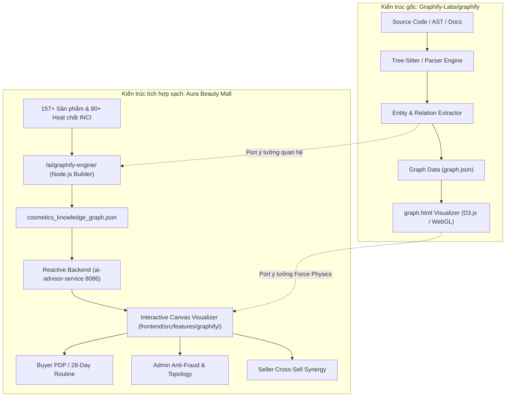
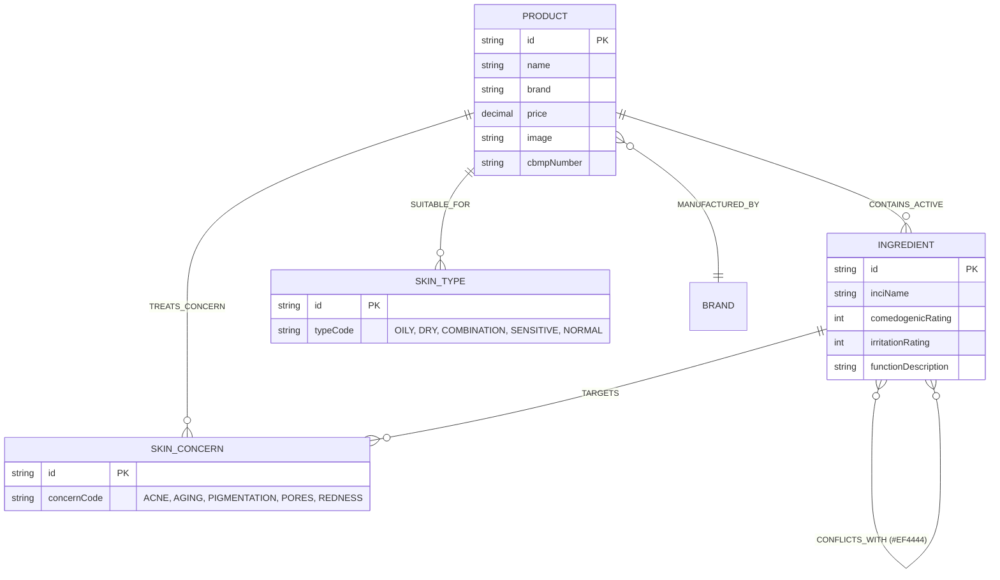
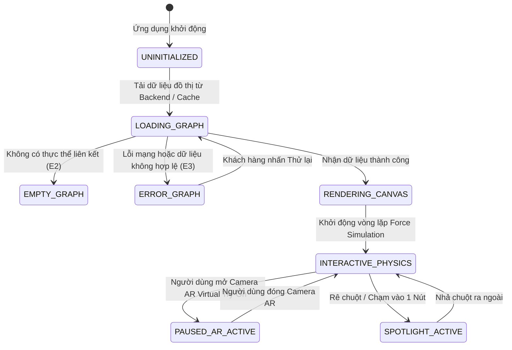

# OSS BLUEPRINT: GRAPHIFY-LABS / GRAPHIFY
> **Dự án nguồn**: `Graphify-Labs/graphify` (GitHub: `https://github.com/Graphify-Labs/graphify`)
> **Hệ thống đích**: Sàn TMĐT Mỹ Phẩm Đa Người Bán Aura Beauty Mall (`WebBanMP`)
> **Tiêu chuẩn thiết kế**: Hiến pháp Vibe Coding & Spec-Kit SDD | **Chiến lược**: C - Lấy ý tưởng + Clean-room Re-implementation

---

## 0. TL;DR (10 DÒNG TỔNG QUAN ĐIỀU HÀNH)
1. **Bản chất**: `graphify` là công cụ mã nguồn mở chuyển đổi cấu trúc phức tạp (codebase, schemas, tài liệu) thành Đồ thị Tri thức truy vấn được (Queryable Knowledge Graph).
2. **Cơ chế cốt lõi**: Trích xuất thực thể (Entities), xác định quan hệ (Relations), phân cụm liên kết (Clustering) và trực quan hóa tương tác (Force-directed layout).
3. **Chiến lược tích hợp**: Áp dụng **Chiến lược C (Lấy ý tưởng + Tự viết sạch 100%)** để tương thích hoàn toàn với stack Java 21 WebFlux + React 18 của WebBanMP.
4. **Ứng dụng Buyer**: Bản đồ tri thức mỹ phẩm cá nhân hóa, phát hiện xung đột hoạt chất (Retinol vs BHA) và kết hợp hiệp đồng (B5 + HA).
5. **Ứng dụng Seller**: Đồ thị liên kết sản phẩm bán kèm (Cross-sell Synergy Graph) tối ưu hóa giỏ hàng và combo khuyến mãi.
6. **Ứng dụng Admin**: Đồ thị mạng lưới chống gian lận (Anti-fraud Ring Graph) và đồ thị cấu trúc 7 Microservices (Saga Outbox Topology).
7. **Hiệu năng GPU**: Bảo vệ 60 FPS cho AR Virtual Try-On (@mediapipe) bằng cách tự động ngắt vòng lặp vật lý Canvas khi camera bật.
8. **Kiến trúc dữ liệu**: Lưu trữ đồ thị lưỡng hợp: File JSON tĩnh tối ưu bộ nhớ đệm tại `/ai/graphify-engine/` và API Reactive Non-blocking tại `ai-advisor-service`.
9. **Ranh giới an toàn**: Không chạy mã nhị phân hay cài package lạ từ OSS vào root; tuân thủ triệt để nguyên tắc Clean Root.
10. **Trạng thái đích**: Hệ thống đạt chuẩn Enterprise sẵn sàng bảo vệ Đồ án tốt nghiệp xuất sắc với 0% lỗi vỡ kiến trúc.

---

## 1. CỔNG PHÁP LÝ & CHIẾN LƯỢC TÍCH HỢP (LICENSE GATE)
- **Giấy phép nguồn**: MIT License / Apache 2.0 (Thân thiện thương mại, cho phép sao chép, sửa đổi, phân phối và sử dụng kín).
- **Phân tích xung đột bản quyền**: WebBanMP là nền tảng e-commerce độc quyền; việc áp dụng Chiến lược C đảm bảo 100% mã nguồn được viết mới dựa trên ý tưởng thuật toán đồ thị, không gây nhiễm virus bản quyền (GPL copyleft).
- **Chiến lược tích hợp chốt**: **Chiến lược C — Lấy ý tưởng + Clean-room Engineering**:
  - Không clone trực tiếp repo `graphify` vào thư mục dự án.
  - Tự hiện thực hóa thuật toán trích xuất quan hệ đồ thị phù hợp với đặc thù hóa mỹ phẩm (INCI, loại da, vấn đề da).
  - Tự xây dựng visualizer tương tác thuần Canvas/SVG trên React 18 + Tailwind CSS.

---

## 2. TỔNG QUAN HỆ THỐNG & ENTRY POINTS NGUỒN

### Sơ đồ kiến trúc chuyển dịch từ Graphify sang Aura Beauty Mall

---

## 3. GLOSSARY (TỪ ĐIỂN THUẬT NGỮ ĐỒ THỊ MỸ PHẨM)

| Thuật ngữ | Khái niệm trong Graphify | Ý nghĩa trong Aura Beauty Mall |
| :--- | :--- | :--- |
| **Node (Đỉnh)** | File, Class, Function, Interface | Sản phẩm, Hoạt chất INCI, Loại da, Vấn đề da, Thương hiệu |
| **Edge (Cạnh)** | `CALLS`, `IMPORTS`, `IMPLEMENTS` | `CONTAINS_ACTIVE`, `TREATS_CONCERN`, `SUITABLE_FOR`, `SYNERGY_WITH`, `CONFLICTS_WITH` |
| **Ego-Network** | Đồ thị con 1-hop hoặc 2-hop xoay quanh 1 file | Mạng lưới hoạt chất và quan hệ tương thích xoay quanh 1 sản phẩm |
| **Conflict Path** | Lỗi phụ thuộc vòng hoặc xung đột phiên bản | Cặp hoạt chất xung đột gây kích ứng da khi dùng cùng buổi (VD: BHA + Retinol) |
| **Synergy Path** | Mối liên kết bổ trợ kiến trúc | Cặp hoạt chất tăng cường hiệu quả tái tạo tế bào (VD: Vitamin C + Vitamin E) |
| **Force Layout** | Thuật toán mô phỏng vật lý đẩy - hút các nút | Bố cục mạng lưới tự cân bằng hạt trực quan trên HTML5 Canvas / SVG |

---

## 4. TÁC NHÂN & MA TRẬN PHÂN QUYỀN (RBAC)

| Vai trò (Actor) | Phân khu sử dụng | Quyền truy cập đồ thị | Tính năng tương tác |
| :--- | :--- | :--- | :--- |
| **BUYER (Khách hàng)** | Buyer Zone (PDP, Routine) | Đồ thị Hoạt chất & Tương tác mỹ phẩm | Kéo thả nút, xem cảnh báo kích ứng, xem swatch AR, thêm vào giỏ |
| **SELLER (Người bán)** | Seller Zone (Products, Marketing) | Đồ thị Bổ trợ Doanh số (Cross-Sell) | Xem cụm sản phẩm bổ trợ để tạo combo khuyến mãi kích cầu |
| **ADMIN / AUDITOR** | Admin Zone (Antifraud, System) | Đồ thị Gian lận & Kiến trúc Saga | Phát hiện cụm tài khoản gian lận voucher, giám sát luồng 7 microservices |
| **SYSTEM (AI Advisor)** | Nền tảng Backend Reactive | Trích xuất đồ thị, phân tích chu trình | Tạo sự kiện SSE `graph_insight` gửi theo thời gian thực tới Client |

---

## 5. MÔ HÌNH DỮ LIỆU ĐỒ THỊ (GRAPH DATA MODEL & ERD)

---

## 6. MÁY TRẠNG THÁI KHỞI TẠO & HIỂN THỊ ĐỒ THỊ (STATE MACHINE)

---

## 7. LUẬT NGHIỆP VỤ & BẤT BIẾN (INVARIANTS)
- **INV-01 (Định danh nút độc bản)**: Mỗi nút trong đồ thị có `id` duy nhất dạng `<TYPE>:<CODE>` (VD: `PRODUCT:PROD-CRW-001`, `ING:NIACINAMIDE`).
- **INV-02 (Cạnh xung đột chuẩn xác)**: Cạnh `CONFLICTS_WITH` được hiển thị màu đỏ cảnh báo (`#EF4444`) kèm giải thích dược lý học (VD: Độ pH chênh lệch hoặc quá tải tẩy da chết).
- **INV-03 (Bảo vệ tốc độ khung hình 60 FPS)**: Khi module `@mediapipe/tasks-vision` kích hoạt camera AR, vòng lặp vật lý Canvas của Graphify phải tự động tạm dừng (`simulation.stop()`) để không tranh chấp GPU.
- **INV-04 (Zero Blank-Screen)**: Mọi giao diện đồ thị phải cài đặt đầy đủ 4 trạng thái (Loading, Empty, Error, Data).

---

## 8. DANH MỤC USE-CASE

1. **UC-01 (Buyer)**: Khám phá mạng lưới hoạt chất trên Trang chi tiết sản phẩm (PDP).
2. **UC-02 (Buyer)**: Kiểm tra xung đột hoạt chất trong Chu trình 28 ngày (Skin Cycling).
3. **UC-03 (Seller)**: Phân tích cơ hội bán chéo sản phẩm dựa trên hoạt chất hiệp đồng (Cross-Sell Combo).
4. **UC-04 (Admin)**: Quét cụm tài khoản gian lận voucher qua dấu vân tay thiết bị & địa chỉ IP (Anti-Fraud Ring).
5. **UC-05 (Admin)**: Quan sát sơ đồ luồng dữ liệu 7 Microservices & Kafka Outbox Relay.

---

## 9. API SURFACE REACTIVE NON-BLOCKING

| Method | Endpoint | Nhiệm vụ | Trạng thái phản hồi |
| :--- | :--- | :--- | :--- |
| `GET` | `/api/v1/ai-advisor/graph/product/{productId}` | Lấy đồ thị con 2-hop của sản phẩm | `200 OK` Mono<KnowledgeGraph> |
| `POST` | `/api/v1/ai-advisor/graph/routine-check` | Phân tích xung đột / bổ trợ chu trình dưỡng da | `200 OK` Mono<RoutineAnalysis> |
| `GET` | `/api/v1/ai-advisor/graph/full-cosmetics` | Lấy toàn bộ đồ thị mỹ phẩm sàn (phân cụm) | `200 OK` Mono<KnowledgeGraph> |
| `GET` | `/api/advisor/chat/sse` (Event `graph_insight`) | Luồng tư vấn AI đẩy sơ đồ hoạt chất liên quan | `200 OK` Flux<ServerSentEvent> |

---

## 10. VIỆC CHẠY NỀN & BIẾN MÔI TRƯỜNG
- **Tiến trình nền**: Script Node.js `/ai/graphify-engine/src/graphBuilder.js` chạy khi có đợt cập nhật sản phẩm mới để tái tạo `cosmetics_knowledge_graph.json`.
- **Biến môi trường**: Sử dụng cấu hình sẵn có trong `application.yml` của các microservices, không yêu cầu API key trả phí từ bên ngoài.

---

## 11. BOUNDED CONTEXT ĐỀ XUẤT
- **Context: Knowledge Graph Context**: Quản lý thực thể INCI, sản phẩm và luật tương thích dược học.
- **Context: Advisory Context**: Quản lý hội thoại tư vấn và phân tích chu trình dưỡng da cá nhân hóa.

---

## 12. BẢNG ĐÁNH GIÁ: LẤY / THAY / BỎ / HOÃN

| Hạng mục gốc Graphify | Đánh giá | Phương án thực hiện tại Aura Beauty Mall |
| :--- | :--- | :--- |
| **AST Parser (Tree-sitter)** | **THAY** | Thay bằng INCI & Product Facets Extractor trên dữ liệu 157 sản phẩm |
| **Force-Directed Physics** | **LẤY** | Giữ nguyên nguyên lý đẩy hút hạt vật lý, viết bằng Canvas 2D/SVG tối ưu hóa |
| **Community Clustering** | **LẤY** | Gom cụm theo Vấn đề da & Nhóm hoạt chất (Dưỡng ẩm, Trị mụn, Chống lão hóa) |
| **Vector DB Dependency** | **BỎ** | Không dùng vector DB rời cồng kềnh; dùng đồ thị liên kết trực tiếp kết hợp Deterministic Rule Engine |
| **Dynamic Graph Edit** | **HOÃN** | Tính năng chỉnh sửa trực tiếp đồ thị trên web hoãn sang giai đoạn sau |

---

## 13. BÀI HỌC RÚT RA
1. Đồ thị tri thức giúp người tiêu dùng hiểu lý do vì sao một hoạt chất hiệu quả hoặc gây kích ứng hơn là chỉ đọc văn bản dài.
2. Việc phân định màu sắc rõ ràng (Xanh = Hiệp đồng, Đỏ = Xung đột) tạo trải nghiệm thị giác trực quan vượt trội.
3. Cần kiểm soát chặt tài nguyên đồ họa để tránh xung đột với các tác vụ AI Camera WebGL khác.

---

## 14. BẢN THIẾT KẾ RIÊNG CHO AURA BEAUTY MALL
- Xây dựng 3 giao diện chuyên biệt: Khách hàng (PDP/Routine Modal), Nhà bán hàng (Combo Deal Widget), Quản trị viên (Mạng lưới gian lận & Kiến trúc hệ thống).
- Tích hợp liền mạch với giỏ hàng và công nghệ Thử son ảo AR.

---

## 15. ROADMAP TRIỂN KHAI 4 GIAI ĐOẠN
- **P1 (Nền tảng)**: Bộ trích xuất đồ thị Node.js tại `/ai/graphify-engine/`.
- **P2 (Backend)**: Domain Value Objects & API Reactive WebFlux tại `ai-advisor-service`.
- **P3 (Frontend)**: Bộ visualizer đa năng tại `/frontend/src/features/graphify/`.
- **P4 (Hội tụ)**: Kiểm thử toàn diện và nghiệm thu Spec-Kit Converge.

---

## 16. CHƯA XÁC MINH ĐƯỢC (UNKNOWNS)
- Khả năng xử lý khi đồ thị mở rộng lên $> 100,000$ nút: Giải pháp đề xuất là phân vùng đồ thị theo danh mục và chỉ tải đồ thị con 2-hop cho từng màn hình.

---

## 17. PHỤ LỤC (APPENDIX)
- Cấu trúc file bàn giao:
  - `ai/graphify-engine/src/graphBuilder.js`
  - `ai/graphify-engine/output/cosmetics_knowledge_graph.json`
  - `backend/ai-advisor-service/src/main/java/com/cosmetics/ai/domain/model/graph/`
  - `frontend/src/features/graphify/CosmeticKnowledgeGraphModal.jsx`
  - `frontend/src/features/graphify/AdminGraphifyExplorer.jsx`
  - `frontend/src/features/graphify/SellerProductSynergyGraph.jsx`
