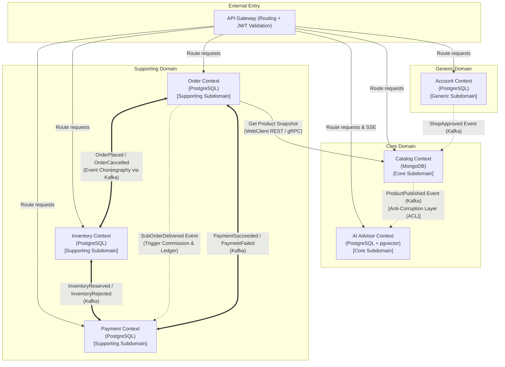

# Bounded Contexts & Context Map

Tài liệu mô tả chi tiết các Bounded Context, Aggregate Roots, các quy tắc bất biến (Invariants) và sơ đồ quan hệ giao tiếp liên Context của hệ thống.

---

## 1. Bảng Phân Loại Context & Invariants

| Bounded Context | Phân loại | Aggregate Root | Database | Invariant quan trọng |
| :--- | :--- | :--- | :--- | :--- |
| **Account Context** | Generic Subdomain | `User`, `Shop` | PostgreSQL (`account_db`) | - Email là duy nhất trên toàn hệ thống. - Một User có thể có các Role: `BUYER`, `SELLER`, `ADMIN`. - `Shop` chỉ được mở bán khi ở trạng thái `APPROVED`. - Skin Profile chỉ do chính Buyer sở hữu đọc/sửa. |
| **Catalog Context** | Core Subdomain | `Product` | MongoDB (`catalog_db`) | - Chỉ sản phẩm có trạng thái `PUBLISHED` mới xuất hiện trên tìm kiếm của Buyer. - Bắt buộc phải có ít nhất một `Variant`. - Phải có `RegistrationNo` hợp lệ mới được chuyển sang `PUBLISHED`. |
| **Order Context** | Supporting Subdomain | `Cart`, `Order` (chứa các `SubOrder`) | PostgreSQL (`order_db`) | - Tổng giá trị đơn = $\sum$ các dòng sản phẩm (`OrderLine`). - Mỗi `SubOrder` gắn chặt với một `ShopId`. - State machine nghiêm ngặt cho vòng đời Order và SubOrder. |
| **Inventory Context** | Supporting Subdomain | `StockItem`, `Reservation` | PostgreSQL (`inventory_db`) | - `reserved` $\le$ `on_hand`, không bao giờ được phép âm. - Câu lệnh giữ hàng nguyên tử, có ràng buộc `CHECK (reserved >= 0 AND reserved <= on_hand)`. |
| **Payment Context** | Supporting Subdomain | `Payment`, `Ledger` | PostgreSQL (`payment_db`) | - Kế toán kép: Tổng Nợ = Tổng Có ($\sum \text{Debit} = \sum \text{Credit}$). - Không bao giờ được hoàn tiền vượt quá số tiền thực tế đã thu từ đơn hàng. - Phân bổ hoa hồng sàn đúng tỷ lệ khi đơn thành công. |
| **AI Advisor Context** | Core Subdomain | `KnowledgeDocument`, `Conversation` | PostgreSQL + `pgvector` (`ai_db`) | - Mỗi Knowledge Chunk luôn gắn với một `productId`. - Khi sản phẩm bị ẩn hoặc hủy kích hoạt (`DEACTIVATED`), toàn bộ chunk liên quan bị xóa hoặc vô hiệu hóa lập tức. - Trả lời có nguồn trích dẫn từ Catalog, không bịa đặt thành phần. |
| **API Gateway** | Infrastructure / Routing | N/A (Stateless) | Không lưu DB | - Xác thực JWT tập trung, chuyển tiếp thông tin người dùng qua HTTP headers (`X-User-Id`, `X-User-Roles`). - Định tuyến và hỗ trợ truyền tải Server-Sent Events (SSE) không bị ngắt quãng. |

---

## 2. Sơ Đồ Context Map (Mermaid)

---

## 3. Các Mẫu Tích Hợp (Integration Patterns)

1. **Published Language / Domain Events qua Apache Kafka:**
   - Các Context trao đổi trạng thái bất đồng bộ qua envelope chuẩn hóa `libs/common-events`:
     - `eventId` (UUID duy nhất)
     - `eventType` (Tên sự kiện)
     - `occurredAt` (Timestamp ISO 8601)
     - `aggregateId` (Mã aggregate root)
     - `payload` (Dữ liệu sự kiện dưới định dạng JSON)
2. **Transactional Outbox & Idempotent Consumer:**
   - Mọi sự kiện phát ra từ PostgreSQL Context (`Order`, `Inventory`, `Payment`) đều ghi đồng thời vào bảng `outbox` trong cùng một transaction với dữ liệu nghiệp vụ.
   - Outbox Poller định kỳ đọc bản ghi `outbox` bằng cơ chế `SELECT ... FOR UPDATE SKIP LOCKED` và gửi lên Kafka topic tương ứng.
   - Phía Consumer kiểm tra bảng `processed_events` để đảm bảo tính Idempotency trước khi xử lý, chống trùng lặp do cơ chế at-least-once của Kafka.
3. **Anti-Corruption Layer (ACL) giữa Catalog và AI Advisor:**
   - AI Advisor không phụ thuộc trực tiếp vào Document Schema của Catalog. Khi nhận `ProductPublished`, ACL Adapter của AI Advisor trích lọc các trường ngữ nghĩa (tên, công dụng, thành phần INCI, loại da phù hợp) để chuẩn hóa thành `KnowledgeChunk` trước khi embedding.
4. **Snapshot Data giữa Order và Catalog:**
   - Order không Join trực tiếp sang MongoDB của Catalog. Khi tạo Order/Sub-order, Order Context gọi đồng bộ (REST non-blocking qua `WebClient`) để lưu bản sao cố định (Snapshot: `productName`, `unitPrice`, `skuCode`) tại thời điểm đặt hàng.
