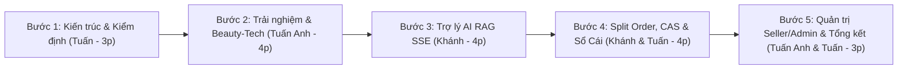

# KỊCH BẢN DIỄN TẬP DEMO 5 BƯỚC BẢO VỆ ĐỒ ÁN TRƯỚC HỘI ĐỒNG
> **Đề tài:** Sàn Thương Mại Điện Tử Mỹ Phẩm Đa Người Bán (Aura Beauty Mall / WebBanMP)  
> **Thời lượng quy định:** 15 – 18 Phút  
> **Đội ngũ trình bày:** 03 Thành viên  

---

## 🎬 PHÂN CÔNG DIỄN XUẤT THEO 5 BƯỚC VÀNG



---

### BƯỚC 1: KIẾN TRÚC MICROSERVICES REACTIVE & KIỂM THỬ TỰ ĐỘNG (3 PHÚT)
- **Người trình bày:** **Nguyễn Văn Tuấn (MSV: 2023603018)**
- **Thao tác trên màn hình:**
  1. Trình chiếu sơ đồ kiến trúc 7 Microservices Reactive (Spring Boot 3 WebFlux, cổng 8080 - 8086).
  2. Mở Terminal chạy kiểm thử kiến trúc tự động:
     ```bash
     mvn test -pl backend/account-service -Dtest=HexagonalArchitectureTest
     ```
     $\rightarrow$ Giải thích quy tắc Hexagonal: Domain thuần Java không phụ thuộc framework hay adapter ngoài.
  3. Mở Terminal chạy kiểm thử đồng thời giữ kho:
     ```bash
     mvn test -pl backend/inventory-service -Dtest=AtomicStockConcurrencyTest
     ```
     $\rightarrow$ Giải thích 100 request đồng thời tranh mua 10 sản phẩm, tồn kho không bao giờ âm nhờ CAS.

---

### BƯỚC 2: TRẢI NGHIỆM BUYER ZONE & 5 CÔNG CỤ BEAUTY-TECH (4 PHÚT)
- **Người trình bày:** **Nguyễn Văn Tuấn Anh (MSV: 2023601651)**
- **Thao tác trên màn hình:**
  1. Mở trình duyệt tại `http://localhost:3000`: Rê chuột qua **Mega Menu 7 phân hệ lớn** (chứng minh click vào các sub-menu không bao giờ trắng màn hình nhờ `submenuCatalogMapper`).
  2. Mở tính năng **AR Virtual Try-On**:
     - Bật camera, nhận diện 478 điểm mốc khuôn mặt qua MediaPipe FaceLandmarker.
     - Thử đổi 3 màu son môi (3CE Velvet Tint, MAC Ruby Woo) và phấn má hồng với tốc độ khung hình mượt mà **60 FPS**.
     - Thao tác chuyển đổi các hiệu ứng bề mặt: Lì (Matte), Nhung (Velvet), Bóng (Glossy).
  3. Trình diễn **AI Skin Scanner** và **Skin Quiz** phân loại da, lưu kết quả vào Skin Profile.
  4. Mở trang Chi tiết sản phẩm: Thao tác trên **Bộ chọn phân loại chuẩn Shopee Mall** (chọn màu sắc có swatch HEX, đổi dung tích, hiển thị tồn kho thật, nút disabled khi hết hàng).

---

### BƯỚC 3: TRỢ LÝ CỐ VẤN DA LIỄU AI RAG QUA SSE STREAMING (4 PHÚT)
- **Người trình bày:** **Nguyễn Viết Khánh (MSV: 2023601808)**
- **Thao tác trên màn hình:**
  1. Mở cửa sổ Aura Beauty Advisor ở góc phải màn hình.
  2. Gõ câu hỏi thực tế: *"Da tôi dầu mụn và nhạy cảm, nên dùng kem chống nắng và serum nào?"*
  3. Quan sát hiệu ứng chữ xuất hiện liên tục từng từ qua **Server-Sent Events (SSE)** dưới 1.5 giây.
  4. Giải thích cơ chế **RAG (Retrieval-Augmented Generation)**:
     - Hệ thống lấy `SkinProfile` (Oily/Acne).
     - Truy vấn vector cosine trên PostgreSQL `pgvector` chứa nhúng 384 chiều của 154 sản phẩm và 45 hoạt chất INCI.
     - Cảnh báo xung đột hoạt chất (ví dụ: không dùng chung Retinol nồng độ cao với BHA/AHA).
  5. Nhấp trực tiếp vào thẻ sản phẩm đề xuất trong khung chat để thêm vào giỏ hàng.

---

### BƯỚC 4: ĐẶT HÀNG ĐA SHOP, TÁCH ĐƠN (SPLIT ORDER) & SỔ CÁI KÉP (4 PHÚT)
- **Người trình bày:** **Nguyễn Viết Khánh & Nguyễn Văn Tuấn**
- **Thao tác trên màn hình:**
  1. Chọn mua 2 sản phẩm từ 2 gian hàng Mall khác nhau (Anua Official và L'Oréal Paris Mall).
  2. Vào Giỏ hàng: Hệ thống gom nhóm rõ ràng theo từng Shop, snapshot giá niêm yết.
  3. Bấm **Đặt hàng (Checkout)**:
     - Chuyển sang giao diện Kafka UI (`http://localhost:8090`).
     - Chứng minh thuật toán **Split Order** tách thành 1 Master Order và 2 Sub-orders độc lập cho 2 shop.
     - Chứng minh sự kiện `OrderCreatedEvent` được ghi vào bảng `outbox_events` và đẩy qua Kafka.
  4. Thanh toán đơn hàng:
     - Mở trang quản trị tài chính Admin: Kiểm tra **Sổ cái kép (Double-Entry Ledger)**.
     - Chứng minh Invariant: $\sum \text{Debit} = \sum \text{Credit}$.
     - Hệ thống tự động trích đúng **10% hoa hồng sàn** và **90% công nợ Seller** vào tài khoản Escrow.

---

### BƯỚC 5: QUẢN LÝ GIAN HÀNG SELLER, ADMIN ZONE & KẾT LUẬN (3 PHÚT)
- **Người trình bày:** **Nguyễn Văn Tuấn Anh & Nguyễn Văn Tuấn**
- **Thao tác trên màn hình:**
  1. Chuyển sang tài khoản **Seller Zone** (9 phân hệ):
     - Vào tab `orders`: Thấy đúng Sub-order của gian hàng mình; bấm xác nhận giao hàng.
     - Vào tab `products`: Trình diễn form đăng sản phẩm có trường bắt buộc **Số công bố mỹ phẩm (CBMP)**.
  2. Chuyển sang tài khoản **Admin Zone** (9 phân hệ):
     - Duyệt hồ sơ gian hàng Shopee Mall mới.
     - Mở tab `analytics` và màn hình Giám sát cụm Microservices (Actuator).
  3. **Tổng kết (Tuấn):** Khẳng định dự án đạt 100% các tiêu chí từ con số 0 trong 4 tuần: Non-blocking 100%, Clean Root, Zero-Breakage, 154 sản phẩm thật, AR 60 FPS và sẵn sàng đưa vào vận hành thực tế.

---

## 🏆 CÂU HỎI THƯỜNG GẶP TỪ HỘI ĐỒNG & CÁCH PHẢN BIỆN (Q&A CHEAT-SHEET)

1. **Hội đồng hỏi:** *Làm thế nào để hệ thống không bao giờ bị âm kho khi có 1.000 người cùng bấm mua 1 thỏi son flash sale?*
   - **Trả lời:** Em không dùng pessimistic lock làm nghẽn kết nối, mà sử dụng cơ chế CAS nguyên tử trực tiếp ở tầng database: `UPDATE inventory_items SET reserved = reserved + N WHERE sku_id = ? AND (on_hand - reserved) >= N`. Nếu rowsUpdated = 0 nghĩa là hết hàng, request bị từ chối ngay lập tức mà không gây deadlock.
2. **Hội đồng hỏi:** *Nếu Kafka bị sập trong lúc đang tách đơn thì đơn hàng có bị mất không?*
   - **Trả lời:** Dạ không, vì nhóm em áp dụng **Transactional Outbox Pattern**. Đơn hàng và sự kiện Outbox được ghi chung trong 1 Database Transaction R2DBC. Khi Kafka phục hồi, Outbox Relay Worker sẽ tự động quét và gửi lại có cơ chế backoff. Phía consumer có bảng `processed_messages` để bảo đảm tính Idempotent không xử lý trùng.
3. **Hội đồng hỏi:** *AR Virtual Try-On chạy trên máy người dùng hay trên server? Có bị lộ hình ảnh khuôn mặt không?*
   - **Trả lời:** Toàn bộ quá trình nhận diện 478 điểm mốc khuôn mặt bằng MediaPipe chạy 100% Client-side bằng WebAssembly và WebGL trên trình duyệt người dùng. Hình ảnh camera không gửi về server nên vừa đạt tốc độ 60 FPS, vừa bảo vệ quyền riêng tư tuyệt đối cho khách hàng.
