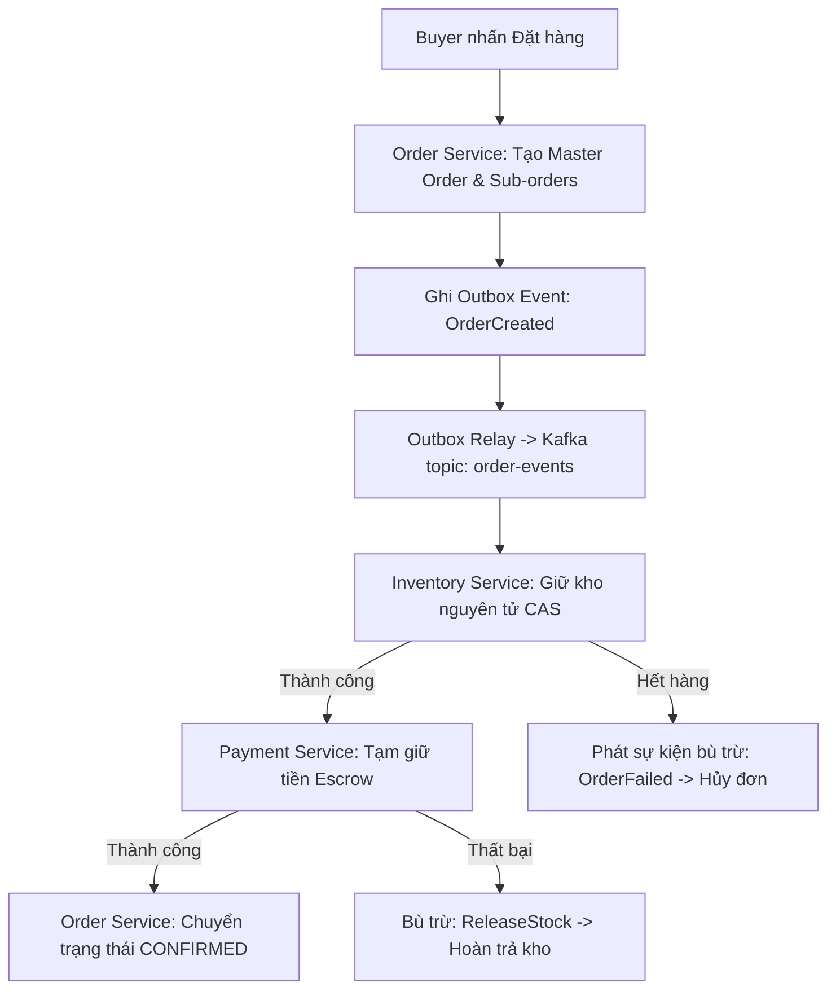
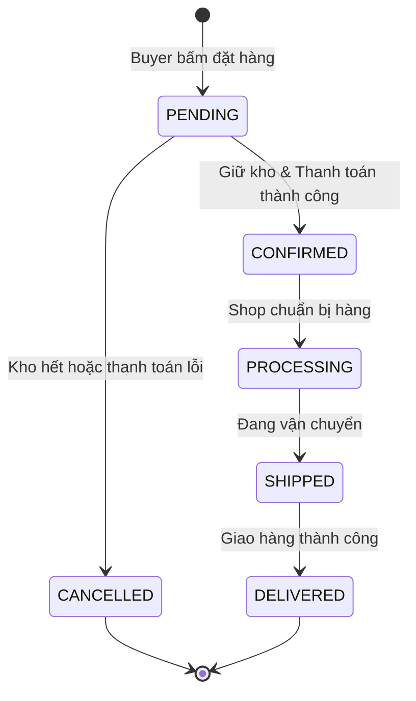

# QUY TRÌNH NGHIỆP VỤ: ĐẶT HÀNG ĐA GIAN HÀNG, TÁCH ĐƠN & SAGA CHOREOGRAPHY
> **Mã quy trình:** `QT-01-dat-hang-tach-don-saga`

| Thuộc tính | Giá trị |
| :--- | :--- |
| **Dự án** | Sàn Thương Mại Điện Tử Mỹ Phẩm Đa Người Bán (Aura Beauty Mall / WebBanMP) |
| **Phiên bản** | v1.0.0 |
| **Người yêu cầu** | Hội đồng Kiến trúc & Agile Project Manager |
| **Ưu tiên** | P0 (Bắt buộc cốt lõi) |
| **Loại quy trình** | Dịch ngược từ mã nguồn hiện tại (`existing`) |

---

## 1. Tóm tắt
Quy trình cho phép khách hàng mua sản phẩm từ nhiều gian hàng mỹ phẩm trong một phiên thanh toán. Hệ thống tự động phân tách giỏ hàng thành một Master Order và các Sub-orders tương ứng cho từng Shop, đồng thời phối hợp giao dịch phân tán qua Saga Choreography và Transactional Outbox.

## 2. Tác nhân & quyền
| Tác nhân | Vai trò hệ thống | Quyền hạn trong quy trình |
| :--- | :--- | :--- |
| **Buyer** | `ROLE_BUYER` | Tạo giỏ hàng, chọn địa chỉ, thanh toán đơn hàng |
| **Seller** | `ROLE_SELLER` | Xem danh sách Sub-order của shop mình, xác nhận đóng gói giao hàng |
| **Sàn Admin** | `ROLE_ADMIN` | Giám sát toàn bộ Master Order và Sub-orders, xử lý khiếu nại |
| **System Worker** | `SYSTEM` | Tách đơn, ghi outbox, giữ kho, thanh toán, bù trừ kho khi lỗi |

## 3. Điều kiện trước
- Khách hàng đã đăng nhập và có token JWT hợp lệ.
- Giỏ hàng có ít nhất 1 mặt hàng từ 1 hoặc nhiều gian hàng đang hoạt động (`ACTIVE`).
- Các mặt hàng có tồn kho khả dụng (`(on_hand - reserved) >= quantity`).

## 4. Luồng chính
| Bước | Ai | Hành động | Hệ thống xử lý | Kết quả người dùng thấy | Trạng thái |
| :---: | :--- | :--- | :--- | :--- | :---: |
| 1 | Buyer | Nhấn "Thanh toán" tại Giỏ hàng | Kiểm tra sản phẩm, snapshot giá niêm yết từ Catalog | Chuyển sang màn hình Checkout | Đã có |
| 2 | Buyer | Chọn địa chỉ, phương thức thanh toán và nhấn "Đặt hàng" | Khóa nút chống double-submit, gửi lệnh `POST /api/orders` | Hiển thị spinner xử lý | Đã có |
| 3 | System | Tiếp nhận lệnh tạo đơn | Tạo `MasterOrder` (PENDING), gom nhóm theo `shop_id` và tạo $K$ `SubOrder` | Đơn hàng được ghi nhận | Đã có |
| 4 | System | Ghi nhận sự kiện Outbox | Ghi `OrderCreatedEvent` vào bảng `outbox_events` cùng transaction | Hệ thống bảo đảm tính nhất quán | Đã có |
| 5 | System | Outbox Relay đẩy Kafka | Đẩy sự kiện sang topic `order-events` (partition key: `master_order_id`) | Kafka Broker tiếp nhận message | Đã có |
| 6 | System | Inventory kiểm tra & giữ kho | Gọi câu lệnh CAS trừ tồn kho khả dụng | Phát sự kiện `StockReservedEvent` | Đã có |
| 7 | System | Payment hạch toán tiền | Tạm giữ tiền vào tài khoản Escrow | Phát sự kiện `PaymentCompletedEvent` | Đã có |
| 8 | Buyer | Nhận phản hồi thành công | Gateway trả về kết quả Master Order và danh sách mã Sub-order | Màn hình Order Success hiển thị | Đã có |

## 5. Sơ đồ

## 6. Luồng phụ & lỗi
| Mã lỗi | Tình huống | Hệ thống phản hồi | Thông báo cho người dùng |
| :--- | :--- | :--- | :--- |
| **E1** | Chưa đăng nhập hoặc token hết hạn | Trả về HTTP 401 Unauthorized | "Vui lòng đăng nhập để tiếp tục đặt hàng." |
| **E2** | Sản phẩm không tồn tại trong DB | Trả về HTTP 404 Not Found | "Sản phẩm trong giỏ không còn tồn tại trên sàn." |
| **E3** | Dữ liệu địa chỉ nhận hàng trống | Trả về HTTP 400 Bad Request | "Vui lòng cung cấp đầy đủ thông tin giao hàng." |
| **E4** | Tồn kho biến động không đủ số lượng | Trả về HTTP 409 Conflict | "Sản phẩm đã hết hàng trong lúc bạn thao tác." |
| **E5** | Lỗi kết nối Kafka / Outbox delay ⚠ | Outbox Worker tự động retry có backoff | "Đơn hàng đang được hệ thống xác nhận xử lý." |

## 7. Trạng thái

## 8. Quy tắc nghiệp vụ
- **BR-01:** Một giỏ hàng chứa sản phẩm của $K$ shop bắt buộc sinh 1 Master Order và $K$ Sub-orders độc lập.
- **BR-02:** Giá sản phẩm tại thời điểm đặt hàng phải được snapshot, không đổi khi Seller cập nhật giá sau đó.
- **BR-03:** Giữ kho phải là nguyên tử (CAS). Nếu 1 sản phẩm trong đơn thất bại, toàn bộ đơn bị bù trừ hủy.

## 9. Thông báo, realtime & nhật ký
- **Realtime:** Bắn SSE hoặc WebSocket cập nhật trạng thái đơn hàng về client Buyer.
- **Audit Log:** Ghi log thao tác tạo đơn, chuyển trạng thái vào bảng `order_audit_logs`.

## 10. Dữ liệu
| Trường | Bắt buộc | Ràng buộc | Ví dụ |
| :--- | :---: | :--- | :--- |
| `master_order_id` | Có | UUID | `e5b7c8...` |
| `customer_id` | Có | UUID | `user-123` |
| `items` | Có | Array $\ge 1$ phần tử | `[{sku, qty, price}]` |
| `shipping_address` | Có | Object đầy đủ | `Số 123 Đường Cầu Giấy, HN` |

## 11. Màn hình liên quan
- Màn hình Cart View: `frontend/src/features/cart/CartView.jsx`
- Màn hình Checkout View: `frontend/src/features/checkout/CheckoutView.jsx`
- Màn hình Order Success: `frontend/src/features/checkout/OrderResultView.jsx`

## 12. Tiêu chí nghiệm thu
- **AC-01:** Cho giỏ hàng gồm 2 sản phẩm từ 2 shop khác nhau, khi bấm Đặt hàng, hệ thống sinh đúng 1 master order và 2 sub-orders tương ứng.
- **AC-02:** Cho người dùng không mang token JWT hợp lệ, khi gửi request tạo đơn, hệ thống trả về mã lỗi 401 Unauthorized.
- **AC-03:** Cho sản phẩm chỉ còn tồn 1 sản phẩm, khi 2 khách hàng đồng thời bấm mua, chỉ 1 người thành công, người còn lại nhận thông báo hết hàng.

## 13. Ảnh hưởng tới phần có sẵn
- Ảnh hưởng trực tiếp đến `services/inventory-service` (giữ kho) và `services/payment-service` (thanh toán).

## 14. Giả định & câu hỏi mở
- `GD-01`: Giả định phí vận chuyển được tính độc lập theo từng gian hàng.
- `Q-01`: Đã tích hợp đơn vị vận chuyển bên thứ 3 (GHN/GHTK) thật chưa? (Hiện tại: Mock nội bộ).

## 15. Ghi chú kỹ thuật cho dev
- **API:** `POST /api/orders` tại `services/order-service/src/main/java/com/cosmetics/order/adapter/in/web/OrderController.java`.
- **Outbox Table:** `services/order-service/src/main/resources/schema.sql:outbox_events`.
- **Entity:** `services/order-service/src/main/java/com/cosmetics/order/adapter/out/persistence/OrderEntity.java`.

---
## Lịch sử thay đổi
| Phiên bản | Ngày | Người thực hiện | Nội dung |
| :---: | :---: | :---: | :--- |
| v1.0.0 | 03/11/2026 | Principal Architect | Khởi tạo tài liệu quy trình đặt hàng tách đơn Saga |
