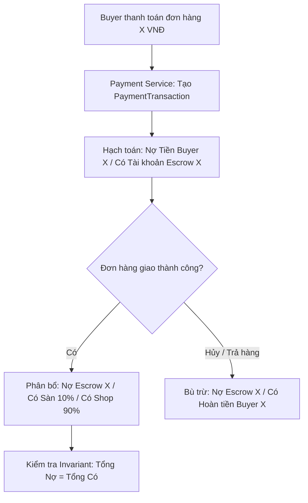
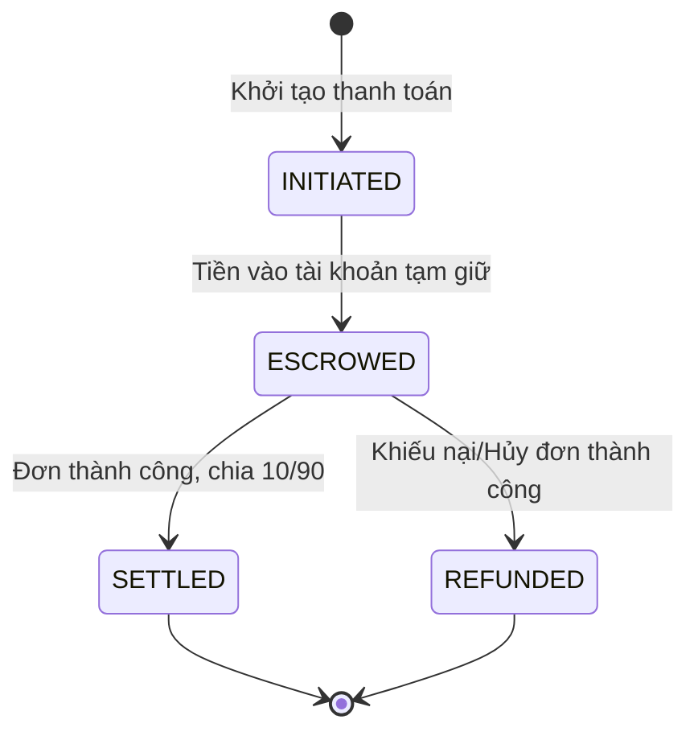

# QUY TRÌNH NGHIỆP VỤ: THANH TOÁN, TÀI KHOẢN ESCROW & SỔ CÁI KÉP (DOUBLE-ENTRY LEDGER)
> **Mã quy trình:** `QT-02-thanh-toan-so-cai-kep`

| Thuộc tính | Giá trị |
| :--- | :--- |
| **Dự án** | Sàn Thương Mại Điện Tử Mỹ Phẩm Đa Người Bán (Aura Beauty Mall / WebBanMP) |
| **Phiên bản** | v1.0.0 |
| **Người yêu cầu** | Hội đồng Tài chính & Agile Project Manager |
| **Ưu tiên** | P0 (Bắt buộc cốt lõi) |
| **Loại quy trình** | Dịch ngược từ mã nguồn hiện tại (`existing`) |

---

## 1. Tóm tắt
Quy trình tiếp nhận thanh toán từ Buyer, ghi nhận tiền vào tài khoản tạm giữ bảo chứng (Escrow Account), tự động hạch toán chia tách 10% hoa hồng sàn và 90% doanh thu Seller thông qua Sổ cái kép tuân thủ quy tắc bất biến kế toán.

## 2. Tác nhân & quyền
| Tác nhân | Vai trò hệ thống | Quyền hạn trong quy trình |
| :--- | :--- | :--- |
| **Buyer** | `ROLE_BUYER` | Chọn phương thức thanh toán, hoàn tất giao dịch |
| **Seller** | `ROLE_SELLER` | Xem số dư doanh thu tạm giữ, nhận tiền sau khi đơn giao thành công |
| **Admin** | `ROLE_ADMIN` | Kiểm toán sổ cái kép, đối soát dòng tiền hoa hồng sàn |
| **System Payment** | `SYSTEM` | Tạo bút toán ghi nợ/có, kiểm tra invariant sổ cái |

## 3. Điều kiện trước
- Đơn hàng đã được giữ kho thành công qua sự kiện `StockReservedEvent`.
- Thông tin giá trị thanh toán khớp với snapshot trong đơn hàng.

## 4. Luồng chính
| Bước | Ai | Hành động | Hệ thống xử lý | Kết quả người dùng thấy | Trạng thái |
| :---: | :--- | :--- | :--- | :--- | :---: |
| 1 | Buyer | Chọn phương thức thanh toán (Mock VNPAY, Thẻ, COD) | Chuẩn bị phiên giao dịch | Hiển thị giao diện thanh toán | Đã có |
| 2 | Buyer | Xác nhận thanh toán | Gửi yêu cầu `POST /api/payments` | Hiển thị trạng thái đang xử lý | Đã có |
| 3 | System | Tiếp nhận thanh toán thành công | Tạo bản ghi `PaymentTransaction` trạng thái COMPLETED | Đơn được đánh dấu đã thanh toán | Đã có |
| 4 | System | Tạo bút toán Sổ cái kép | Ghi nợ `CUSTOMER_PAYMENT` = $X$; Ghi có `ESCROW_HOLDING` = $X$ | Dòng tiền được tạm giữ an toàn | Đã có |
| 5 | System | Phân tách hoa hồng và công nợ | Khi giao thành công: Trích 10% sang `PLATFORM_REVENUE`, 90% sang `SELLER_PAYABLE` | Seller thấy số dư ví tăng | Đã có |
| 6 | System | Kiểm tra Invariant kế toán | Xác nhận $\sum \text{Debit} = \sum \text{Credit}$ | Bút toán được chốt sổ bất biến | Đã có |

## 5. Sơ đồ

## 6. Luồng phụ & lỗi
| Mã lỗi | Tình huống | Hệ thống phản hồi | Thông báo cho người dùng |
| :--- | :--- | :--- | :--- |
| **E1** | Người dùng không có quyền truy cập thanh toán | Trả về HTTP 403 Forbidden | "Bạn không có quyền thực hiện giao dịch này." |
| **E2** | Mã giao dịch không tìm thấy | Trả về HTTP 404 Not Found | "Không tìm thấy thông tin phiên thanh toán." |
| **E3** | Số tiền thanh toán không hợp lệ ($\le 0$) | Trả về HTTP 400 Bad Request | "Giá trị thanh toán không hợp lệ." |
| **E4** | Lệch bút toán kế toán (Tổng Nợ $\ne$ Tổng Có) ⚠ | Hủy transaction ngay lập tức, rollback | "Giao dịch không hợp lệ, hệ thống đã dừng xử lý." |

## 7. Trạng thái

## 8. Quy tắc nghiệp vụ
- **BR-01:** Bất biến kế toán $\sum \text{Debit} = \sum \text{Credit}$ là bắt buộc tuyệt đối cho mọi giao dịch.
- **BR-02:** Tiền thanh toán luôn giữ tại tài khoản Escrow cho đến khi khách xác nhận hoặc hết hạn khiếu nại (7 ngày).
- **BR-03:** Tỷ lệ chiết khấu cố định 10% phí nền tảng, 90% chuyển vào ví người bán.

## 9. Thông báo, realtime & nhật ký
- **Thông báo:** Bắn thông báo xác nhận thanh toán thành công về điện thoại/email khách hàng.
- **Audit Log:** Ghi log bất biến vào `ledger_entries` (không cho phép sửa hoặc xóa).

## 10. Dữ liệu
| Trường | Bắt buộc | Ràng buộc | Ví dụ |
| :--- | :---: | :--- | :--- |
| `transaction_id` | Có | UUID | `txn-789...` |
| `order_id` | Có | UUID | `order-123...` |
| `amount` | Có | `DECIMAL(19, 2)` $> 0$ | `500000.00` |
| `platform_fee` | Có | `DECIMAL(19, 2)` = $10\%$ | `50000.00` |
| `seller_amount` | Có | `DECIMAL(19, 2)` = $90\%$ | `450000.00` |

## 11. Màn hình liên quan
- Màn hình Checkout: `frontend/src/features/checkout/CheckoutView.jsx`
- Phân hệ Tài chính Seller: `frontend/src/components/SellerZone.jsx` (tab `finance`)
- Phân hệ Tài chính Admin: `frontend/src/components/AdminZone.jsx` (tab `finance`)

## 12. Tiêu chí nghiệm thu
- **AC-01:** Cho đơn hàng giá trị 1.000.000 VND, khi thanh toán thành công và hoàn tất, sổ cái ghi nhận đúng 100.000 VND cho sàn và 900.000 VND cho shop.
- **AC-02:** Cho request giả mạo số tiền âm hoặc bằng 0, hệ thống từ chối với mã 400 Bad Request.
- **AC-03:** Kiểm thử sổ cái với 100 giao dịch liên tiếp, tổng nợ và tổng có phải bằng nhau tuyệt đối.

## 13. Ảnh hưởng tới phần có sẵn
- Tương tác với `services/order-service` để cập nhật trạng thái đơn hàng.

## 14. Giả định & câu hỏi mở
- `GD-01`: Cổng thanh toán bên ngoài hiện được giả lập (Mock Payment Gateway).
- `Q-01`: Thời gian chuyển tiền từ Escrow sang tài khoản ngân hàng thực tế của Seller mất bao lâu?

## 15. Ghi chú kỹ thuật cho dev
- **API:** `POST /api/payments` tại `services/payment-service/src/main/java/com/cosmetics/payment/adapter/in/web/PaymentController.java`.
- **Ledger Entity:** `services/payment-service/src/main/java/com/cosmetics/payment/adapter/out/persistence/LedgerEntryEntity.java`.
- **R2DBC Repository:** `services/payment-service/src/main/java/com/cosmetics/payment/adapter/out/persistence/LedgerRepository.java`.

---
## Lịch sử thay đổi
| Phiên bản | Ngày | Người thực hiện | Nội dung |
| :---: | :---: | :---: | :--- |
| v1.0.0 | 03/11/2026 | Principal Architect | Khởi tạo tài liệu quy trình thanh toán và sổ cái kép |
