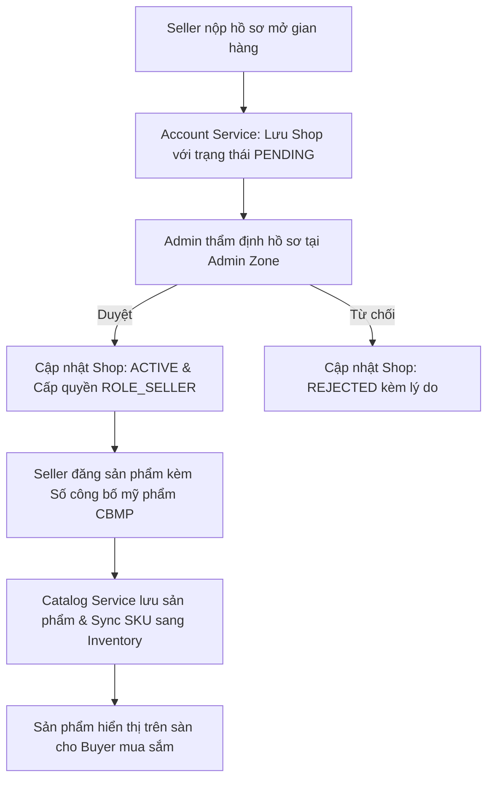
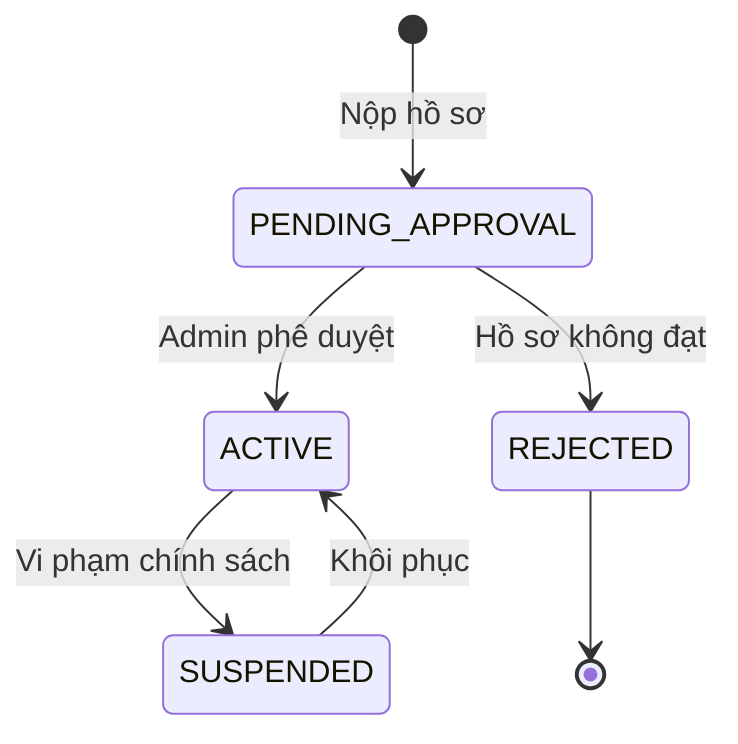

# QUY TRÌNH NGHIỆP VỤ: ĐĂNG KÝ, PHÊ DUYỆT GIAN HÀNG & ĐĂNG BÁN SẢN PHẨM CÓ CBMP
> **Mã quy trình:** `QT-03-dang-ky-duyet-shop-dang-san-pham`

| Thuộc tính | Giá trị |
| :--- | :--- |
| **Dự án** | Sàn Thương Mại Điện Tử Mỹ Phẩm Đa Người Bán (Aura Beauty Mall / WebBanMP) |
| **Phiên bản** | v1.0.0 |
| **Người yêu cầu** | Trưởng ban Pháp chế & Quản lý Gian hàng Mall |
| **Ưu tiên** | P1 (Nghiệp vụ vận hành sàn) |
| **Loại quy trình** | Dịch ngược từ mã nguồn hiện tại (`existing`) |

---

## 1. Tóm tắt
Quy trình hướng dẫn người bán đăng ký gian hàng chính hãng (Shopee Mall / Brand Store), được Sàn Admin thẩm định phê duyệt, và tiến hành đăng bán mỹ phẩm bắt buộc kèm theo Số tiếp nhận Phiếu công bố mỹ phẩm (CBMP) chuẩn Bộ Y tế.

## 2. Tác nhân & quyền
| Tác nhân | Vai trò hệ thống | Quyền hạn trong quy trình |
| :--- | :--- | :--- |
| **Người bán (Seller)** | `ROLE_USER` / `ROLE_SELLER` | Nộp hồ sơ mở shop, quản lý sản phẩm sau khi duyệt |
| **Quản trị viên (Admin)** | `ROLE_ADMIN` | Thẩm định hồ sơ doanh nghiệp, phê duyệt mở gian hàng, duyệt sản phẩm |
| **Khách mua (Buyer)** | `ROLE_BUYER` | Xem thông tin gian hàng chính hãng và giấy phép CBMP |

## 3. Điều kiện trước
- Người bán đã có tài khoản người dùng đã kích hoạt.
- Có đầy đủ giấy phép kinh doanh, hợp đồng phân phối chính hãng hoặc giấy ủy quyền thương hiệu.

## 4. Luồng chính
| Bước | Ai | Hành động | Hệ thống xử lý | Kết quả người dùng thấy | Trạng thái |
| :---: | :--- | :--- | :--- | :--- | :---: |
| 1 | Seller | Điền form đăng ký gian hàng tại cổng người bán | Gửi `POST /api/shops/register` kèm giấy phép | Nhận thông báo hồ sơ đang chờ duyệt | Đã có |
| 2 | Admin | Truy cập phân hệ quản lý gian hàng `/admin/merchants` | Tải danh sách các shop `PENDING_APPROVAL` | Hiển thị thông tin hồ sơ thẩm định | Đã có |
| 3 | Admin | Nhấn "Phê duyệt" gian hàng | Cập nhật trạng thái shop thành `ACTIVE`, gán quyền `ROLE_SELLER` cho chủ shop | Gian hàng được cấp phép hoạt động | Đã có |
| 4 | Seller | Truy cập Seller Zone, bấm "Thêm sản phẩm mới" | Mở form đăng sản phẩm | Hiển thị các trường thông tin | Đã có |
| 5 | Seller | Nhập tên, thương hiệu, danh mục, bảng INCI và Số công bố mỹ phẩm (CBMP) | Kiểm tra định dạng số CBMP (ví dụ: `12345/24/CBMP-QLD`) | Dữ liệu hợp lệ | Đã có |
| 6 | Seller | Nhập các biến thể (Màu son HEX, Dung tích) và số lượng tồn kho | Gửi `POST /api/products` sang `catalog-service` | Sản phẩm được lưu trữ ở trạng thái sẵn sàng | Đã có |
| 7 | System | Đồng bộ hóa dữ liệu tồn kho sang Inventory | Tự động tạo các bản ghi SKU trong `inventory_items` | Tồn kho sẵn sàng bán | Đã có |

## 5. Sơ đồ

## 6. Luồng phụ & lỗi
| Mã lỗi | Tình huống | Hệ thống phản hồi | Thông báo cho người dùng |
| :--- | :--- | :--- | :--- |
| **E1** | Người dùng chưa có quyền Seller mà cố đăng sản phẩm | Trả về HTTP 403 Forbidden | "Bạn chưa có quyền đăng bán sản phẩm." |
| **E2** | Shop không tồn tại hoặc bị khóa | Trả về HTTP 404 Not Found | "Gian hàng không tồn tại hoặc đã ngừng hoạt động." |
| **E3** | Thiếu Số công bố mỹ phẩm (CBMP) bắt buộc | Trả về HTTP 400 Bad Request | "Mỹ phẩm bắt buộc phải có Số công bố mỹ phẩm hợp lệ." |
| **E4** | Tên gian hàng bị trùng lặp | Trả về HTTP 409 Conflict | "Tên gian hàng đã được đăng ký trên sàn." |

## 7. Trạng thái

## 8. Quy tắc nghiệp vụ
- **BR-01:** Mọi sản phẩm mỹ phẩm đăng bán trên sàn bắt buộc phải có Số công bố mỹ phẩm (CBMP) theo quy định Bộ Y tế.
- **BR-02:** Gian hàng chưa được Admin phê duyệt (`PENDING`) không được phép kích hoạt sản phẩm ra ngoài sàn.
- **BR-03:** Chỉ gian hàng có chứng nhận Mall mới được hiển thị nhãn đỏ "Mall Chính Hãng" và được kích hoạt tính năng AR Virtual Try-On.

## 9. Thông báo, realtime & nhật ký
- **Email:** Gửi email thông báo kết quả phê duyệt hồ sơ cho người bán trong vòng 24h.
- **Audit Log:** Ghi log thao tác Admin duyệt/từ chối gian hàng vào bảng kiểm toán.

## 10. Dữ liệu
| Trường | Bắt buộc | Ràng buộc | Ví dụ |
| :--- | :---: | :--- | :--- |
| `shop_name` | Có | Độ dài 3 - 50 ký tự | `Cocoon Vietnam Official` |
| `license_number` | Có | Định dạng mã số thuế | `0312345678` |
| `cbmp_number` | Có | Định dạng CBMP hợp chuẩn | `24680/23/CBMP-QLD` |
| `is_mall` | Có | Boolean | `true` |

## 11. Màn hình liên quan
- Trang đăng ký Shop: `frontend/src/components/TopBarModals.jsx`
- Phân hệ Quản lý sản phẩm Seller: `frontend/src/components/SellerZone.jsx` (tab `products`)
- Phân hệ Duyệt gian hàng Admin: `frontend/src/components/AdminZone.jsx` (tab `merchants`)

## 12. Tiêu chí nghiệm thu
- **AC-01:** Cho tài khoản đăng ký gian hàng hợp lệ, khi Admin duyệt thành công, người dùng đăng nhập lại nhận vai trò `ROLE_SELLER`.
- **AC-02:** Cho form đăng sản phẩm không điền trường `cbmp_number`, hệ thống báo lỗi validation và chặn lưu vào DB.
- **AC-03:** Kiểm tra người dùng không có quyền Admin truy cập `/api/admin/shops`, hệ thống trả về mã 403.

## 13. Ảnh hưởng tới phần có sẵn
- Tương tác với `services/account-service` (quản lý shop) và `services/catalog-service` (quản lý sản phẩm).

## 14. Giả định & câu hỏi mở
- `GD-01`: Tra cứu số CBMP hiện kiểm tra qua regex cấu trúc, chưa kết nối trực tiếp Cổng dịch vụ công Quốc gia.
- `Q-01`: Có cần áp dụng thu phí duy trì gian hàng hàng tháng không?

## 15. Ghi chú kỹ thuật cho dev
- **API Shop:** `services/account-service/src/main/java/com/cosmetics/account/adapter/in/web/UserController.java`.
- **API Product:** `services/catalog-service/src/main/java/com/cosmetics/catalog/adapter/in/web/ProductController.java`.
- **Shop Entity:** `services/account-service/src/main/java/com/cosmetics/account/adapter/out/persistence/ShopEntity.java`.

---
## Lịch sử thay đổi
| Phiên bản | Ngày | Người thực hiện | Nội dung |
| :---: | :---: | :---: | :--- |
| v1.0.0 | 03/11/2026 | Principal Architect | Khởi tạo tài liệu quy trình duyệt shop và đăng sản phẩm CBMP |
