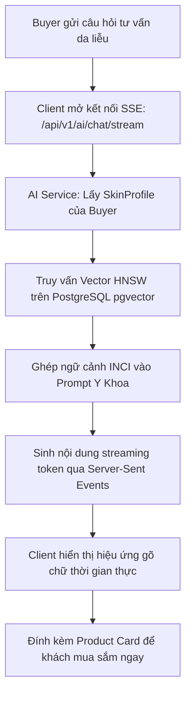
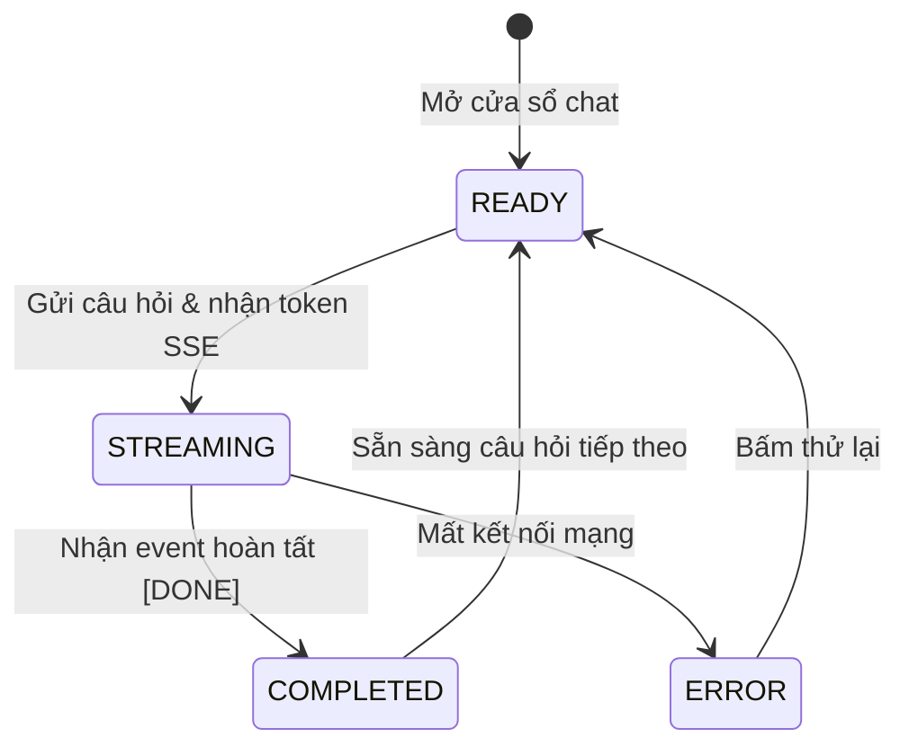

# QUY TRÌNH NGHIỆP VỤ: CỐ VẤN DA LIỄU AI RAG & TRÒ CHUYỆN PHẢN HỒI QUA SSE STREAM
> **Mã quy trình:** `QT-04-tu-van-ai-rag-sse`

| Thuộc tính | Giá trị |
| :--- | :--- |
| **Dự án** | Sàn Thương Mại Điện Tử Mỹ Phẩm Đa Người Bán (Aura Beauty Mall / WebBanMP) |
| **Phiên bản** | v1.0.0 |
| **Người yêu cầu** | Trưởng bộ phận Trải nghiệm AI & Dermocosmetics |
| **Ưu tiên** | P1 (Tính năng khác biệt hóa sản phẩm) |
| **Loại quy trình** | Dịch ngược từ mã nguồn hiện tại (`existing`) |

---

## 1. Tóm tắt
Quy trình tiếp nhận câu hỏi tư vấn chăm sóc da từ người dùng, kết hợp dữ liệu Hồ Sơ Da (`SkinProfile`) cá nhân hóa, truy vấn đối chiếu vector thành phần mỹ phẩm (INCI) trên PostgreSQL `pgvector`, và phản hồi trực tiếp từng từ theo thời gian thực về trình duyệt qua Server-Sent Events (SSE).

## 2. Tác nhân & quyền
| Tác nhân | Vai trò hệ thống | Quyền hạn trong quy trình |
| :--- | :--- | :--- |
| **Người dùng (Buyer / Khách)** | Tất cả | Gửi câu hỏi tư vấn, nhận phản hồi streaming, xem sản phẩm đề xuất |
| **Hệ thống AI Advisor** | `SYSTEM` | Phân tích câu hỏi, vector search, sinh câu trả lời y khoa da liễu |

## 3. Điều kiện trước
- Dịch vụ `ai-advisor-service` (Port 8086) và cơ sở dữ liệu `ai_db` có extension `pgvector` đang hoạt động.
- Kho dữ liệu thành phần INCI và vector sản phẩm đã được đánh chỉ mục HNSW.

## 4. Luồng chính
| Bước | Ai | Hành động | Hệ thống xử lý | Kết quả người dùng thấy | Trạng thái |
| :---: | :--- | :--- | :--- | :--- | :---: |
| 1 | Buyer | Nhấp vào biểu tượng Aura Beauty Advisor ở góc màn hình | Mở widget chat, lấy `skinProfile` từ cache/tài khoản | Cửa sổ chat hiển thị kèm gợi ý câu hỏi | Đã có |
| 2 | Buyer | Gõ câu hỏi và nhấn gửi | Mở kết nối SSE tới `GET /api/v1/ai/chat/stream` | Hiển thị tin nhắn người dùng và spinner | Đã có |
| 3 | System | Nhận yêu cầu và trích xuất thực thể | Phân tích vấn đề da, loại da, hoạt chất quan tâm | Hệ thống xác định phạm vi chuyên môn | Đã có |
| 4 | System | Truy vấn tương đồng Vector | Tìm kiếm vector cosine trong `product_embeddings` & `inci_embeddings` | Lọc ra top sản phẩm và hoạt chất phù hợp | Đã có |
| 5 | System | Xây dựng Prompt và sinh lời tư vấn | Ghép nối kiến thức y khoa, sinh phản hồi từng token qua Reactive Flux | Các ký tự xuất hiện liên tục trên màn hình | Đã có |
| 6 | System | Gửi kèm danh sách sản phẩm gợi ý | Gửi event `products` chứa mảng thẻ sản phẩm có thể bấm mua | Thẻ sản phẩm mini xuất hiện trong bong bóng chat | Đã có |
| 7 | Buyer | Nhấn "Thêm vào giỏ" trên thẻ sản phẩm gợi ý | Thêm trực tiếp sản phẩm vào giỏ hàng | Thông báo toast thêm giỏ thành công | Đã có |

## 5. Sơ đồ

## 6. Luồng phụ & lỗi
| Mã lỗi | Tình huống | Hệ thống phản hồi | Thông báo cho người dùng |
| :--- | :--- | :--- | :--- |
| **E1** | Khách chưa đăng nhập mà yêu cầu tư vấn theo hồ sơ cá nhân | Sử dụng hồ sơ da mặc định hoặc mời làm Skin Quiz | "Bạn có thể làm bài khảo sát da nhanh để nhận tư vấn chính xác hơn." |
| **E2** | Không tìm thấy sản phẩm nào phù hợp với hoạt chất hỏi | Trả về lời khuyên da liễu chung | "Hiện sàn chưa có sản phẩm chứa hoạt chất này, gợi ý hoạt chất thay thế..." |
| **E3** | Nội dung câu hỏi trống hoặc chỉ chứa ký tự đặc biệt | Trả về HTTP 400 Bad Request | "Vui lòng nhập câu hỏi rõ ràng về tình trạng da của bạn." |
| **E4** | Mạng gián đoạn làm đứt kết nối SSE ⚠ | Client tự động thử kết nối lại hoặc hiển thị nút Thử lại | "Kết nối bị gián đoạn, đang thử kết nối lại..." |

## 7. Trạng thái

## 8. Quy tắc nghiệp vụ
- **BR-01:** Mọi lời khuyên của AI mang tính tham khảo da liễu chuyên môn, không thay thế chẩn đoán y khoa chính thức.
- **BR-02:** Luồng SSE stream phải là non-blocking 100%, không giữ thread làm cạn kiệt tài nguyên máy chủ.
- **BR-03:** Sản phẩm gợi ý bắt buộc phải là sản phẩm có sẵn trên sàn và còn hàng trong kho.

## 9. Thông báo, realtime & nhật ký
- **Realtime:** Sử dụng giao thức HTTP Server-Sent Events (`text/event-stream`).
- **Audit Log:** Ghi log câu hỏi và lịch sử hội thoại vào bảng `chat_messages` để huấn luyện cải thiện chất lượng phản hồi.

## 10. Dữ liệu
| Trường | Bắt buộc | Ràng buộc | Ví dụ |
| :--- | :---: | :--- | :--- |
| `message` | Có | Chuỗi không rỗng | "Da dầu mụn dùng serum B5 nào tốt?" |
| `skin_type` | Không | Enum: OILY, DRY, COMBINATION, SENSITIVE | `OILY` |
| `event` | Có | Định dạng SSE (`message`, `product`, `done`) | `event: message` |

## 11. Màn hình liên quan
- Widget Aura Beauty Advisor: `frontend/src/features/ai-advisor/AiAdvisorChat.jsx`
- Support Chat Drawer: `frontend/src/features/ai-advisor/SupportChat.jsx`

## 12. Tiêu chí nghiệm thu
- **AC-01:** Cho câu hỏi tư vấn da liễu hợp lệ, chữ bắt đầu xuất hiện trên màn hình trong vòng $< 1.5$ giây.
- **AC-02:** Kiểm tra phản hồi streaming không làm treo giao diện trình duyệt hoặc tụt FPS.
- **AC-03:** Sản phẩm hiển thị trong chat có thể nhấp trực tiếp để chuyển tới trang chi tiết hoặc thêm vào giỏ.

## 13. Ảnh hưởng tới phần có sẵn
- Tương tác với `services/catalog-service` để lấy chi tiết thông tin sản phẩm đề xuất.

## 14. Giả định & câu hỏi mở
- `GD-01`: Giả định model sinh từ embedding 384 chiều sử dụng mô hình mã nguồn mở cục bộ hoặc Cloud API.
- `Q-01`: Cần giới hạn số câu hỏi mỗi ngày đối với người dùng miễn phí không?

## 15. Ghi chú kỹ thuật cho dev
- **API SSE:** `services/ai-advisor-service/src/main/java/com/cosmetics/ai/adapter/in/web/AiAdvisorController.java`.
- **Service RAG:** `services/ai-advisor-service/src/main/java/com/cosmetics/ai/application/AiAdvisorService.java`.
- **Repository Vector:** `services/ai-advisor-service/src/main/java/com/cosmetics/ai/adapter/out/persistence/VectorKnowledgeRepository.java`.

---
## Lịch sử thay đổi
| Phiên bản | Ngày | Người thực hiện | Nội dung |
| :---: | :---: | :---: | :--- |
| v1.0.0 | 03/11/2026 | Principal Architect | Khởi tạo tài liệu quy trình tư vấn da liễu AI RAG SSE |
