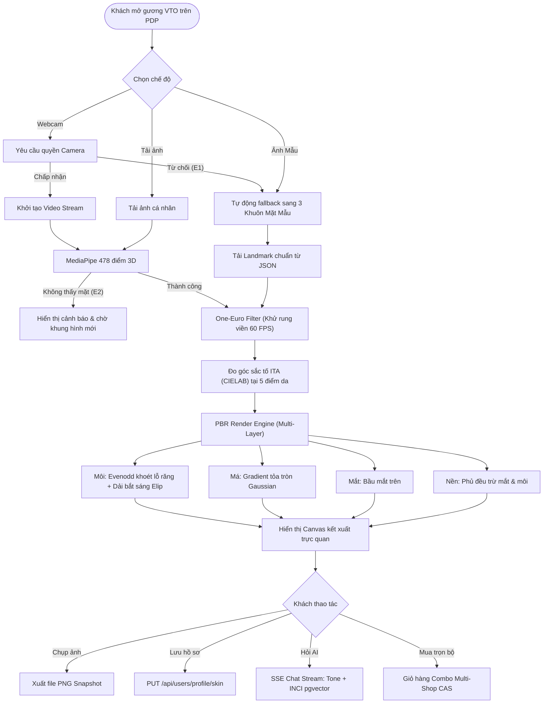
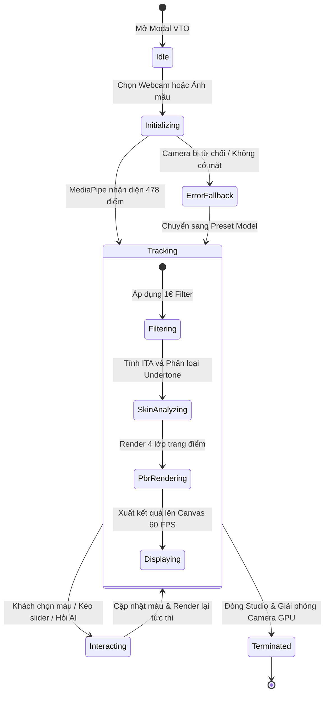

# 🏛️ QUY TRÌNH NGHIỆP VỤ: QT-05 — AURA VIRTUAL TRY-ON 2.0 (AR BEAUTY MAKEUP STUDIO)

> **MÃ QUY TRÌNH**: `QT-05-aura-virtual-try-on`  
> **PHÂN HỆ**: Frontend React 18 SPA (`/frontend`) + Catalog Service (:8082) + Account Service (:8081) + AI Advisor (:8086) + Inventory (:8083) + Order (:8084)  
> **TIÊU CHUẨN KỸ THUẬT**: MediaPipe Face Mesh 478 điểm 3D (Edge WebGL/WASM 60 FPS) • Thuật toán One-Euro Filter (1€ Filter) khử rung viền môi • Trích xuất sắc tố da $ITA^\circ$ (CIELAB) • Kết xuất PBR 5 chất liệu • Multi-Shop Split Order  
> **PHIÊN BẢN**: 2.0 (Chuẩn ModiFace / Perfect Corp) • **TRẠNG THÁI**: Sẵn sàng tích hợp

---

## 1. BẢNG VAI TRÒ & TÁC NHÂN (ACTORS & ROLES)

| Vai trò / Tác nhân | Ký hiệu | Mô tả trách nhiệm trong quy trình AR |
| :--- | :---: | :--- |
| **Khách mua hàng (Buyer)** | `ACT-BUYER` | Người dùng trải nghiệm gương thử mỹ phẩm thực tế ảo trực tiếp qua Webcam, ảnh cá nhân tải lên, hoặc 3 khuôn mặt mẫu chuẩn; tinh chỉnh độ đậm, độ bóng, so sánh Before/After và thêm trọn bộ phối màu vào giỏ hàng. |
| **Người bán hàng (Seller)** | `ACT-SELLER` | Chủ Shop/Thương hiệu cấu hình thông số quang học `VtoConfig` (`hexColor`, `finishType`, `opacity`, `glossiness`, `shimmerIntensity`, `bestUndertone`) cho từng biến thể SKU khi đăng bán kèm Số công bố mỹ phẩm (CBMP). |
| **Edge AR Engine (Frontend)** | `SYS-VTO-EDGE` | Module WebGL/Canvas 2D tại trình duyệt (`frontend/src/features/vto/`) chạy MediaPipe 478 điểm, lọc rung 1€ Filter, khoét rỗng viền răng, đo góc $ITA^\circ$ và kết xuất PBR 60 FPS. |
| **AI Beauty Advisor (SSE)** | `SYS-AI-SSE` | Microservice AI (:8086) nhận ngữ cảnh thời gian thực qua Server-Sent Events (SSE) để đối chiếu tông da người dùng với thành phần INCI, tư vấn độ tương thích màu sắc và cảnh báo kích ứng. |
| **Kho CAS & Đặt hàng (Backend)**| `SYS-CAS-ORDER` | Quản lý kiểm tra tồn kho nguyên tử CAS (`inventory-service` :8083) và tách đơn hàng đa shop (`order-service` :8084) khi khách bấm *"Mua trọn bộ đang thử"*. |

---

## 2. ĐIỂM KÍCH HOẠT & ĐIỀU KIỆN (TRIGGERS & CONDITIONS)

### 2.1. Điểm kích hoạt (Triggers)
- **TG-01**: Khách hàng bấm nút **"✨ Thử màu trực tuyến (Live AR)"** trên trang chi tiết sản phẩm (`ProductDetail.jsx`), thẻ sản phẩm (`MotionCard.jsx`), hoặc trên thanh phân loại biến thể (`VariantSelector.jsx`).
- **TG-02**: Khách hàng click chuyển đổi sắc độ biến thể SKU hoặc đổi danh mục trang điểm (`Son môi`, `Phấn má`, `Kem nền`, `Phấn mắt`) trong Studio.
- **TG-03**: Khách hàng bấm **"Lưu Hồ Sơ Tông Da"** để đồng bộ kết quả đo $ITA^\circ$ vào `SkinProfile` cá nhân.
- **TG-04**: Khách hàng bấm **"Hỏi AI: Màu này có hợp tông da?"** kích hoạt luồng tư vấn SSE.
- **TG-05**: Khách hàng bấm **"Thêm trọn bộ vào giỏ hàng"** để checkout combo phối màu đa thương hiệu.

### 2.2. Tiền điều kiện (Pre-conditions)
- Trình duyệt hỗ trợ HTML5 Canvas và WebGL (Chrome, Edge, Safari, Firefox).
- Đối với chế độ Webcam: Thiết bị có camera và người dùng cấp quyền `navigator.mediaDevices.getUserMedia`.
- Đối với chế độ Ảnh mẫu: Hệ thống đã tải sẵn 3 bộ ảnh chân dung cận cảnh độ phân giải cao cùng 478 tọa độ landmarks định danh chuẩn (`presetLandmarks.json`).

### 2.3. Hậu điều kiện (Post-conditions)
- Gương AR hiển thị màu sắc chuẩn xác với độ trễ $\le 16\text{ ms}$ (60 FPS), không lem màu vào răng, giữ nguyên vân môi và kết cấu da tự nhiên.
- Dữ liệu màu son/phấn không gửi ảnh khuôn mặt lên server (bảo vệ quyền riêng tư 100% on-device).
- Khi thêm vào giỏ, các mặt hàng được ánh xạ chính xác `skuCode`, `productId`, `shopId` để chuẩn bị tách đơn Split Order.

---

## 3. BẢNG ĐỐI CHIẾU TÍNH NĂNG ĐÃ CÓ VS TÍNH NĂNG MỚI (VTO 1.0 VS 2.0)

| Hạng mục kỹ thuật | VTO 1.0 (Hiện trạng) | VTO 2.0 (Spec Kit Hoàn thiện) | Trạng thái |
| :--- | :--- | :--- | :---: |
| **Khử rung Landmarks** | Nhận diện thô trực tiếp từ MediaPipe, có hiện tượng giật nhẹ mép môi khi người dùng lắc đầu | Thuật toán **One-Euro Filter (`oneEuroFilter.js`)** lọc nhiễu tần số cao, mượt mà 60 FPS | **MỚI** |
| **Chống lem màu vào răng** | Vẽ đa giác kín đè lên toàn bộ miệng, khi cười hé miệng son bị tô đè lên răng | Tách 2 vòng: `LIP_OUTER_LOOP` trừ `LIP_INNER_LOOP` theo quy tắc Canvas `evenodd` | **MỚI** |
| **Phản xạ ánh sáng Glossy** | Dải đốm trắng tròn rời rạc (13 cung tròn `screen`) gây hiện tượng "vệt sáng li ti đom đóm" | Dải phản quang elip liên tục mềm mại theo đệm môi dưới (`soft-light` + viền mờ `blur`), loại bỏ đốm li ti | **ĐÃ SỬA & CHUẨN HÓA** |
| **Mẫu ảnh chân dung** | Mẫu 2 & 3 ảnh chụp xa (~30% diện tích khuôn mặt), tỷ lệ viền môi nhỏ 44px gây khó thấy màu | Đã crop cận mặt 50-51% (môi 85px), chuẩn hóa ánh xạ tọa độ 478 điểm trong `presetLandmarks.json` | **ĐÃ SỬA & CHUẨN HÓA** |
| **Kiểu thoa son (Lip Styles)** | Chỉ có một chế độ phủ màu toàn bộ môi | Bổ sung tùy chọn: **Full môi** (quyến rũ) & **Lòng môi Ombré** (tự nhiên Hàn Quốc) | **MỚI** |
| **Chụp ảnh Snapshot** | Chưa có nút tải ảnh kết quả thử màu | Bổ sung nút **📸 Chụp Ảnh**, xuất file PNG chất lượng cao kèm Watermark sang trọng | **MỚI** |
| **Tối ưu hóa GPU** | Canvas AR chạy song song với các hiệu ứng animation nền của ứng dụng | Tự động thêm class `vto-active-no-anim` tạm dừng animation nền để nhường 100% GPU cho AR | **MỚI** |
| **Cấu trúc Module** | Dồn chung mã nguồn trong `vtoEngine.js` | Tách kiến trúc module chuẩn: `constants/`, `engine/oneEuroFilter.js`, `colorSpaceUtils.js`, `skinToneDetector.js`, `makeupPbrRenderer.js` | **MỚI** |

---

## 4. BẢNG LUỒNG NGHIỆP VỤ CHÍNH (MAIN FLOW)

| Bước | Tác nhân | Thao tác thực hiện | Dữ liệu đầu vào / Xử lý | Kết quả kỳ vọng | Trạng thái |
| :---: | :---: | :--- | :--- | :--- | :---: |
| **B1** | `ACT-BUYER` | Bấm *"✨ Thử màu trực tuyến"* từ PDP hoặc Variant Selector | `productId`, `vtoConfig`, danh sách biến thể màu | Modal VTO mở ra, tạm dừng animation nền, hiển thị loading skeleton | Đã có |
| **B2** | `SYS-VTO-EDGE` | Khởi tạo nguồn hình ảnh (Mặc định: Ảnh mẫu 1 Sáng lạnh `COOL` hoặc mở Webcam) | Quyền Camera hoặc `model1_cool.jpg` + `presetLandmarks.json` | Render khung hình đầu tiên lên Canvas kích thước thực tế | Đã có |
| **B3** | `SYS-VTO-EDGE` | Chạy bộ lọc khử rung **One-Euro Filter** trên 478 tọa độ MediaPipe | Tọa độ raw $(x, y, z)$, tần số $60\text{ Hz}$, $minCutoff=1.0$, $beta=0.007$ | Tọa độ mượt mà, không giật lắc mép môi khi cử động | **MỚI** |
| **B4** | `SYS-VTO-EDGE` | Phân tích sắc tố da $ITA^\circ$ tại 5 điểm chuẩn (Trán, 2 Gò má, Cằm) | 5 điểm `SKIN_SAMPLE_POINTS`, chuyển sRGB sang CIELAB, tính $ITA^\circ = \frac{\arctan((L^* - 50)/b^*) \times 180}{\pi}$ | Xác định mã Hex da và Undertone (`WARM`, `COOL`, `NEUTRAL`) hiển thị huy hiệu | Đã có |
| **B5** | `ACT-BUYER` | Chọn danh mục (`Son môi`, `Phấn má`, `Kem nền`, `Phấn mắt`) và sắc độ mong muốn | Click chọn ô Shade trong bảng điều khiển | Áp dụng màu cho lớp trang điểm tương ứng trong `activeLooks` | Đã có |
| **B6** | `SYS-VTO-EDGE` | Kết xuất PBR đa lớp (`makeupPbrRenderer.js`): Môi (chống lem răng, PBR vân môi), Má (tán mờ), Nền, Mắt | Thuật toán `evenodd` clipping, composite `multiply` + `soft-light`, dải sáng Glossy mượt mà | Gương AR phản ánh chân thực chất son/màu phấn | **CHUẨN HÓA** |
| **B7** | `ACT-BUYER` | Kéo thanh Before/After (`splitRatio`) hoặc chuyển kiểu son Full/Ombré | Tương tác chuột/cảm ứng trên thanh trượt và toggle button | Màn hình chia đôi nửa mộc nửa trang điểm trực quan | **MỚI** |
| **B8** | `ACT-BUYER` | Bấm *"📸 Chụp Ảnh"* để lưu ảnh thử màu | Render snapshot canvas thành Blob PNG và kích hoạt tải về máy | Tải file `aura-tryon-look-[timestamp].png` về máy khách | **MỚI** |
| **B9** | `ACT-BUYER` | Bấm *"Lưu Hồ Sơ"* để đồng bộ tông da | Gửi PUT request lên `/api/users/profile/skin` (`account-service` :8081) | Cập nhật hồ sơ da người dùng, nút chuyển sang trạng thái đã lưu | Đã có |
| **B10**| `ACT-BUYER` | Bấm *"Hỏi AI: Màu này có hợp tông da?"* | Mở luồng SSE `/api/advisor/chat` (`ai-advisor-service` :8086) kèm ngữ cảnh VTO | AI phân tích tone màu + thành phần INCI, hiển thị chat stream thời gian thực | Đã có |
| **B11**| `ACT-BUYER` | Bấm *"Thêm trọn bộ vào giỏ hàng"* | Mảng các món đang thử trong `activeLooks` (kèm `skuCode`, `productId`, `shopId`) | Giỏ hàng nhận combo đa shop, kiểm tra tồn kho CAS sẵn sàng tạo Split Order | Đã có |

---

## 5. CÁC LUỒNG LỖI VÀ XỬ LÝ NGOẠI LỆ (ERROR FLOWS)

### 🔴 E1: Khách hàng từ chối quyền truy cập Webcam hoặc thiết bị không có Camera
- **Nguyên nhân**: Trình duyệt chặn quyền truy cập thiết bị hoặc máy tính để bàn không có webcam.
- **Xử lý phẫu thuật**:
  1. Bắt ngoại lệ `NotAllowedError` / `NotFoundError` trong `navigator.mediaDevices.getUserMedia`.
  2. Hiển thị thông báo thân thiện: *"Không thể mở webcam. Aura Studio đã tự động chuyển sang chế độ 3 Khuôn mặt mẫu chuẩn."*
  3. Tự động chuyển mode sang `'preset'`, kích hoạt Mẫu 1 và giữ nguyên mọi tính năng thử màu mà không gây crash màn hình.

### 🔴 E2: Không tìm thấy khuôn mặt trong ảnh tải lên hoặc webcam bị che khuất
- **Nguyên nhân**: Ảnh người dùng tải lên quá mờ, góc nghiêng $> 45^\circ$, hoặc tay che mặt trước webcam.
- **Xử lý phẫu thuật**:
  1. MediaPipe trả về mảng rỗng `results.faceLandmarks.length === 0`.
  2. Hiển thị thông báo Toast cảnh báo: *"Chưa nhận diện được khuôn mặt rõ ràng. Vui lòng nhìn thẳng vào camera hoặc chọn ảnh có đủ ánh sáng."*
  3. Giữ nguyên canvas khung hình gốc, không áp dụng màu lem nhem, đợi khung hình tiếp theo nhận diện thành công mới vẽ tiếp.

### 🔴 E3: Dữ liệu mã màu HEX hoặc cấu hình VTO của sản phẩm không hợp lệ
- **Nguyên nhân**: Dữ liệu seed cũ hoặc người bán nhập sai định dạng HEX (ví dụ: thiếu dấu `#`, sai độ dài).
- **Xử lý phẫu thuật**:
  1. Backend `VtoConfig.VtoShade` tự động kiểm tra regex `^#([A-Fa-f0-9]{6})$`, nếu sai fallback về mã an toàn `#C72C48`.
  2. Frontend `hexToRgba` tự động kiểm tra và chuẩn hóa mã màu, nếu rỗng fallback về `#9B111E`, bảo đảm Canvas không bị ném lỗi `Invalid color format`.

### 🔴 E4: Biến thể màu SKU hết tồn kho nguyên tử CAS khi bấm thêm vào giỏ
- **Nguyên nhân**: Sản phẩm có khách khác vừa đặt mua hết trong kho tại `inventory-service` (:8083).
- **Xử lý phẫu thuật**:
  1. Nút bấm kiểm tra tồn kho `stockOnHand - stockReserved > 0`.
  2. Nếu hết hàng, hiển thị nhãn đỏ *"Tạm hết hàng"* trên ô màu, vô hiệu hóa nút *"Thêm vào giỏ"*, nhưng vẫn cho phép khách thử màu trên gương ảo để trải nghiệm.

---

## 6. SƠ ĐỒ MERMAID CHUẨN HOÁ

### 6.1. Sơ đồ luồng xử lý tổng thể (`flowchart TD`)

### 6.2. Sơ đồ trạng thái máy ảo AR (`stateDiagram-v2`)

---

## 7. TIÊU CHÍ NGHIỆM THU (GIVEN / WHEN / THEN)

### Kịch bản 1: Khử rung và chống lem màu vào răng khi cười hé miệng
- **Given**: Khách hàng đang bật Webcam thử màu son "01 Ruby Matte".
- **When**: Khách hàng cử động đầu và cười hé miệng để lộ hàm răng.
- **Then**:
  - Tọa độ viền môi không bị giật rung nhờ bộ lọc One-Euro Filter.
  - Màu son chỉ phủ lên bề mặt môi (`LIP_OUTER_LOOP`), khoang miệng và răng (`LIP_INNER_LOOP`) hoàn toàn giữ nguyên màu trắng ngà tự nhiên nhờ thuật toán `evenodd`.

### Kịch bản 2: Hiệu ứng phản quang Glossy mềm mại không đốm li ti
- **Given**: Khách hàng thử màu son chất liệu `GLOSSY` (Cam Đào Mọng) với độ bóng 90%.
- **When**: Canvas kết xuất lớp bắt sáng (Specular Layer).
- **Then**:
  - Dải phản quang xuất hiện dưới dạng dải elip mờ mềm mại (`soft-light`) chạy dọc đệm môi dưới và đỉnh nhân trung.
  - Tuyệt đối không xuất hiện các hạt đốm sáng trắng tròn rời rạc như đom dóm.

### Kịch bản 3: Chụp ảnh Snapshot và tải về
- **Given**: Khách hàng ưng ý với diện mạo trang điểm kết hợp son và phấn má.
- **When**: Khách hàng bấm nút **"📸 Chụp Ảnh"**.
- **Then**:
  - Hệ thống chụp lại canvas độ phân giải thực, gắn logo "Aura Beauty AR" góc phải dưới.
  - Trình duyệt tự động tải xuống file hình ảnh `.png` rõ nét.

### Kịch bản 4: Mua trọn bộ phối màu đa gian hàng (Split Order)
- **Given**: Khách hàng đang thử 1 thỏi son từ Shop A và 1 hộp phấn má từ Shop B.
- **When**: Khách hàng bấm nút **"Thêm trọn bộ vào giỏ (2)"**.
- **Then**:
  - Giỏ hàng cập nhật đủ 2 mặt hàng kèm đúng mã phân loại `skuCode`.
  - Hệ thống kiểm tra tồn kho CAS tại `inventory-service` và sẵn sàng chia 2 đơn hàng độc lập cho Shop A và Shop B tại `order-service`.

---

## 8. TRÍCH DẪN MÃ NGUỒN LIÊN QUAN TRONG DỰ ÁN
- `frontend/src/features/vto/vtoEngine.js`: Hàm `renderLipstick`, `detectSkinTone`, `calculateITA`.
- `frontend/src/features/vto/faceLandmarks.js`: Danh sách hằng số 478 tọa độ MediaPipe.
- `frontend/src/features/vto/presetLandmarks.json`: Tọa độ 478 điểm chuẩn của Model 1, 2, 3.
- `frontend/src/features/vto/VirtualTryOnModal.jsx`: Giao diện Studio, điều khiển Before/After, SSE Chat AI.
- `backend/catalog-service/src/main/java/com/cosmetics/catalog/domain/model/VtoConfig.java`: Value Object lưu thông số quang học.
- `backend/account-service/src/main/java/com/cosmetics/account/domain/SkinProfile.java`: Hồ sơ tông da người dùng.
- `backend/ai-advisor-service/src/main/java/com/cosmetics/ai/adapter/in/web/AiAdvisorController.java`: API Stream SSE nhận ngữ cảnh VTO.
