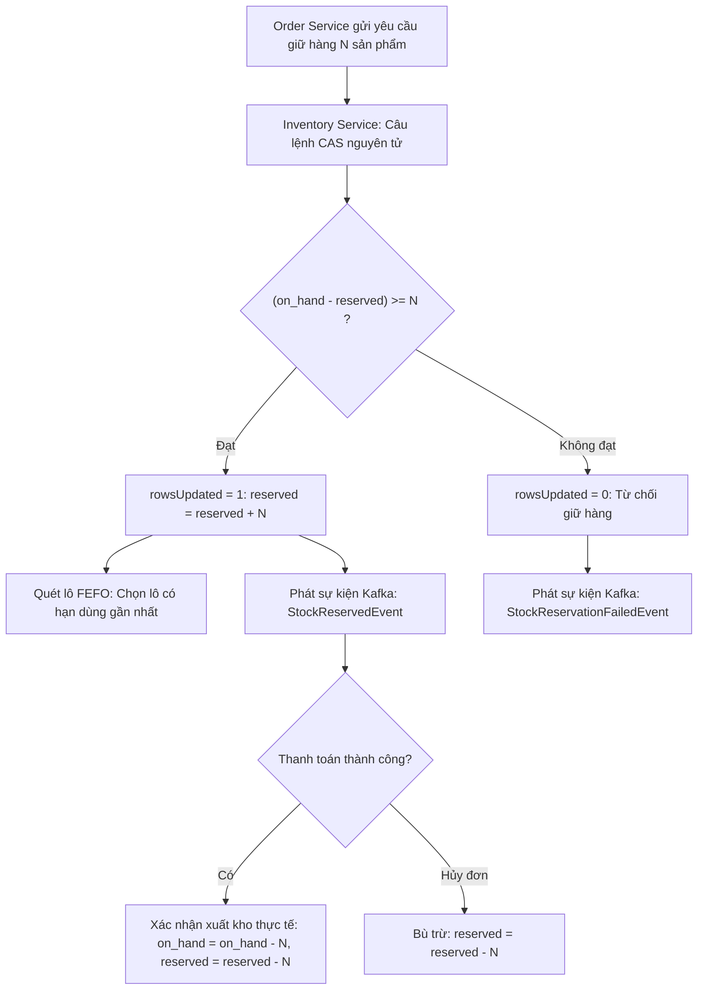
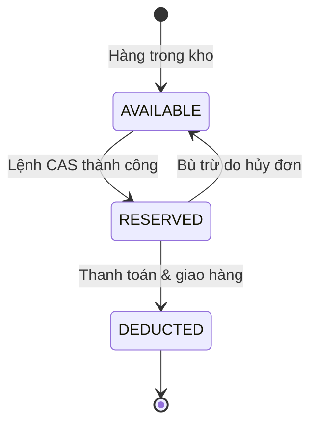

# QUY TRÌNH NGHIỆP VỤ: GIỮ HÀNG TỒN KHO NGUYÊN TỬ (CAS) & QUẢN LÝ LÔ HẠN DÙNG FEFO
> **Mã quy trình:** `QT-05-giu-hang-ton-kho-cas`

| Thuộc tính | Giá trị |
| :--- | :--- |
| **Dự án** | Sàn Thương Mại Điện Tử Mỹ Phẩm Đa Người Bán (Aura Beauty Mall / WebBanMP) |
| **Phiên bản** | v1.0.0 |
| **Người yêu cầu** | Trưởng ban Vận hành Kho vận & Supply Chain |
| **Ưu tiên** | P0 (Bảo đảm tính toàn vẹn kinh doanh) |
| **Loại quy trình** | Dịch ngược từ mã nguồn hiện tại (`existing`) |

---

## 1. Tóm tắt
Quy trình đảm bảo số lượng tồn kho của từng phân loại sản phẩm (SKU) không bao giờ bị âm khi chịu tải đồng thời cao (Flash Sale) thông qua câu lệnh giữ hàng nguyên tử Compare-And-Swap (CAS), kết hợp thuật toán quản lý xuất kho theo lô ưu tiên hạn dùng gần nhất (FEFO).

## 2. Tác nhân & quyền
| Tác nhân | Vai trò hệ thống | Quyền hạn trong quy trình |
| :--- | :--- | :--- |
| **Khách mua (Buyer)** | `ROLE_BUYER` | Tạo yêu cầu mua hàng, kích hoạt giữ hàng |
| **Chủ gian hàng (Seller)** | `ROLE_SELLER` | Khai báo lô hàng, hạn sử dụng, điều chỉnh số lượng tồn |
| **System Inventory** | `SYSTEM` | Thực thi lệnh CAS nguyên tử, bù trừ giải phóng kho |

## 3. Điều kiện trước
- Sản phẩm và các biến thể SKU đã được khởi tạo trong `inventory_items`.
- Số lượng tồn kho khả dụng hiện tại lớn hơn hoặc bằng số lượng yêu cầu.

## 4. Luồng chính
| Bước | Ai | Hành động | Hệ thống xử lý | Kết quả người dùng thấy | Trạng thái |
| :---: | :--- | :--- | :--- | :--- | :---: |
| 1 | System | Nhận `ReserveStockCommand` từ luồng Saga Order | Tiếp nhận mã `sku_id` và số lượng cần giữ $N$ | Bắt đầu giao dịch giữ kho | Đã có |
| 2 | System | Thực thi câu lệnh CAS tại tầng DB | `UPDATE inventory_items SET reserved = reserved + N WHERE sku_id = ? AND (on_hand - reserved) >= N` | Thực hiện khóa nguyên tử | Đã có |
| 3 | System | Đánh giá số dòng bị ảnh hưởng (`rowsUpdated`) | Nếu = 1: Thành công; Nếu = 0: Hết hàng hoặc bị tranh chấp | Phân nhánh kết quả | Đã có |
| 4 | System | Phân bổ xuất kho theo nguyên tắc FEFO | Quét các lô `inventory_lots` có `expiry_date` gần nhất để gán cho đơn hàng | Đơn được chuẩn bị từ lô date mới nhất | Đã có |
| 5 | System | Phát sự kiện Kafka thành công | Bắn `StockReservedEvent` sang Kafka topic `stock-events` | Saga chuyển sang bước thanh toán | Đã có |
| 6 | System | Xử lý bù trừ (nếu thanh toán sau đó hủy) | Nhận `CompensateStockCommand`, thực hiện: `UPDATE SET reserved = reserved - N` | Tồn kho được hoàn trả ngay lập tức | Đã có |

## 5. Sơ đồ

## 6. Luồng phụ & lỗi
| Mã lỗi | Tình huống | Hệ thống phản hồi | Thông báo cho người dùng |
| :--- | :--- | :--- | :--- |
| **E1** | Không tìm thấy mã SKU trong kho | Trả về HTTP 404 Not Found | "Sản phẩm không có thông tin quản lý kho." |
| **E2** | Tranh chấp đồng thời, số lượng không đủ (rowsUpdated = 0) | Trả về lỗi hết hàng | "Sản phẩm vừa hết hàng do có người đặt trước." |
| **E3** | Số lượng yêu cầu giữ kho $\le 0$ | Trả về HTTP 400 Bad Request | "Số lượng sản phẩm đặt hàng không hợp lệ." |
| **E4** | Lô hàng mỹ phẩm bị quá hạn sử dụng (Expired Lot) ⚠ | Tự động loại bỏ lô khỏi thuật toán phân bổ FEFO | Cảnh báo nội bộ Seller cần nhập lô date mới. |

## 7. Trạng thái

## 8. Quy tắc nghiệp vụ
- **BR-01:** Tồn kho khả dụng = `on_hand - reserved`. Nghiêm cấm tồn kho khả dụng $< 0$ trong mọi hoàn cảnh.
- **BR-02:** Tuyệt đối không dùng khóa bi quan (Pessimistic Lock) gây giữ kết nối DB và treo luồng Netty EventLoop.
- **BR-03:** Các lô hàng mỹ phẩm có hạn sử dụng dưới 6 tháng phải được gắn cờ cảnh báo cho người bán.

## 9. Thông báo, realtime & nhật ký
- **Realtime:** Cập nhật số lượng tồn kho còn lại về trang chi tiết sản phẩm của Buyer.
- **Audit Log:** Ghi log mọi thay đổi giữ hàng/hoàn trả kho kèm theo `order_id` và mã SKU.

## 10. Dữ liệu
| Trường | Bắt buộc | Ràng buộc | Ví dụ |
| :--- | :---: | :--- | :--- |
| `sku_id` | Có | Chuỗi không rỗng | `SKU-3CE-TAUPE` |
| `on_hand` | Có | Số nguyên $\ge 0$ | `120` |
| `reserved` | Có | Số nguyên $\ge 0$ | `0` |
| `lot_number` | Có | Chuỗi | `LOT-202410-01` |
| `expiry_date` | Có | Date (YYYY-MM-DD) | `2027-10-15` |

## 11. Màn hình liên quan
- Trang chi tiết sản phẩm: `frontend/src/features/catalog/ProductDetailView.jsx`
- Bộ chọn phân loại màu/dung tích: `frontend/src/features/catalog/VariantColorPicker.jsx`
- Phân hệ Quản lý kho Seller: `frontend/src/components/SellerZone.jsx` (tab `inventory`)

## 12. Tiêu chí nghiệm thu
- **AC-01:** Dưới bài test áp lực 100 request đồng thời tranh chấp 10 sản phẩm còn lại, đúng 10 request thành công, 90 request bị từ chối, tồn kho không bao giờ âm.
- **AC-02:** Khi một đơn hàng bị hủy trước khi thanh toán, số lượng `reserved` được giảm đúng bằng số lượng hàng đã giữ.
- **AC-03:** Thuật toán FEFO luôn chọn lô có ngày hết hạn sớm nhất để xuất hàng trước.

## 13. Ảnh hưởng tới phần có sẵn
- Tương tác mật thiết với `services/order-service` trong chuỗi giao dịch Saga.

## 14. Giả định & câu hỏi mở
- `GD-01`: Giả định mỗi SKU tương ứng 1 bản ghi duy nhất trong `inventory_items`.
- `Q-01`: Có cần áp dụng cơ chế tự động hủy đơn sau 15 phút nếu người mua chưa thanh toán để giải phóng tồn kho không?

## 15. Ghi chú kỹ thuật cho dev
- **Bài kiểm thử áp lực:** `services/inventory-service/src/test/java/com/cosmetics/inventory/AtomicStockConcurrencyTest.java`.
- **Repository CAS:** `services/inventory-service/src/main/java/com/cosmetics/inventory/adapter/out/persistence/StockItemRepository.java`.
- **Entity:** `services/inventory-service/src/main/java/com/cosmetics/inventory/adapter/out/persistence/StockItemEntity.java`.

---
## Lịch sử thay đổi
| Phiên bản | Ngày | Người thực hiện | Nội dung |
| :---: | :---: | :---: | :--- |
| v1.0.0 | 03/11/2026 | Principal Architect | Khởi tạo tài liệu quy trình giữ kho nguyên tử CAS và quản lý lô FEFO |
