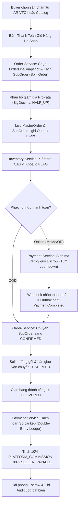
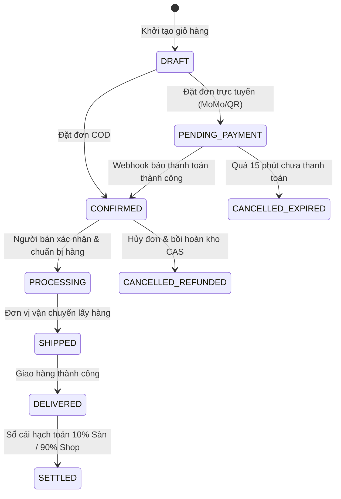

# 📜 QUY TRÌNH NGHIỆP VỤ QT-06: HOÀN THIỆN TOÀN DIỆN HỆ THỐNG TMĐT MỸ PHẨM AURA BEAUTY MALL (DDD, REACTIVE SAGA, HYBRID RAG, VTO 2.0 & MCP)

> **Mã quy trình:** `QT-06-complete-ddd-reactive-hybrid-rag-vto-mcp`  
> **Phân hệ:** Toàn sàn TMĐT (`services/`, `libs/`, `frontend/`, `ai/`, `mcp/`)  
> **Trạng thái:** Chuẩn hóa Spec-Kit (SDD)  
> **Kiến trúc:** Hexagonal Architecture + Rich Domain-Driven Design (Java 21) + Reactive WebFlux + One-Euro Filter VTO + Model Context Protocol (MCP)

---

## 1. TÓM TẮT NGHIỆP VỤ (BUSINESS SUMMARY)
Quy trình QT-06 chuẩn hóa và tích hợp toàn bộ chu trình sống của hệ thống sàn TMĐT Mỹ phẩm Đa Người Bán Aura Beauty Mall:
1. **Mua sắm & Đặt hàng Đa Gian Hàng (Split Order):** Người mua đặt đơn từ nhiều gian hàng; hệ thống lưu giữ nguyên vẹn Anti-Corruption Layer (`OrderLineSnapshot`), phân bổ giảm giá Pro-rata chính xác từng xu (`BigDecimal` `HALF_UP`), tự động phân tách `MasterOrder` thành các `SubOrder` theo `shopId` và ghi sự kiện vào Outbox.
2. **Quản lý Tồn kho CAS & Lô FEFO:** Giữ kho nguyên tử chống race condition bằng câu lệnh CAS `(on_hand - reserved) >= quantity`, tự động chọn lô cận hạn sử dụng nhất (`First-Expired, First-Out`), tự động gắn cờ cảnh báo và khóa các lô có hạn dùng dưới 6 tháng.
3. **Ký quỹ & Sổ cái kép Bất biến (Double-Entry Ledger):** Toàn bộ dòng tiền ký quỹ tại `PLATFORM_ESCROW`. Khi giao hàng thành công, tự động hạch toán bút toán kép bất biến ($\sum \text{Debit} = \sum \text{Credit}$): trích 10% hoa hồng sàn (`PLATFORM_COMMISSION`) và giải ngân 90% công nợ người bán (`SELLER_PAYABLE`).
4. **Tư vấn Da liễu AI Hybrid RAG & Lịch 28 Ngày:** Kết hợp tìm kiếm ngữ nghĩa pgvector với lọc cứng từ khóa INCI (RRF); áp dụng bộ quy tắc cứng (Deterministic INCI Conflict Engine) cảnh báo xung đột hoạt chất (Retinoids, AHA/BHA, Vit C, Benzoyl Peroxide) và thiết lập chu trình Skin Cycling 4 đêm; truyền dữ liệu thời gian thực qua Multi-Stage SSE.
5. **Gương Trang Điểm Ảo AR VTO 2.0:** Gương AR 60 FPS kết hợp One-Euro Filter (1€ Filter) triệt tiêu rung giật điểm mốc khuôn mặt, kết xuất PBR Blending giữ nguyên vân môi tự nhiên và tính góc sắc tố da ($ITA^\circ$) cùng `skinUndertone`.
6. **Kiểm duyệt CBMP & Máy chủ MCP Server:** Tự động đối chiếu số công bố mỹ phẩm CBMP, rà soát danh mục hóa chất cấm của Bộ Y Tế; cung cấp MCP Server chuẩn (`aura-beauty-mcp-server`) cho AI Agent tra cứu an toàn và tự động hóa vận hành.

---

## 2. TÁC NHÂN & MA TRẬN PHÂN QUYỀN (ACTORS & RBAC MATRIX)

| Vai trò (Actor) | Mã quyền (Role/Scope) | Trách nhiệm & Quyền hạn nghiệp vụ |
| :--- | :--- | :--- |
| **Khách mua (Buyer)** | `ROLE_BUYER` | Quét mặt AR VTO, chẩn đoán da AI, đặt đơn giỏ hàng đa shop, thanh toán trực tuyến/COD, khiếu nại đơn hàng. |
| **Người bán (Seller)** | `ROLE_SELLER` | Quản lý lô hàng FEFO, kiểm tra tồn kho Shop, cập nhật trạng thái `SubOrder`, yêu cầu đối soát và rút tiền ví Shop. |
| **Kiểm duyệt viên (Staff Auditor)** | `STAFF_AUDITOR` | Thẩm định số công bố CBMP, kiểm tra danh mục thành phần INCI, khóa sản phẩm chứa chất cấm, gắn huy hiệu Official Mall. |
| **Kế toán đối soát (Staff Accountant)**| `STAFF_ACCOUNTANT`| Kiểm toán Sổ cái kép, giám sát số dư Escrow, đối chiếu Debit/Credit, duyệt lệnh thanh toán giải ngân định kỳ. |
| **Quản trị viên (Admin)** | `ROLE_ADMIN` | Quản trị toàn sàn, phân quyền nhân sự, giám sát sức khỏe cụm Microservices, cấu hình chiết khấu hoa hồng. |
| **Hệ thống tự động (System)** | `SYSTEM` | Chạy Outbox Poller, phân phối Kafka Events, hủy đơn hết hạn (Saga Compensation), cập nhật định kỳ lô cận date. |

---

## 3. ĐIỀU KIỆN TIÊN QUYẾT (PRE-CONDITIONS)
- `PR-01`: Tất cả sản phẩm đưa vào giỏ hàng phải có trạng thái `APPROVED`, sở hữu số `cbmpNumber` hợp lệ và không chứa hoạt chất nằm trong Blacklist của Bộ Y Tế.
- `PR-02`: Các SKU được chọn phải còn đủ tồn kho khả dụng CAS tại gian hàng tương ứng (`on_hand - reserved >= quantity`).
- `PR-03`: Với đơn hàng thanh toán trực tuyến (MoMo / VietQR / Thẻ), đơn hàng phải khởi tạo ở trạng thái `PENDING_PAYMENT` và có bộ đếm ngược 15 phút.

---

## 4. LUỒNG XỬ LÝ CHÍNH (MAIN FLOW - STEP-BY-STEP)

---

## 5. LUỒNG PHỤ & LUỒNG NGOẠI LỆ (ALTERNATIVE & EXCEPTION FLOWS)

- **E1: Không có quyền thao tác (403 Forbidden):**
  - *Trigger:* Khách vãng lai hoặc Buyer cố tình truy cập `/admin` hoặc `/seller` qua URL hoặc gọi trực tiếp API Admin.
  - *Xử lý:* Gateway và Server từ chối ngay lập tức, trả mã `403 FORBIDDEN`, hiển thị giao diện Luxury Access Denied và ghi log bảo mật.
- **E2: Không tìm thấy SKU hoặc đơn hàng (404 Not Found):**
  - *Trigger:* SKU bị gỡ hoặc ID đơn hàng không tồn tại.
  - *Xử lý:* Trả mã `404 NOT_FOUND` kèm JSON chuẩn RFC 7807 (`ProblemDetail`).
- **E3: Sai lệch số tiền hoặc vi phạm Sổ cái kép (422 Unprocessable):**
  - *Trigger:* $\sum \text{Debit} \neq \sum \text{Credit}$ hoặc tổng tiền phân bổ Pro-rata không khớp với tổng đơn gốc.
  - *Xử lý:* Hủy bỏ giao dịch R2DBC lập tức (Rollback), báo động đỏ hệ thống kế toán.
- **E4: Hết tồn kho CAS hoặc lô hàng cận date FEFO (409 Conflict):**
  - *Trigger:* Khi đồng thời 2 khách mua SKU cuối cùng, câu lệnh CAS thất bại (`affected_rows == 0`) hoặc lô hàng chỉ còn hạn dưới 6 tháng.
  - *Xử lý:* Trả mã `409 CONFLICT`, kích hoạt Saga Compensation hủy `SubOrder` và nhả các tài nguyên đã giữ.
- **E5: Trùng lặp sự kiện Kafka hoặc Webhook (Idempotency Hit):**
  - *Trigger:* Kafka broker gửi lại sự kiện hoặc cổng thanh toán gọi webhook nhiều lần.
  - *Xử lý:* `TransactionalInbox` kiểm tra khóa duy nhất `messageId`; nếu đã xử lý thì bỏ qua an toàn và trả `200 OK`.

---

## 6. SƠ ĐỒ TRẠNG THÁI THỰC THỂ (STATE DIAGRAM)

---

## 7. CÁC QUY TẮC NGHIỆP VỤ CỐT LÕI (BUSINESS RULES)
- **BR-01 (Clean Architecture & Rich DDD):** Package `domain` thuần Java 21 100%, không chứa import của Spring Framework, R2DBC, MongoDB, Kafka, đảm bảo pass `HexagonalArchitectureTest`.
- **BR-02 (Atomic Stock CAS):** Mọi thao tác trừ kho đều dùng câu lệnh nguyên tử `UPDATE stock SET reserved = reserved + :qty, version = version + 1 WHERE sku = :sku AND (on_hand - reserved) >= :qty AND version = :version`.
- **BR-03 (FEFO Expiry Guard):** Phân bổ lô hàng có ngày hết hạn gần nhất trước (`ORDER BY expiry_date ASC`); cấm xuất kho các lô có hạn dùng dưới 180 ngày (< 6 tháng) tính từ thời điểm đặt hàng.
- **BR-04 (Double-Entry Ledger Invariant):** Mọi giao dịch tài chính phải tuân thủ nghiêm ngặt phương trình cân bằng: $\sum \text{Debit} = \sum \text{Credit}$. Số tiền lưu kiểu `NUMERIC(19,4)` và tính toán bằng `BigDecimal` (`RoundingMode.HALF_UP`).
- **BR-05 (Commission Split):** Phí sàn cố định 10% tính trên tổng giá trị hàng hóa của từng `SubOrder` sau giảm giá. Người bán hưởng trọn vẹn 90% doanh thu.
- **BR-06 (Anti-Corruption Layer Snapshot):** Khi tạo đơn hàng, thông tin tên sản phẩm, giá bán, mã vạch, số CBMP và tên gian hàng được chụp cứng vào `OrderLineSnapshot` để tránh việc người bán sửa giá/sản phẩm làm sai lệch lịch sử giao dịch.
- **BR-07 (Deterministic INCI Conflict):** Cấm kết hợp Retinoids nồng độ cao với AHA/BHA hoặc Vitamin C L-AA trong cùng một buổi dưỡng da cho loại da nhạy cảm (`SENSITIVE`).
- **BR-08 (Zero Blank-Screen Frontend):** Tất cả 51 Sub-menu, 9 phân hệ Seller, 9 phân hệ Admin và 15 trang Footer bắt buộc hiển thị đầy đủ 4 trạng thái (`Loading`, `Empty`, `Error`, `Data`), không được phép crash hoặc trắng màn hình.
- **BR-09 (Anti-Double-Submit):** Nút gọi API thanh toán và tạo đơn tự động chuyển sang trạng thái disabled kèm spinner loading khi đang xử lý.
- **BR-10 (Audit Log Bất biến):** Mọi hành động của Admin và Seller đối với duyệt sản phẩm, khóa gian hàng, chuyển trạng thái đơn, giải ngân đều được lưu vết thời gian thực kèm mã định danh tác nhân.

---

## 8. THÔNG BÁO THỜI GIAN THỰC & MULTI-STAGE SSE
1. **Multi-Stage SSE trong Tư vấn Da liễu AI (`/api/ai/advisor/stream`):**
   - Stage 1: `event: skin_analysis` -> Trả về kết quả phân tích chỉ số da ($ITA^\circ$, `skinType`, `skinUndertone`).
   - Stage 2: `event: inci_safety_matrix` -> Ma trận an toàn hóa mỹ phẩm và cảnh báo xung đột hoạt chất.
   - Stage 3: `event: routine_28_days` -> Lịch trình dưỡng da 28 ngày chuẩn Skin Cycling.
   - Stage 4: `event: token` -> Stream từng từ tư vấn chuyên sâu của AI Dược sĩ.
   - Stage 5: `event: recommended_skus` -> Danh sách SKU gợi ý kèm huy hiệu hợp tông da AR.
2. **SSE Đơn hàng & Ví sàn (`/api/orders/sse` & `/api/payments/sse`):**
   - Thông báo tức thì cho Seller khi có `SubOrder` mới.
   - Thông báo cho Buyer khi trạng thái đơn đổi sang `SHIPPED` hoặc `DELIVERED`.

---

## 9. MÔ HÌNH DỮ LIỆU & ĐỊNH DẠNG SỐ/THỜI GIAN
- Tiền tệ: `NUMERIC(19,4)` trong SQL, `BigDecimal` trong Java 21, làm tròn `HALF_UP`.
- Thời gian: `TIMESTAMPTZ` trong SQL, `Instant` / `OffsetDateTime` múi giờ UTC trong Java.
- Khóa chính & Aggregate ID: `UUID` hoặc String có tiền tố (`ord-xxx`, `sub-xxx`, `sku-xxx`, `shop-xxx`).

---

## 10. TIÊU CHÍ NGHIỆM THU (ACCEPTANCE CRITERIA)
- `AC-01 (Given/When/Then)`:
  - *Cho:* Giỏ hàng có 2 sản phẩm thuộc 2 Shop khác nhau (`shop-001`, `shop-002`) và mã giảm giá sàn 50.000đ.
  - *Khi:* Buyer bấm "Đặt Hàng".
  - *Thì:* Hệ thống tạo 1 `MasterOrder` và tách chính xác 2 `SubOrder`; giảm giá 50.000đ được chia Pro-rata theo tỷ lệ giá trị hàng hóa; tồn kho CAS được giữ tại cả 2 shop.
- `AC-02`:
  - *Cho:* Đơn hàng MoMo ở trạng thái `PENDING_PAYMENT`.
  - *Khi:* Cổng thanh toán gọi Webhook thành công.
  - *Thì:* Đơn hàng chuyển sang `CONFIRMED`, tiền vào ví `PLATFORM_ESCROW`, phát sự kiện `PaymentCompleted`.
- `AC-03`:
  - *Cho:* Người dùng quét mặt trên camera AR VTO.
  - *Khi:* Khởi động gương AR.
  - *Thì:* Bộ lọc One-Euro Filter duy trì độ ổn định mốc mặt ở 60 FPS; vân môi không bị mất; màu son hòa trộn chuẩn PBR.
- `AC-04`:
  - *Cho:* Khách vãng lai truy cập `/?view=admin` hoặc `/?view=seller`.
  - *Khi:* Màn hình tải xong.
  - *Thì:* Không có dữ liệu mật nào bị lộ; hiển thị Card cảnh báo 403 Access Denied sang trọng.
- `AC-05`:
  - *Cho:* Microservices chạy kiểm thử kiến trúc `mvn test -Dtest=*ArchitectureTest`.
  - *Khi:* ArchUnit quét toàn bộ class trong tầng `domain`.
  - *Thì:* Kết quả trả về 0 vi phạm (Zero Architecture Violations).
- `AC-06`:
  - *Cho:* AI Agent kết nối vào MCP Server `aura-beauty-mcp-server`.
  - *Khi:* Gọi tool `audit_double_entry_ledger`.
  - *Thì:* Trả về kết quả kiểm toán cân bằng $\sum \text{Debit} = \sum \text{Credit}$ và tỷ lệ 10%/90% chính xác.

---

## 11. TÁC ĐỘNG HỆ THỐNG HIỆN TẠI (ZERO-BREAKAGE COMPLIANCE)
- Giữ nguyên 100% danh mục 154+ sản phẩm ảnh thật tại `/frontend/public/products/`.
- Giữ nguyên toàn bộ các cổng mạng chuẩn: Gateway 8080, Account 8081, Catalog 8082, Inventory 8083, Order 8084, Payment 8085, AI 8086, Frontend 3000.
- Không sửa file `infra/docker/docker-compose.yml`.

---

## 12. GHI CHÚ KỸ THUẬT & TRÍCH DẪN MÃ NGUỒN THỰC TẾ
- `backend/order-service/src/main/java/com/cosmetics/order/domain/model/`: Nơi chứa `MasterOrder`, `SubOrder`, `OrderLineSnapshot`.
- `backend/inventory-service/src/main/java/com/cosmetics/inventory/domain/model/`: Nơi chứa logic FEFO và CAS.
- `backend/payment-service/src/main/java/com/cosmetics/payment/domain/model/`: Nơi chứa `LedgerEntry`, `EscrowWallet`.
- `backend/ai-advisor-service/src/main/java/com/cosmetics/ai/domain/`: Nơi chứa Hybrid Search RRF & Deterministic Conflict Engine.
- `frontend/src/features/vto/`: Nơi chứa One-Euro Filter & PBR WebGL shader.
- `mcp/aura-beauty-mcp-server/`: Nơi đặt MCP Server tiêu chuẩn.
