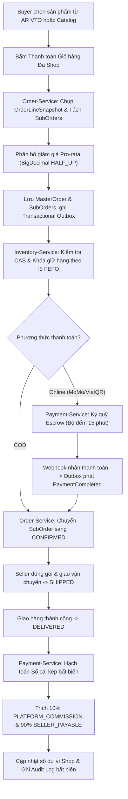
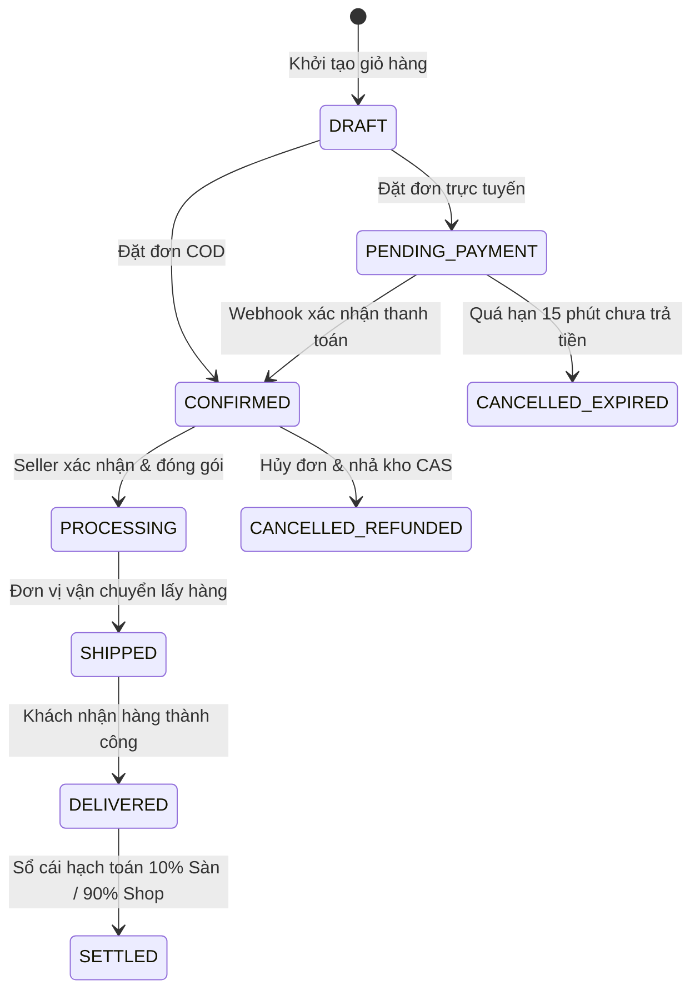

# 📜 QUY TRÌNH NGHIỆP VỤ QT-07: NÂNG CẤP & HOÀN THIỆN TOÀN DIỆN NỀN TẢNG TMĐT MỸ PHẨM AURA BEAUTY MALL (MASTER UPGRADE)

> **Mã quy trình:** `QT-07-complete-platform-master-upgrade`  
> **Tên quy trình:** Nâng cấp & Hoàn thiện Toàn diện Hệ thống Sàn TMĐT Mỹ phẩm Đa Người Bán Aura Beauty Mall  
> **Phân hệ phụ trách:** Toàn bộ hệ thống (`backend/`, `frontend/`, `ai/`, `mcp/`, `infra/`, `docs/`)  
> **Trạng thái:** Chuẩn hóa Spec-Kit (SDD) — Sẵn sàng hội tụ (Converged)  
> **Kiến trúc cốt lõi:** Hexagonal Architecture + Quarkus 3.15 Mutiny Reactive (100% Non-Blocking) + Rich DDD (Java 21/22) + Sổ cái kép + CAS Inventory + AR VTO 60 FPS + Hybrid RAG + Zero Blank-Screen UI

---

## 1. THÔNG TIN CHUNG (OVERVIEW)
- **Hệ thống:** Aura Beauty Mall / WebBanMP — Nền tảng TMĐT Mỹ phẩm Đa Người Bán chính hãng cao cấp.
- **Microservices Backend (Port 8080–8086):**
  - `api-gateway` (8080): Định tuyến, JWT Verification, Rate Limiting, CORS.
  - `account-service` (8081): Quản lý danh tính, RBAC đa tầng, hồ sơ da người dùng, Shop seller.
  - `catalog-service` (8082): Danh mục mỹ phẩm, INCI Analyzer, xác thực CBMP, kiểm duyệt sản phẩm.
  - `inventory-service` (8083): Quản lý tồn kho nguyên tử CAS, phân bổ lô theo hạn dùng FEFO.
  - `order-service` (8084): Tách đơn giỏ hàng đa shop (Split Order), phân bổ chiết khấu Pro-rata, Saga Checkout.
  - `payment-service` (8085): Ký quỹ Escrow, Sổ cái kép Double-Entry Ledger (10% sàn / 90% shop), Webhook Idempotency.
  - `ai-advisor-service` (8086): Trợ lý AI da liễu Hybrid RAG (pgvector + INCI match + RRF), INCI Conflict Engine, Multi-Stage SSE.
- **Frontend SPA (Port 3000):** React 18, Vite 5, Tailwind CSS, Animate UI, AR Virtual Try-On (@mediapipe + WebGL 60 FPS), Mega Menu 51 sub-menus, 9 phân hệ Seller Zone, 9 phân hệ Admin Zone, Footer 15 trang.

---

## 2. TÓM TẮT NGHIỆP VỤ (BUSINESS SUMMARY)
Quy trình QT-07 tích hợp toàn bộ chuỗi giá trị và quy tắc vận hành khắt khe của sàn TMĐT mỹ phẩm chuẩn Enterprise:
1. **Đặt hàng Split Order & Hạch toán Sổ cái kép:** Người mua đặt hàng từ nhiều shop trong 1 giỏ; hệ thống chụp `OrderLineSnapshot`, phân bổ giảm giá Pro-rata từng xu (`HALF_UP`), tách `MasterOrder` thành các `SubOrder` theo `shopId`. Tiền giữ tại `PLATFORM_ESCROW`. Khi giao hàng thành công, tự động trích 10% hoa hồng sàn (`PLATFORM_COMMISSION`) và 90% công nợ người bán (`SELLER_PAYABLE`) với bất biến $\sum \text{Debit} = \sum \text{Credit}$.
2. **Quản lý Tồn kho CAS & Lô FEFO:** Giữ kho nguyên tử chống bán vượt (overselling) bằng CAS `(on_hand - reserved) >= quantity`. Tự động xuất kho ưu tiên lô có hạn dùng gần nhất (`First-Expired, First-Out`), chặn các lô cận date dưới 6 tháng.
3. **Gương Trang điểm ảo AR VTO 2.0:** Gương AR 60 FPS với One-Euro Filter triệt tiêu rung giật điểm mốc khuôn mặt, kết xuất PBR Blending giữ nguyên vân môi và bề mặt da, tính toán góc sắc tố da $ITA^\circ$ và xác định `skinUndertone` để gợi ý sản phẩm phù hợp.
4. **Tư vấn Da liễu AI Hybrid RAG & INCI Conflict Engine:** Kết hợp vector embeddings và từ khóa INCI bằng Reciprocal Rank Fusion (RRF); áp dụng bộ quy tắc cứng cảnh báo xung đột hoạt chất (AHA/BHA, Retinol, Vitamin C) và đề xuất chu trình Skin Cycling 28 ngày qua Multi-stage SSE.
5. **Kiểm duyệt CBMP & Phân quyền Đa tầng:** Quét số công bố mỹ phẩm CBMP và thành phần độc hại; Dashboard đa vai trò (Admin, Seller, Buyer) với cam kết 0% màn hình trắng trên toàn bộ 51 sub-menu và 18 phân hệ quản trị.

---

## 3. TÁC NHÂN & MA TRẬN PHÂN QUYỀN (ACTORS & RBAC MATRIX)

| Tác nhân (Actor) | Mã quyền (Role/Scope) | Phạm vi quyền hạn nghiệp vụ |
| :--- | :--- | :--- |
| **Khách mua (Buyer)** | `ROLE_BUYER` | Quét mặt AR VTO, chẩn đoán da AI, đặt đơn hàng đa shop, thanh toán trực tuyến/COD, xem lịch sử đơn. |
| **Người bán (Seller)** | `ROLE_SELLER` | Quản lý lô hàng FEFO của shop, theo dõi SubOrder, xem ví doanh thu 90%, yêu cầu đối soát định kỳ. |
| **Kiểm duyệt viên (Auditor)** | `STAFF_AUDITOR` | Thẩm định số công bố CBMP, duyệt sản phẩm mới, kiểm tra cảnh báo thành phần độc hại. |
| **Kế toán sàn (Accountant)** | `STAFF_ACCOUNTANT`| Kiểm toán Sổ cái kép, giám sát số dư Escrow, đối chiếu Debit/Credit, duyệt lệnh thanh toán giải ngân. |
| **Quản trị viên (Admin)** | `ROLE_ADMIN` | Quản trị toàn sàn, phân quyền nhân sự, giám sát hệ thống, cấu hình tỷ lệ hoa hồng sàn. |
| **Hệ thống tự động (System)** | `SYSTEM` | Chạy Outbox Poller, điều phối Kafka Saga, hủy đơn hết hạn 15 phút, giải phóng kho CAS. |

---

## 4. ĐIỀU KIỆN TIÊN QUYẾT (PRE-CONDITIONS)
- `PR-01`: Sản phẩm hiển thị và bán trên sàn phải có trạng thái `APPROVED`, có số `cbmpNumber` hợp lệ và không chứa thành phần cấm.
- `PR-02`: Đơn hàng đa shop phải có tồn kho khả dụng CAS tại từng shop tương ứng (`on_hand - reserved >= quantity`).
- `PR-03`: Mọi giao dịch tài chính phải tuân thủ định dạng số thực `NUMERIC(19,4)` và chế độ làm tròn `RoundingMode.HALF_UP`.
- `PR-04`: Mọi thao tác người dùng trên giao diện web phải đảm bảo đủ 4 trạng thái (Loading, Empty, Error, Data), không được xuất hiện màn hình trắng.

---

## 5. LUỒNG XỬ LÝ CHÍNH (MAIN FLOW)



---

## 6. LUỒNG NGOẠI LỆ & XỬ LÝ LỖI (EXCEPTION FLOWS E1–E5)

- **E1: Không có quyền thao tác (403 Forbidden):**
  - *Trigger:* Buyer hoặc khách chưa đăng nhập cố truy cập `/admin` hoặc `/seller` qua URL hoặc gọi trực tiếp API nội bộ.
  - *Xử lý:* Trả về HTTP `403 FORBIDDEN` chuẩn RFC 9457 `ProblemDetail`. Frontend hiển thị màn hình Luxury Access Denied kèm nút chuyển hướng.
- **E2: Không tìm thấy tài nguyên (404 Not Found):**
  - *Trigger:* SKU, mã đơn hàng hoặc sản phẩm không tồn tại trong hệ thống.
  - *Xử lý:* Trả về HTTP `404 NOT_FOUND`. Frontend hiển thị Empty State với hình minh họa và nút CTA quay lại Catalog.
- **E3: Sai lệch số tiền / Vi phạm Sổ cái kép (422 Unprocessable Entity):**
  - *Trigger:* $\sum \text{Debit} \neq \sum \text{Credit}$ hoặc tổng tiền phân bổ Pro-rata không khớp với tổng đơn gốc.
  - *Xử lý:* Rollback giao dịch ngay lập tức, ghi log báo động đỏ `AuditLogRecord`, trả mã `422 UNPROCESSABLE_ENTITY`.
- **E4: Hết tồn kho CAS hoặc lô hàng cận date (409 Conflict):**
  - *Trigger:* Tranh chấp tồn kho khi 2 người cùng mua sản phẩm cuối cùng (`affected_rows == 0`) hoặc lô hàng chỉ còn hạn dưới 6 tháng.
  - *Xử lý:* Trả về HTTP `409 CONFLICT`, kích hoạt Saga Compensation hủy `SubOrder` và hoàn lại tài nguyên cho người mua.
- **E5: Trùng lặp sự kiện Kafka hoặc Webhook (Idempotency Hit):**
  - *Trigger:* Cổng thanh toán gọi Webhook nhiều lần hoặc Kafka rebalance phát lại sự kiện.
  - *Xử lý:* `TransactionalInbox` kiểm tra khóa duy nhất `eventId`. Nếu đã xử lý, ghi nhận no-op an toàn và trả mã `200 OK`.

---

## 7. SƠ ĐỒ TRẠNG THÁI ĐƠN HÀNG (STATE DIAGRAM)



---

## 8. BẢNG ÁNH XẠ API ENDPOINTS CHUẨN

| Method | Endpoint | Quyền hạn | Mô tả chức năng |
| :--- | :--- | :--- | :--- |
| `POST` | `/api/v1/orders/checkout` | `ROLE_BUYER` | Đặt hàng đa shop, tách SubOrder, khóa CAS và ghi Outbox. |
| `GET` | `/api/v1/orders/{orderId}` | `ROLE_BUYER`, `ROLE_SELLER`, `ROLE_ADMIN` | Lấy chi tiết đơn hàng Master/SubOrder kèm lịch sử trạng thái. |
| `POST` | `/api/v1/inventory/reserve` | `SYSTEM` (Saga) | Giữ kho nguyên tử CAS theo danh sách SKU và số lượng. |
| `POST` | `/api/v1/inventory/release` | `SYSTEM` (Saga) | Nhả tồn kho khi đơn hàng bị hủy hoặc timeout thanh toán. |
| `POST` | `/api/v1/payments/webhook` | Public (Secret Auth) | Tiếp nhận webhook thanh toán MoMo/VietQR an toàn qua Inbox. |
| `GET` | `/api/v1/payments/ledger` | `STAFF_ACCOUNTANT`, `ROLE_ADMIN` | Tra cứu bảng đối soát Sổ cái kép (Debit = Credit). |
| `POST` | `/api/v1/ai/advisor/chat` | Public / `ROLE_BUYER` | Tư vấn mỹ phẩm Hybrid RAG, INCI conflict, phát luồng SSE. |
| `GET` | `/api/v1/catalog/products` | Public | Lấy danh sách sản phẩm phân trang, lọc theo danh mục và da. |

---

## 9. RÀNG BUỘC TOÀN VẸN CƠ SỞ DỮ LIỆU & BẤT BIẾN TÀI CHÍNH
1. **Bất biến Sổ cái kép (Double-Entry Ledger):**
   $$\sum \text{DebitAmount} = \sum \text{CreditAmount}$$
   Mỗi giao dịch thanh toán thành công phải sinh ra ít nhất 2 bút toán cân bằng: Ghi Nợ tài khoản Ký quỹ (`PLATFORM_ESCROW`), Ghi Có tài khoản Hoa hồng sàn (`PLATFORM_COMMISSION` 10%) và Ghi Có tài khoản Công nợ người bán (`SELLER_PAYABLE` 90%).
2. **Bất biến Tồn kho CAS:**
   Tồn kho thực tế không bao giờ được phép âm:
   ```sql
   UPDATE stock_items 
   SET reserved = reserved + :qty 
   WHERE sku_code = :skuCode AND (on_hand - reserved) >= :qty;
   ```
3. **Bất biến Phân bổ Giảm giá Pro-rata:**
   Tổng số tiền giảm giá trên các `SubOrder` và `OrderLine` phải khớp chính xác 100% với giá trị Voucher áp dụng, sai số cho phép là $0$ nhờ thuật toán phân bổ phần dư cho dòng sản phẩm có giá trị lớn nhất.

---

## 10. SỰ KIỆN MIỀN & TÍCH HỢP KAFKA OUTBOX (DOMAIN EVENTS)
- `OrderCreatedEvent`: Phát ra khi `MasterOrder` được tạo; chứa danh sách `SubOrders` và thông tin chiết khấu.
- `StockReservedEvent`: Phát ra khi `inventory-service` giữ thành công toàn bộ SKU theo lô FEFO.
- `StockReservationFailedEvent`: Phát ra khi 1 SKU bị hết hàng; kích hoạt bù trừ hủy đơn hàng trong Saga.
- `PaymentCompletedEvent`: Phát ra khi Webhook thanh toán xác nhận thành công.
- `PaymentExpiredEvent`: Phát ra khi hết hạn thanh toán 15 phút.

---

## 11. TRẢI NGHIỆM NGƯỜI DÙNG FRONTEND & CAM KẾT ZERO BLANK-SCREEN
- **4 Trạng thái bắt buộc:** Toàn bộ 51 Sub-menu Mega Menu, 9 phân hệ Seller, 9 phân hệ Admin và 15 liên kết Footer cam kết luôn có đủ:
  1. *Loading:* Skeleton loader hoặc Spinner tinh tế.
  2. *Empty:* Hình minh họa thẩm mỹ + Thông điệp tiếng Việt + Nút gợi ý khám phá.
  3. *Error:* Thông báo lỗi thân thiện + Nút "Thử lại".
  4. *Data:* Trình bày sang trọng Luxury Monochrome, bố cục cân đối, phản hồi tức thì.
- **Nút bấm API an toàn:** Tự động vô hiệu hóa (`disabled`) và hiển thị biểu tượng quay vòng (spinner) khi đang gửi request, ngăn chặn người dùng bấm đúp (double-click).
- **Hộp thoại xác nhận phá hủy:** Mọi thao tác xóa, hủy đơn, khóa tài khoản hoặc từ chối sản phẩm bắt buộc phải có Confirm Modal nêu rõ hậu quả.

---

## 12. TÍCH HỢP TRÍ TUỆ NHÂN TẠO AI RAG & GƯƠNG AR VTO
- **Hybrid RAG (RRF):** Kết hợp vector embeddings (pgvector) với bộ lọc từ khóa INCI để đảm bảo độ chính xác y khoa da liễu.
- **Deterministic INCI Conflict Engine:** Phát hiện xung đột hoạt chất (ví dụ: AHA 10% kết hợp Retinol 1%, hoặc Benzoyl Peroxide kết hợp Vitamin C) và đưa ra cảnh báo trực quan đỏ trên giao diện người dùng.
- **28-Day Skin Cycling Scheduler:** Tự động tạo lộ trình chăm sóc da 4 đêm (Exfoliation $\rightarrow$ Retinoid $\rightarrow$ Recovery $\rightarrow$ Recovery) lặp lại theo chu kỳ tái tạo da sinh học 28 ngày.
- **Gương AR VTO 2.0:** Xử lý 478 điểm mốc khuôn mặt với One-Euro Filter ở tốc độ 60 FPS, tính toán góc $ITA^\circ$ và độ sáng melanin để phân tích undertone (Cool/Neutral/Warm) và tự động đồng bộ vào `account-service`.

---

## 13. MA TRẬN BẢO MẬT & KIỂM SOÁT HỒ SƠ CBMP
- **Kiểm soát chất cấm:** Tự động đối chiếu thành phần sản phẩm với danh mục chất cấm (Corticoid, Thủy ngân, Chì, Hydroquinone) theo quy định của Hiệp định Mỹ phẩm ASEAN.
- **Số công bố mỹ phẩm (CBMP):** Yêu cầu bắt buộc số CBMP theo định dạng `XX/YY/CBMP-ZZ` trước khi sản phẩm được kích hoạt lên sàn.
- **Audit Log bất biến:** Ghi lại `userId`, `action`, `resourceId`, `timestamp`, `ipAddress` và `diffSnapshot` cho mọi thao tác cập nhật dữ liệu tài chính hoặc duyệt sản phẩm.

---

## 14. TIÊU CHÍ NGHIỆM THU (ACCEPTANCE CRITERIA - GIVEN/WHEN/THEN)
- **AC-01 (Split Order & CAS):**
  - *Cho (Given):* Khách hàng chọn 2 sản phẩm từ Shop A và 1 sản phẩm từ Shop B.
  - *Khi (When):* Khách hàng bấm Đặt hàng.
  - *Thì (Then):* Hệ thống tách thành 2 `SubOrder` độc lập, tồn kho CAS của cả 3 sản phẩm bị giữ nguyên tử, không có hiện tượng race condition khi 100 luồng chạy đồng thời.
- **AC-02 (Double-Entry Ledger):**
  - *Cho (Given):* Đơn hàng trị giá 1.000.000 VNĐ được xác nhận giao thành công.
  - *Khi (When):* `payment-service` hạch toán tiền.
  - *Thì (Then):* Bút toán Sổ cái ghi Nợ 1.000.000 VNĐ cho `PLATFORM_ESCROW`, ghi Có 100.000 VNĐ (10%) cho `PLATFORM_COMMISSION`, và ghi Có 900.000 VNĐ (90%) cho `SELLER_PAYABLE`. Tổng Nợ bằng chính xác Tổng Có.
- **AC-03 (Zero Blank-Screen):**
  - *Cho (Given):* Người dùng truy cập bất kỳ sub-menu nào trong 51 sub-menus hoặc 18 trang quản trị.
  - *Khi (When):* Trang đang tải dữ liệu hoặc cơ sở dữ liệu trống.
  - *Thì (Then):* Giao diện hiển thị đúng Skeleton hoặc Empty State có nút hành động, tỷ lệ màn hình trắng là 0%.

---

## 15. ĐỐI CHIẾU MÃ NGUỒN THỰC TẾ (CODE REFERENCES)
- **Kiến trúc Hexagonal & Domain:**
  - `backend/account-service/src/test/java/com/cosmetics/account/HexagonalArchitectureTest.java#L1-L25`
  - `backend/catalog-service/src/test/java/com/cosmetics/catalog/HexagonalArchitectureTest.java#L1-L25`
  - `backend/order-service/src/test/java/com/cosmetics/order/HexagonalArchitectureTest.java#L1-L25`
  - `backend/payment-service/src/test/java/com/cosmetics/payment/HexagonalArchitectureTest.java#L1-L25`
- **CAS & FEFO:**
  - `backend/inventory-service/src/test/java/com/cosmetics/inventory/AtomicStockConcurrencyTest.java#L1-L54`
  - `backend/inventory-service/src/test/java/com/cosmetics/inventory/FefoAllocationPolicyTest.java#L1-L45`
  - `backend/inventory-service/src/main/java/com/cosmetics/inventory/adapter/out/persistence/StockItemRepository.java#L8-L21`
- **Sổ cái kép:**
  - `backend/payment-service/src/test/java/com/cosmetics/payment/DoubleEntryLedgerTest.java#L1-L40`
  - `backend/payment-service/src/main/java/com/cosmetics/payment/domain/DoubleEntryLedger.java#L1-L60`
- **Transactional Inbox & Outbox:**
  - `backend/common-outbox/src/main/java/com/cosmetics/common/outbox/TransactionalInbox.java#L1-L55`
  - `backend/common-outbox/src/main/java/com/cosmetics/common/outbox/OutboxHelper.java#L1-L50`
- **Frontend Fallback & Navigation:**
  - `frontend/src/lib/submenuCatalogMapper.js#L1-L150`
  - `frontend/src/App.jsx#L1-L500`
