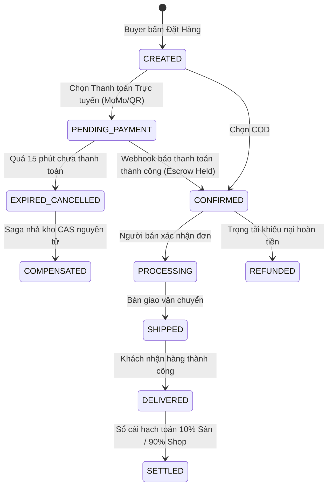

# 🏛️ QUY TRÌNH NGHIỆP VỤ QT-07: KIẾN TRÚC BACKEND MICROSERVICES REACTIVE ENTERPRISE CLOUD-NATIVE

> **Mã quy trình:** `QT-07-modern-enterprise-backend-architecture`  
> **Phân hệ:** Toàn bộ khối Backend (`backend/`, `libs/`)  
> **Trạng thái:** Chuẩn hóa Spec-Kit (SDD)  
> **Kiến trúc:** Hexagonal Architecture (Ports & Adapters) + Reactive Spring WebFlux (100% Non-Blocking) + RFC 9457 ProblemDetail + Saga Choreography + Double-Entry Ledger

---

## BẢNG THÔNG TIN CHUNG
- **Hệ thống:** Sàn Thương Mại Điện Tử Mỹ Phẩm Đa Người Bán Aura Beauty Mall (WebBanMP).
- **Cụm 7 Microservices (Port 8080-8086):** `api-gateway` (8080), `account-service` (8081), `catalog-service` (8082), `inventory-service` (8083), `order-service` (8084), `payment-service` (8085), `ai-advisor-service` (8086).
- **Thư viện dùng chung:** `common-web`, `common-events`, `common-outbox`.
- **Tuân thủ chuẩn mực:** RFC 9457 (HTTP Problem Details), Java 21 LTS (Sealed Types, Records, Pattern Matching), ArchUnit 1.3.0, Reactor Netty 100% Non-Blocking (BlockHound).

---

## 1. TÓM TẮT NGHIỆP VỤ (BUSINESS SUMMARY)
Quy trình QT-07 xác lập nền tảng kỹ thuật và tiêu chuẩn vận hành phân tán chuẩn Enterprise cho toàn bộ 7 Microservices của sàn Aura Beauty Mall:
1. **Truyền dẫn Ngữ cảnh Phân tán & Nhận diện Lỗi (RFC 9457 ProblemDetail):** Mọi HTTP Request đi qua `api-gateway` được tự động gán và truyền thông suốt `X-Correlation-Id` vào Reactor Context và Response Header; mọi biệt lệ nghiệp vụ hoặc lỗi hệ thống được đóng gói theo chuẩn RFC 9457 kèm mã lỗi định danh (`E1`–`E5`).
2. **Kỷ luật Tiền tệ & Thời gian Bất biến:** Toàn bộ phép toán tiền tệ, phân bổ Pro-rata, phí hoa hồng và bút toán sổ cái sử dụng `BigDecimal` với chế độ làm tròn `RoundingMode.HALF_UP` (tương ứng `NUMERIC(19,4)` trong cơ sở dữ liệu), triệt tiêu hoàn toàn sai số dấu phẩy động (`float`/`double`). Thời gian giao dịch lưu trữ định dạng UTC `Instant` (`TIMESTAMPTZ`).
3. **Idempotency & Transactional Inbox:** Chặn đứng 100% rủi ro trừ kho hoặc hạch toán trùng lặp khi Kafka rebalance hoặc Webhook cổng thanh toán gửi lại (Retry) thông qua cơ chế `TransactionalInbox`.
4. **Phân quyền Đa Tầng, Cô Lập Multi-tenant & Audit Log:** Kiểm soát quyền phía Server (Server-side RBAC), cô lập truy vấn của người bán theo `shopId`, và ghi nhận `AuditLogRecord` bất biến cho mọi thao tác nhạy cảm của Admin và Seller.

---

## 2. TÁC NHÂN & MA TRẬN PHÂN QUYỀN RBAC (ACTORS & RBAC MATRIX)

| Tác nhân (Actor) | Mã vai trò | Quyền hạn & Phạm vi trách nhiệm Backend |
| :--- | :--- | :--- |
| **Khách mua (Buyer)** | `ROLE_BUYER` | Đặt đơn hàng giỏ hàng đa shop, gửi yêu cầu thanh toán MoMo/QR/COD, chẩn đoán da AR/AI, khiếu nại hoàn tiền. |
| **Chủ gian hàng (Seller)** | `ROLE_SELLER` | Quản lý lô hàng FEFO của riêng shop, xem danh sách `SubOrder` thuộc `shopId`, yêu cầu đối soát số dư ví Shop. |
| **Kiểm duyệt viên (Staff Auditor)** | `STAFF_AUDITOR` | Kiểm tra hồ sơ CBMP, quét chất cấm (Corticoid, Thủy ngân), phê duyệt sản phẩm công khai lên sàn. |
| **Kế toán sàn (Staff Accountant)** | `STAFF_ACCOUNTANT`| Kiểm toán Sổ cái kép, giám sát số dư `PLATFORM_ESCROW`, ký lệnh giải ngân 90% công nợ Shop. |
| **Quản trị viên (Admin)** | `ROLE_ADMIN` | Quản trị hệ thống, cấp nhãn Official Mall, kích hoạt khóa tài khoản gian lận, cấu hình phí sàn. |
| **Hệ thống nền (System)** | `SYSTEM` | Chạy Outbox Poller, phân phối Kafka Events, xử lý bù trừ hủy đơn khi timeout 15 phút. |

---

## 3. ĐIỀU KIỆN TIÊN QUYẾT (PRE-CONDITIONS)
- `PR-01`: Mọi request từ bên ngoài vào Backend phải đi qua `api-gateway` (Port 8080) để xác thực JWT và sinh `X-Correlation-Id`.
- `PR-02`: Đơn hàng hợp lệ phải có ít nhất 1 `SubOrder` với số tiền thanh toán `totalAmount > 0`.
- `PR-03`: Tồn kho khả dụng CAS tại thời điểm giữ hàng phải thỏa mãn `(on_hand - reserved) >= quantity`.

---

## 4. LUỒNG XỬ LÝ CHÍNH (MAIN FLOW - STEP-BY-STEP)

| Bước | Tác nhân | Hành động | Hệ thống xử lý | Kết quả | Trạng thái |
| :--- | :--- | :--- | :--- | :--- | :--- |
| **B1** | Buyer | Gửi request đặt hàng giỏ hàng đa shop | `api-gateway` gắn `X-Correlation-Id`, giải mã JWT claim sang `X-User-Id` | Chuyển tiếp tới `order-service` | Đã có |
| **B2** | Order-Service | Khởi tạo đơn hàng đa shop | Chụp `OrderLineSnapshot` (ACL), phân bổ voucher Pro-rata bằng `BigDecimal` | Tạo `MasterOrder` & các `SubOrder` | Mới củng cố |
| **B3** | Order-Service | Ghi sự kiện vào Outbox | Ghi `OrderCreatedEvent` vào bảng `outbox_messages` trong cùng R2DBC transaction | Đảm bảo tính nhất quán cục bộ | Đã có |
| **B4** | Inventory-Service | Nhận sự kiện từ Kafka | `TransactionalInbox` kiểm tra `eventId`. Thực thi CAS và phân bổ lô FEFO an toàn | Giữ kho nguyên tử thành công | Mới củng cố |
| **B5** | Payment-Service | Khởi tạo phiên thanh toán ký quỹ | Sinh mã giao dịch ký quỹ, đặt trạng thái `PENDING_PAYMENT` (15m timeout) | Trả mã QR và thông tin Shop Escrow | Đã có |
| **B6** | Gateway / Payment | Nhận Webhook thanh toán | `payment-service` hạch toán ký quỹ, phát `PaymentCompleted` lên Kafka | Chuyển đơn sang `CONFIRMED` | Mới củng cố |
| **B7** | Payment-Service | Giải ngân khi giao hàng thành công | Hạch toán Sổ cái kép: Nợ `ESCROW_HOLDING` = Có 10% `PLATFORM_REVENUE` + Có 90% `SELLER_PAYABLE` | Bất biến $\sum \text{Debit} = \sum \text{Credit}$ | Mới củng cố |
| **B8** | Account-Service | Admin duyệt Shop / Cấp Mall | Ghi nhận `AuditLogRecord` bất biến lưu vết `actorId`, `action`, `targetId`, `timestamp` | Hoàn tất kiểm toán bảo mật | Mới củng cố |

---

## 5. SƠ ĐỒ QUY TRÌNH HỆ THỐNG (FLOWCHART TD)

```mermaid
flowchart TD
    Client["Frontend Client / Buyer / Seller / Admin"] -->|HTTP REST / SSE + X-Correlation-Id| Gateway["api-gateway (8080)"]
    Gateway -->|JWT Claims: X-User-Id, X-User-Roles| AccountSvc["account-service (8081)"]
    Gateway -->|Products, Facet, CBMP| CatalogSvc["catalog-service (8082)"]
    Gateway -->|Split Order, Checkout| OrderSvc["order-service (8084)"]
    Gateway -->|CAS Reserve, FEFO Lots| InventorySvc["inventory-service (8083)"]
    Gateway -->|Escrow, Double-Entry Ledger| PaymentSvc["payment-service (8085)"]
    Gateway -->|Hybrid RAG, Multi-Stage SSE| AiAdvisorSvc["ai-advisor-service (8086)"]
    
    OrderSvc -->|Transactional Outbox| KafkaBroker["Apache Kafka (9092)"]
    KafkaBroker -->|Transactional Inbox (Idempotent)| InventorySvc
    KafkaBroker -->|Transactional Inbox (Idempotent)| PaymentSvc
    KafkaBroker -->|Transactional Inbox (Idempotent)| AiAdvisorSvc
```

---

## 6. LUỒNG PHỤ & LUỒNG LỖI CHUẨN HÓA RFC 9457 (EXCEPTIONS E1–E5)

- **`E1 - FORBIDDEN_ACCESS (403)`**:
  - *Nguyên nhân:* Người dùng không có vai trò hợp lệ hoặc Seller truy cập tài nguyên của Shop khác.
  - *Response RFC 9457:* `status: 403`, `title: "Access Denied"`, `errorCode: "E1_FORBIDDEN_ACCESS"`, `detail: "User lacks required role or multi-tenant permission"`.
- **`E2 - RESOURCE_NOT_FOUND (404)`**:
  - *Nguyên nhân:* Không tìm thấy sản phẩm, SKU, đơn hàng hoặc bút toán sổ cái.
  - *Response RFC 9457:* `status: 404`, `title: "Resource Not Found"`, `errorCode: "E2_RESOURCE_NOT_FOUND"`, `detail: "The requested resource could not be found"`.
- **`E3 - DOMAIN_INVARIANT_VIOLATION (422)`**:
  - *Nguyên nhân:* Vi phạm luật bất biến Domain (mã CBMP không đúng định dạng, chứa chất cấm, tổng Debit != tổng Credit, số tiền âm).
  - *Response RFC 9457:* `status: 422`, `title: "Domain Invariant Violation"`, `errorCode: "E3_DOMAIN_INVARIANT_VIOLATION"`, `detail: "Double-entry imbalance or invalid CBMP specification"`.
- **`E4 - CONCURRENCY_OR_STOCK_CONFLICT (409)`**:
  - *Nguyên nhân:* Xung đột giữ kho nguyên tử CAS (`affected_rows == 0`) hoặc lô hàng FEFO hết hạn / cận date `< 6 tháng`.
  - *Response RFC 9457:* `status: 409`, `title: "Concurrency Or Stock Conflict"`, `errorCode: "E4_CONCURRENCY_OR_STOCK_CONFLICT"`, `detail: "Insufficient available CAS stock or lot is near expiry"`.
- **`E5 - DUPLICATE_IDEMPOTENT_REQUEST (200 OK)`**:
  - *Nguyên nhân:* Trùng lặp sự kiện Kafka hoặc Webhook gọi lại khi đã xử lý xong.
  - *Response:* `TransactionalInbox` ghi log warning, trả về kết quả đã xử lý trước đó một cách an toàn mà không thực thi lại nghiệp vụ.

---

## 7. SƠ ĐỒ TRẠNG THÁI SAGA ESCROW & ĐƠN HÀNG (STATE DIAGRAM)



---

## 8. QUY TẮC NGHIỆP VỤ CỐT LÕI (BUSINESS RULES)
- **`BR-01` (Clean Architecture & Rich DDD):** Toàn bộ package `domain` của 7 microservices thuần Java 21 100%, không chứa annotation hay class phụ thuộc của Spring Framework, R2DBC, MongoDB, Kafka; bảo đảm vượt qua bài test ArchUnit `HexagonalArchitectureTest`.
- **`BR-02` (100% Non-Blocking Reactive):** Mọi pipeline xử lý trong WebFlux, R2DBC, MongoDB Reactive Streams và Kafka Consumer tuyệt đối không sử dụng lệnh đồng bộ/blocking (`.block()`, `Thread.sleep()`), bảo đảm vượt qua kiểm chứng BlockHound.
- **`BR-03` (CAS Concurrency Stock):** Trừ kho khả dụng theo công thức nguyên tử: `UPDATE stock SET reserved = reserved + :qty, version = version + 1 WHERE sku = :sku AND (on_hand - reserved) >= :qty AND version = :version`.
- **`BR-04` (FEFO Safety Expiry Guard):** Phân bổ lô hàng xuất kho theo thứ tự ngày hết hạn tăng dần; cấm tuyệt đối xuất kho các lô hàng có hạn dùng dưới 180 ngày (< 6 tháng) tính từ ngày đặt hàng.
- **`BR-05` (Double-Entry Ledger Invariant):** Mọi giao dịch tài chính phải bảo toàn phương trình cân bằng: $\sum \text{Debit} = \sum \text{Credit}$. Số tiền lưu dạng `NUMERIC(19,4)` và tính toán bằng `BigDecimal` (`HALF_UP`).
- **`BR-06` (10% Commission / 90% Seller Net):** Khi đơn hàng chuyển sang `SETTLED`, sàn tự động trích 10% hoa hồng (`PLATFORM_REVENUE`) và ghi nhận 90% công nợ người bán (`SELLER_PAYABLE`).
- **`BR-07` (Pro-rata Discount Allocation):** Voucher giảm giá sàn được phân bổ theo tỷ lệ giá trị hàng hóa của từng `SubOrder` với công thức: `Discount_i = TotalDiscount * (SubGross_i / MasterGross)`. Phần dư làm tròn được bù chính xác vào Shop cuối cùng để tổng chiết khấu không bị lệch 1 xu.
- **`BR-08` (Audit Log Bất Biến):** Mọi hành động nhạy cảm của Admin và Seller phải được ghi nhận vào bảng Audit Log bất biến kèm định danh tác nhân, vai trò, hành động và thời gian UTC.

---

## 9. THÔNG BÁO, REALTIME SSE & NHẬT KÝ AUDIT
- **SSE Stream (`/api/advisor/multi-stage-stream`):** Phát trực tiếp 5 giai đoạn: `skin_analysis` -> `inci_safety_matrix` -> `routine_28_days` -> `token` -> `recommended_skus`.
- **Distributed Correlation Tracing:** Mọi request được gắn `X-Correlation-Id` để truy vết luồng log qua các Microservices.
- **Audit Log Event:** Ghi nhận `AuditLogRecord` gồm: `logId`, `actorId`, `actorRole`, `action`, `targetType`, `targetId`, `details`, `timestamp`.

---

## 10. MÔ HÌNH DỮ LIỆU, CHUẨN TIỀN TỆ & THỜI GIAN
- **Tiền tệ:** `BigDecimal` trong Java, `NUMERIC(19,4)` trong PostgreSQL R2DBC. Không sử dụng `float`/`double`.
- **Thời gian:** `Instant` / `OffsetDateTime` trong Java, `TIMESTAMPTZ` (UTC) trong PostgreSQL R2DBC.
- **Correlation ID:** UUID v4 string (`c8f1...`).

---

## 11. GIAO DIỆN & API LIÊN QUAN
- `POST /api/orders/checkout`: Đặt hàng giỏ hàng đa shop và tách SubOrder.
- `POST /api/payments/momo/simulate`: Mô phỏng thanh toán MoMo Escrow.
- `POST /api/advisor/multi-stage-stream`: Tư vấn da liễu và cảnh báo xung đột INCI qua SSE.
- `GET /api/inventory/stock/{skuCode}`: Kiểm tra tồn kho CAS và các lô FEFO.

---

## 12. TIÊU CHÍ NGHIỆM THU (ACCEPTANCE CRITERIA)
- `AC-01 (Cho/Khi/Thì)`: Cho giỏ hàng gồm 2 sản phẩm từ 2 Shop khác nhau. Khi Buyer bấm đặt hàng, hệ thống tách thành 2 `SubOrder` riêng biệt, phân bổ giảm giá Pro-rata chính xác từng xu.
- `AC-02`: Cho thanh toán đơn hàng trực tuyến. Khi nhận tiền vào ví Escrow, hệ thống ghi Nợ `BUYER_ACCOUNT` và Có `ESCROW_HOLDING` với tổng Nợ = tổng Có.
- `AC-03`: Cho đơn hàng hoàn tất giao hàng. Khi giải ngân, hệ thống hạch toán Nợ `ESCROW_HOLDING`, Có 10% `PLATFORM_REVENUE` và Có 90% `SELLER_PAYABLE` với sai số bằng 0.
- `AC-04`: Cho thao tác duyệt Shop hoặc thay đổi quyền hạn. Khi Admin thực hiện, một bản ghi `AuditLogRecord` bất biến được lưu vết thành công.
- `AC-05`: Cho bài test kiến trúc `HexagonalArchitectureTest`. Khi chạy ArchUnit trên cả 4 microservices, 100% class trong tầng `domain` không phụ thuộc Spring/R2DBC/MongoDB.
- `AC-06`: Cho 100 request đồng thời trừ kho SKU chỉ còn 10 chiếc. Khi chạy `AtomicStockConcurrencyTest`, đúng 10 request thành công và 90 request bị từ chối an toàn, tồn kho không bao giờ âm.

---

## 13. TÁC ĐỘNG TỚI PHẦN CÓ SẴN (ZERO-BREAKAGE COMPLIANCE)
- Giữ nguyên 100% các API contract hiện tại mà Frontend (Port 3000) đang gọi.
- Giữ nguyên toàn bộ cấu hình kết nối database và port 8080-8086.

---

## 14. GIẢ ĐỊNH NGHIỆP VỤ (ASSUMPTIONS)
- `GD-01`: Đơn vị tiền tệ chính thức của sàn là Việt Nam Đồng (VNĐ).
- `GD-02`: Tỷ lệ hoa hồng sàn mặc định là 10% tính trên doanh thu bán lẻ sau giảm giá.
- `GD-03`: Thời gian giữ kho tạm thời cho đơn hàng chờ thanh toán MoMo/QR là 15 phút.
- `GD-04`: Ngưỡng cảnh báo lô hàng cận hạn sử dụng là 180 ngày (< 6 tháng).

---

## 15. GHI CHÚ KỸ THUẬT KÈM PATH:LINE THỰC TẾ & LỊCH SỬ THAY ĐỔI
- `backend/common-web/src/main/java/com/cosmetics/common/web/GlobalExceptionHandler.java#L19`: Xử lý lỗi tập trung RFC 9457 `ProblemDetail`.
- `backend/common-web/src/main/java/com/cosmetics/common/web/SecurityHeaderUtils.java#L10`: Tiện ích trích xuất header xác thực và correlation ID.
- `backend/order-service/src/main/java/com/cosmetics/order/domain/ProRataDiscountCalculator.java#L16`: Phân bổ voucher Pro-rata chính xác bằng `BigDecimal`.
- `backend/payment-service/src/main/java/com/cosmetics/payment/domain/DoubleEntryLedger.java#L14`: Hạch toán sổ cái kép bất biến 10% sàn / 90% shop.
- `backend/inventory-service/src/main/java/com/cosmetics/inventory/domain/FefoAllocationPolicy.java#L13`: Điều phối lô hàng xuất kho FEFO.
- `backend/ai-advisor-service/src/main/java/com/cosmetics/ai/domain/DeterministicInciConflictEngine.java#L8`: Ma trận xung đột hoạt chất da liễu.
