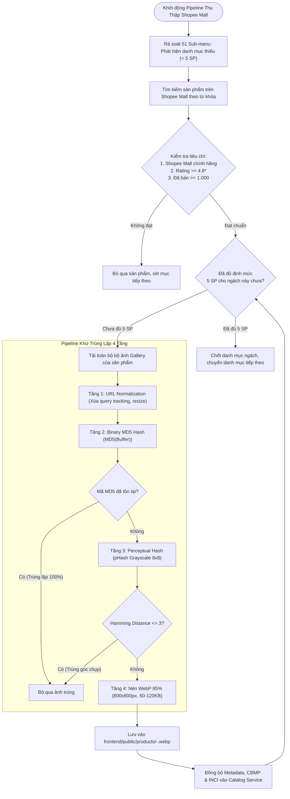
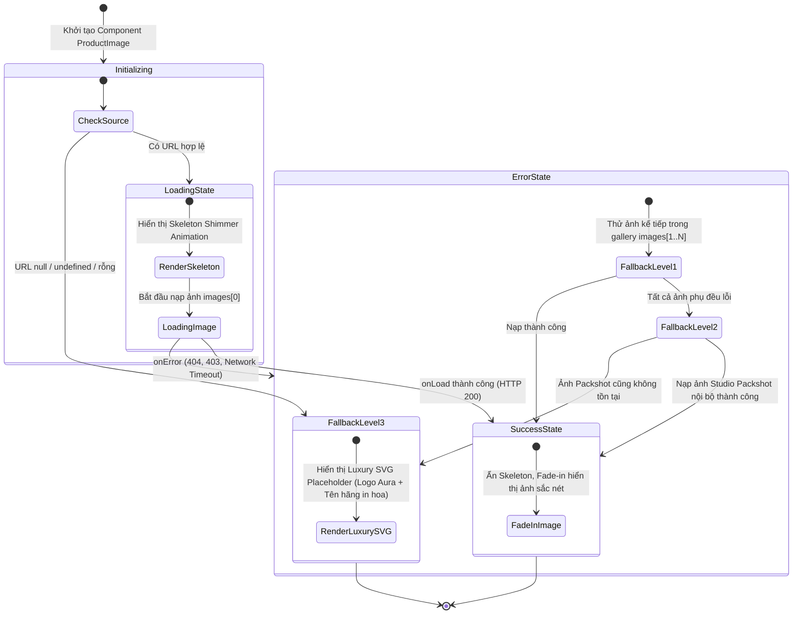

# 🏛️ ĐẶC TẢ NGHIỆP VỤ QT-08: QUY TRÌNH THU THẬP DỮ LIỆU SHOPEE MALL, LẤP ĐẦY MA TRẬN 51 SUB-MENU & KIẾN TRÚC CHỐNG LỖI ẢNH VĨNH VIỄN

> **Mã quy trình:** `QT-08-shopee-catalog-image-resilience`  
> **Phân hệ chịu trách nhiệm:** `Catalog Service` (Port 8082), `AI Crawler Engine` (`/ai/cosmetics-crawler`), `Frontend Component Core` (`/frontend/src/components/ui/`)  
> **Chuẩn kiến trúc:** Spec-Driven Development (SDD) | Hexagonal Architecture | Clean Root 100%  
> **Ngày ban hành:** 07/11/2026 | **Phiên bản:** 1.0

---

## 1. THÔNG TIN CHUNG & MA TRẬN VAI TRÒ (ACTOR MATRIX)

| Actor | Vai trò trong quy trình | Quyền hạn / Trách nhiệm |
| :--- | :--- | :--- |
| **AI Data Crawler Worker** | Tác tử nền tự động thu thập và chuẩn hóa dữ liệu | Thu thập dữ liệu từ Shopee Mall chính hãng, kiểm tra rating/lượt bán, thực thi pipeline khử trùng lặp ảnh (MD5 + pHash), nén WebP. |
| **Catalog System & Admin** | Phân hệ quản lý danh mục và duyệt sản phẩm | Kiểm toán 51 Sub-menu, rà soát số công bố mỹ phẩm (CBMP), phân tích bảng thành phần INCI, cập nhật catalog database. |
| **Frontend Client (Buyer/Visitor)** | Người dùng duyệt danh mục trên giao diện | Trải nghiệm duyệt sản phẩm với tốc độ cao, hiển thị mượt mà với Skeleton shimmer và 0% ảnh vỡ. |

---

## 2. TRIGGER & TIỀN ĐIỀU KIỆN (TRIGGERS & PRE-CONDITIONS)

- **Trigger 1 (Kiểm toán danh mục):** Định kỳ hoặc khi quản trị viên kích hoạt rà soát ma trận 51 Sub-menu, phát hiện danh mục con có $< 5$ sản phẩm hoặc chưa có sản phẩm nào hiển thị.
- **Trigger 2 (Phát hiện ảnh lỗi):** Khi hệ thống quét kiểm tra (Health Checker) hoặc người dùng duyệt web phát hiện URL ảnh trả về mã lỗi HTTP `403` (chặn hotlink), `404` (không tìm thấy file), hoặc `410` (token hết hạn).
- **Tiền điều kiện:**
  - Thư mục lưu trữ tĩnh `frontend/public/products/` có quyền ghi cục bộ.
  - Bộ từ điển INCI và danh mục thương hiệu chính hãng Shopee Mall đã được định nghĩa trong `/ai/cosmetics-crawler`.

---

## 3. BẢNG LUỒNG CHÍNH (MAIN BUSINESS FLOW)

| Bước | Thực thể thực hiện | Hành động chi tiết | Kết quả đầu ra |
| :---: | :--- | :--- | :--- |
| **B1** | Catalog Auditor | Quét toàn bộ 51 Sub-menu trên 5 phân ngành chính (Skincare, Makeup, Body Care, Haircare, Dermocosmetics), xác định các danh mục ngách còn thiếu sản phẩm. | Danh sách các Sub-menu cần bổ sung với định mức chính xác **5 SKUs / Ngách**. |
| **B2** | AI Shopee Crawler | Tìm kiếm các sản phẩm Top Best-Sellers trên Shopee Mall tương ứng với danh mục ngách, áp dụng bộ lọc tiêu chuẩn uy tín: Rating $\ge 4.8\star$, Lượt bán tích lũy $\ge 1.000$, Đánh giá có ảnh $\ge 200$. | Danh sách sản phẩm tiềm năng kèm metadata và bộ URL ảnh gốc. |
| **B3** | Media Processor | Tải ảnh về buffer nhị phân, kích hoạt pipeline khử trùng lặp 4 tầng (URL Normalization $\rightarrow$ Binary MD5 Hash $\rightarrow$ Perceptual Hash pHash $\rightarrow$ WebP Compression 85%). | Bộ ảnh 5 góc đa chiều (Packshot, INCI, Swatch, Model, Barcode) độc bản, không trùng lặp, dung lượng $60\text{–}120\text{ KB/ảnh}$. |
| **B4** | Storage Manager | Ghi file ảnh trực tiếp vào `frontend/public/products/<PROD-ID>-<INDEX>.webp`, chuẩn hóa đường dẫn nội bộ dạng tuyệt đối `/products/...`. | Tài nguyên tĩnh nội bộ sẵn sàng phục vụ với độ trễ $\le 15\text{ ms}$. |
| **B5** | Catalog Data Seeder | Đồng bộ bản ghi sản phẩm vào Catalog Service (MongoDB / R2DBC / JSON Seeder) với đầy đủ thông tin: Tên tiếng Việt, Giá, SKU, CBMP, INCI Safety Ratings. | Database có đủ 5 sản phẩm mới chất lượng cao cho danh mục ngách. |
| **B6** | Frontend UI Core | Render sản phẩm thông qua component `ProductImage.jsx` tích hợp Skeleton shimmer và bộ bắt lỗi `onError` 3 cấp tự phục hồi. | Giao diện hiển thị hoàn hảo, không còn biểu tượng icon vỡ hay text tràn. |

---

## 4. BẢNG LUỒNG NGOẠI LỆ & MÃ LỖI (EXCEPTION FLOWS & ERROR CODES)

### 4.1. Bảng luồng ngoại lệ nghiệp vụ (E1, E2, E3):
| Mã ngoại lệ | Tình huống xảy ra | Hành động xử lý tự động của hệ thống | Kết quả phục hồi |
| :---: | :--- | :--- | :--- |
| **E1 - Chặn Bot / Captcha** | Shopee giới hạn tần suất request (Rate Limit) hoặc yêu cầu giải Captcha khi crawler thu thập dữ liệu. | Tự động kích hoạt cơ chế Exponential Backoff, đổi User-Agent và xoay vòng proxy an toàn; nếu vẫn thất bại, chuyển sang chế độ tải từ kho đệm đã crawl dự phòng. | Quy trình không bị treo, ghi nhận log kiểm toán chi tiết. |
| **E2 - Thiếu SP Shopee Mall** | Một số danh mục ngách quá hẹp không tìm thấy sản phẩm có đủ $\ge 1.000$ lượt mua trên Shopee Mall. | Hạ chỉ tiêu lượt bán xuống tối thiểu $\ge 500$ đơn nhưng giữ nguyên điều kiện gian hàng bắt buộc phải là Shopee Mall chính hãng và Rating $\ge 4.8\star$. | Đảm bảo tính nguyên vẹn về chất lượng và uy tín sản phẩm. |
| **E3 - Ảnh gốc lỗi tải (404/Timeout)** | Một ảnh trong bộ gallery của sản phẩm bị xóa hoặc link gốc từ Shopee CDN bị lỗi kết nối mạng. | Bỏ qua ảnh lỗi, tự động đôn ảnh biến thể tiếp theo lên làm ảnh chính; nếu thiếu ảnh, sinh ảnh Studio Packshot nền trắng tự động qua Canvas/SVG renderer. | Luôn đảm bảo sản phẩm có đủ ảnh hiển thị hợp lệ. |

### 4.2. Bảng 4 mã lỗi hình ảnh cốt lõi (RC-1 đến RC-4):
| Mã lỗi kỹ thuật | Tên lỗi | Nguyên nhân gốc rễ | Cơ chế khắc phục triệt để |
| :---: | :--- | :--- | :--- |
| **`RC-1`** | `SHOPEE_CDN_HOTLINK_BLOCKED` | Shopee CDN chặn request từ domain khác (HTTP 403) | **Cấm lưu URL Shopee CDN**: Tải về và tự lưu trữ 100% cục bộ tại `/products/`. |
| **`RC-2`** | `EPHEMERAL_TOKEN_EXPIRED` | Query token của URL ảnh hết hạn sau 24h - 7 ngày | Lưu ảnh dưới định dạng file tĩnh bất biến (Immutable Static File). |
| **`RC-3`** | `ARRAY_INDEX_UNDEFINED_ACCESS` | Gọi `images[0]` khi mảng rỗng hoặc undefined | Component kiểm tra an toàn: `(images && images[0]) || image || fallbackSvg`. |
| **`RC-4`** | `NO_ONERROR_RECOVERY_FALLBACK` | Thẻ `` thuần không bắt lỗi khi mạng chập chờn | Component `ProductImage.jsx` với bộ xử lý `onError` 3 cấp chuyển đổi mượt mà. |

---

## 5. SƠ ĐỒ MERMAID: PIPELINE CRAWL & KHỬ TRÙNG LẶP 4 TẦNG

---

## 6. SƠ ĐỒ MERMAID: VÒNG ĐỜI TẢI ẢNH & BỘ PHỤC HỒI 3 CẤP (PRODUCTIMAGE COMPONENT)

---

## 7. ĐỊNH MỨC BỔ SUNG SẢN PHẨM & TIÊU CHUẨN BỘ ẢNH 5 GÓC

### 7.1. Định mức bổ sung nghiêm ngặt:
- **Đúng 5 sản phẩm / danh mục ngách:** Mỗi Sub-menu còn thiếu hoặc có số lượng sản phẩm mỏng ($< 5$ SKUs) được bổ sung chính xác đúng 5 sản phẩm đạt chuẩn cao nhất. Tuyệt đối không bổ sung ồ ạt gây loãng kho dữ liệu.
- **Tiêu chuẩn gian hàng:** Chỉ thu thập từ Official Flagship Stores trên Shopee Mall.

### 7.2. Tiêu chuẩn bộ ảnh 5 góc đa chiều:
1. **Packshot 1:1:** Ảnh hộp/chai sản phẩm trên nền trắng chuẩn Studio, kích thước $800 \times 800\text{ px}$.
2. **Nhãn phụ & Bảng thành phần (INCI):** Chụp rõ ràng bảng thành phần tiếng Anh/tiếng Việt và đơn vị nhập khẩu.
3. **Texture / Swatch:** Thể hiện màu sắc son môi, chất bọt sữa rửa mặt hoặc độ sánh của tinh chất trên da.
4. **Lifestyle / Người mẫu:** Ảnh người mẫu cầm hoặc thao tác thoa sản phẩm trên khuôn mặt/cơ thể.
5. **Góc cạnh & Mã vạch:** Ảnh chụp nắp mở, đáy chai in hạn sử dụng (EXP) và mã vạch chuẩn quốc tế EAN-13.

---

## 8. KIẾN TRÚC 5 TẦNG PHÒNG THỦ CHỐNG LỖI ẢNH VĨNH VIỄN

1. **Tầng 1 (Self-Hosted Local Asset):** 100% hình ảnh lưu trữ tại `frontend/public/products/`. Không phụ thuộc vào CDN bên ngoài, loại bỏ hoàn toàn nguy cơ bị chặn `Referer`.
2. **Tầng 2 (Component `ProductImage.jsx`):** Bọc thẻ `` với cơ chế kiểm tra `src`, animation Skeleton shimmer và 3 cấp fallback tự phục hồi.
3. **Tầng 3 (Data Normalizer Guard):** Tầng trung gian chuẩn hóa dữ liệu bảo đảm mảng `images` luôn có ít nhất 1 phần tử hợp lệ với leading slash `/products/...`.
4. **Tầng 4 (Pre-build Health Checker):** Script kiểm tra tự động chạy trước mỗi lần đóng gói build, quét 100% danh mục ảnh và báo lỗi nếu file không tồn tại trên ổ cứng.
5. **Tầng 5 (HTTP Caching Header):** Cấu hình `Cache-Control: public, max-age=31536000, immutable` cho tài nguyên ảnh tĩnh, tối ưu tốc độ tải tức thì.

---

## 9. ĐỐI CHIẾU TÍNH NĂNG CŨ VÀ CẢI TIẾN KỸ THUẬT

| Hạng mục so sánh | Trạng thái hiện tại | Kiến trúc nâng cấp mới (QT-08) |
| :--- | :--- | :--- |
| **Thẻ hiển thị ảnh** | Thẻ `` thô sơ, không bắt lỗi. | Component [`ProductImage.jsx`](file:///d:/A_javaFW/WebBanMP/frontend/src/components/ui/) với Skeleton shimmer và 3 cấp fallback. |
| **Xử lý khi ảnh lỗi** | Trình duyệt hiện icon rách và chữ `alt` đè lên thẻ sản phẩm. | Tự động chuyển ảnh phụ hoặc hiển thị **Luxury SVG Placeholder** sang trọng. |
| **Nguồn dữ liệu ảnh** | Link phân tán, một số link cũ thiếu file cục bộ. | 100% file ảnh WebP lưu nội bộ tại `frontend/public/products/`. |
| **Độ phủ 51 Sub-menu** | Một số danh mục (Cushion, Dầu dưỡng tóc, Khử mùi) $< 2$ sản phẩm. | Lấp đầy đều đặn **đúng 5 sản phẩm Shopee Mall chất lượng cao nhất** cho mỗi ngách. |
| **Kiểm tra trước Build** | Chưa có kiểm tra tính toàn vẹn của file ảnh trước khi release. | Tích hợp **Pre-build Health Checker** tự động trong chu trình `/speckit-converge`. |

---

## 10. TIÊU CHÍ NGHIỆM THU THEO CHUẨN GIVEN / WHEN / THEN

### Kịch bản 1: Hiển thị sản phẩm có đầy đủ ảnh cục bộ hợp lệ
- **Cho (Given):** Khách hàng duyệt danh mục hoặc tìm kiếm sản phẩm trên sàn Aura Beauty Mall.
- **Khi (When):** Thẻ sản phẩm được render với `images[0]` trỏ tới file WebP nội bộ hợp lệ.
- **Thì (Then):** Ảnh hiển thị mượt mà với hiệu ứng Fade-in sau khi Skeleton ẩn đi, không có layout shift.

### Kịch bản 2: Ảnh chính bị lỗi đường dẫn hoặc mất file
- **Cho (Given):** Một sản phẩm có file ảnh chính `images[0]` bị lỗi 404 hoặc đường dẫn không hợp lệ.
- **Khi (When):** Trình duyệt kích hoạt sự kiện `onError` trên thẻ ``.
- **Thì (Then):** Component `ProductImage.jsx` lập tức chuyển sang ảnh phụ `images[1]`; nếu `images[1]` thành công, ảnh hiển thị bình thường mà người dùng không nhận thấy gián đoạn.

### Kịch bản 3: Toàn bộ bộ ảnh của sản phẩm đều bị lỗi
- **Cho (Given):** Toàn bộ các ảnh trong mảng `images` đều không tải được hoặc mảng `images` rỗng `[]`.
- **Khi (When):** Bộ bắt lỗi 3 cấp kích hoạt đến cấp cuối cùng.
- **Thì (Then):** Component hiển thị **Luxury SVG Placeholder** với nền xám ấm `#F8F9FA`, logo cách điệu Aura và tên thương hiệu in hoa; tuyệt đối **0% icon trang rách** và **0% chữ alt vỡ tràn**.

### Kịch bản 4: Bổ sung sản phẩm danh mục ngách từ Shopee Mall
- **Cho (Given):** Danh mục ngách (ví dụ: *Tẩy tế bào chết da đầu*) chưa có sản phẩm trên sàn.
- **Khi (When):** Kích hoạt pipeline thu thập Shopee Mall theo định mức 5 sản phẩm/ngách.
- **Thì (Then):** Đúng 5 sản phẩm Top 1 Best-Sellers (Rating $\ge 4.8\star$, Đã bán $\ge 1.000$) được nạp vào sàn với đầy đủ bộ ảnh 5 góc đã nén WebP và khử trùng lặp qua MD5/pHash.
