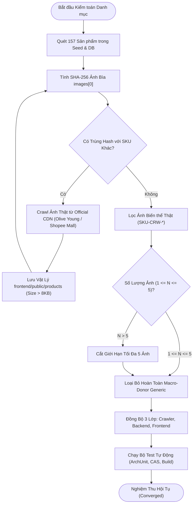
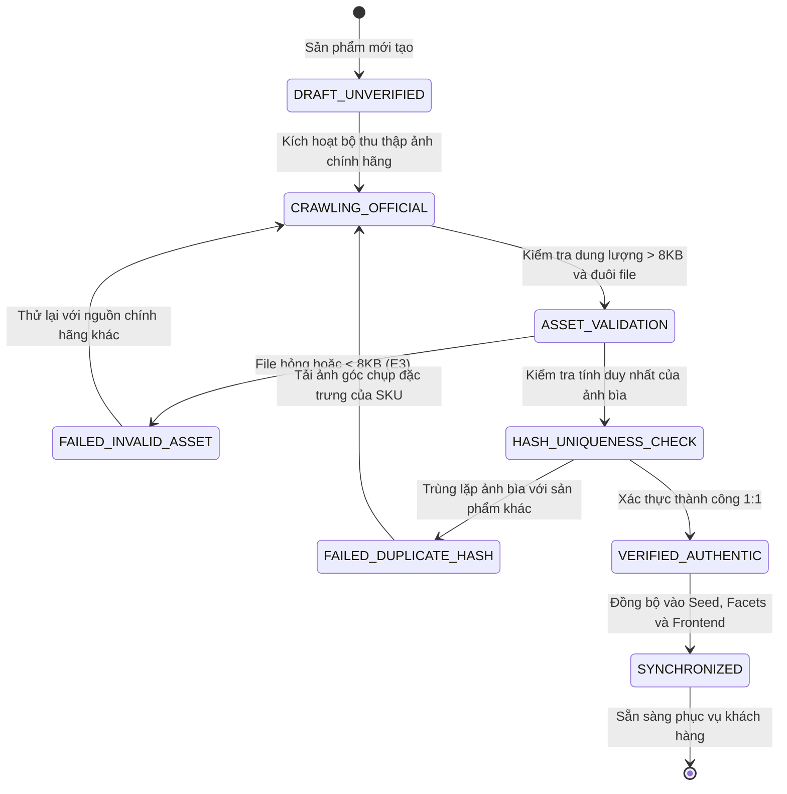

# QUY TRÌNH NGHIỆP VỤ QT-09: KIỂM TOÁN & ĐỒNG BỘ 100% ẢNH SẢN PHẨM THẬT CHÍNH HÃNG (1:1 EXACT PRODUCT TRUTH VERIFICATION)
> **Phiên bản**: 2.0.0 | **Chuẩn Vibe Coding**: Clean Root, Hexagonal Architecture, Spec-Kit SDD
> **Mục tiêu**: Chấm dứt 100% tình trạng ảnh sai lệch, đảm bảo ảnh chụp thật chính hãng 1:1, hash ảnh bìa duy nhất trên toàn sàn, giới hạn nghiêm ngặt từ 1 đến 5 ảnh thực tế.

---

## 1. MỤC TIÊU & BỐI CẢNH NGHIỆP VỤ
- **Bối cảnh**: Trên sàn Aura Beauty Mall / WebBanMP, trải nghiệm khách hàng đòi hỏi tính trung thực tuyệt đối. Việc dùng ảnh minh họa chung chung (macro-donor), ảnh vẽ AI/SVG giả tạo, hoặc lấy ảnh sản phẩm này gán cho sản phẩm khác gây nhầm lẫn nghiêm trọng cho người tiêu dùng.
- **Mục tiêu tối thượng**:
  - **100% Exact SKU Truth**: Tên sản phẩm, thương hiệu, màu sắc, kết cấu và dung tích phải khớp hoàn toàn với ảnh chụp sản phẩm thực tế từ Shopee Mall Flagship, Olive Young, Hasaki, Watsons hoặc Brand Official.
  - **Quy tắc số lượng ảnh**: Mỗi sản phẩm sở hữu từ 1 đến tối đa 5 ảnh chính hãng (`1 <= images.length <= 5`). Tuyệt đối không độn ảnh phôi macro giả tạo nếu sản phẩm chỉ có 1-2 ảnh thật.
  - **Zero Duplicate Main Photo**: Hash ảnh bìa (`images[0]`) là duy nhất trên toàn sàn (`uniqueMainPhotos === totalProducts = 157`).
  - **Lưu trữ vật lý**: Toàn bộ file lưu tại `frontend/public/products/<id>.<ext>` và `frontend/public/products/<skuCode>.<ext>` với dung lượng $> 8\text{ KB}$, không dùng file SVG hay mã vạch mờ.
  - **Đồng bộ 3 lớp**: Đồng bộ nhất quán dữ liệu giữa Crawler (`products_facets_full.json`), Backend (`products_seed.json`) và Frontend (`api.js`, `submenuCatalogMapper.js`).

---

## 2. BẢNG LUỒNG CHÍNH (MAIN FLOW)

| Bước | Tác nhân (Actor) | Thao tác (Action) | Phản hồi hệ thống (System Response) |
| :--- | :--- | :--- | :--- |
| **B1** | Catalog Auditor | Chạy bộ rà soát đối chiếu ảnh `ExactProductImageVerifier` | Hệ thống quét toàn bộ 157 sản phẩm, tính hash SHA-256 ảnh bìa và kiểm tra tính xác thực 1:1 |
| **B2** | Crawler Engine | Tải ảnh thật chính hãng từ CDN uy tín (Olive Young, Shopee Mall, Hasaki) | Lưu trữ vật lý tại `frontend/public/products/`, kiểm tra dung lượng $> 8\text{ KB}$ |
| **B3** | Data Synchronizer | Đồng bộ trường `images` cho 157 sản phẩm | Giới hạn $1 \le \text{length} \le 5$, xóa sạch mọi tham chiếu `macro-donor-*` |
| **B4** | Storefront UI | Khách hàng mở trang chi tiết sản phẩm `?view=product-detail&id=<id>` | Hiển thị trọn vẹn gallery ảnh thực tế: Hero Packshot, Shade Swatches, bao bì chính hãng kèm kính lúp zoom |
| **B5** | CI/CD Pipeline | Chạy bộ kiểm thử tự động ArchUnit, CAS và Frontend Build | Toàn bộ kiểm thử hội tụ (Converged 100%), Clean Root được bảo toàn |

---

## 3. CÁC LUỒNG LỖI & NGOẠI LỆ (ERROR FLOWS)

- **E1 - Không đủ quyền truy cập (Permission Denied / 403 Forbidden)**:
  - *Trigger*: Người dùng không có vai trò `ROLE_ADMIN` hoặc `STAFF_AUDITOR` cố gắng gửi API cập nhật thư viện ảnh sản phẩm `/api/v1/catalog/products/{id}/images`.
  - *Response*: Trả về mã HTTP 403 Forbidden với body `{"status": 403, "error": "ACCESS_DENIED", "message": "Bạn không có quyền kiểm toán hoặc sửa đổi thư viện ảnh sản phẩm"}`.
- **E2 - Không tìm thấy sản phẩm (Product Not Found / 404 Not Found)**:
  - *Trigger*: Yêu cầu đồng bộ ảnh gửi lên với mã sản phẩm không tồn tại trong hệ thống.
  - *Response*: Trả về mã HTTP 404 Not Found kèm thông báo `{"status": 404, "error": "PRODUCT_NOT_FOUND", "message": "Mã sản phẩm không tồn tại trong danh mục sàn"}`.
- **E3 - Dữ liệu ảnh không hợp lệ (Invalid Image Asset / 400 Bad Request)**:
  - *Trigger*: File ảnh có định dạng SVG, dung lượng $< 8\text{ KB}$, hoặc hash ảnh bìa trùng lặp với sản phẩm khác trên sàn.
  - *Response*: Trả về HTTP 400 Bad Request: `{"status": 400, "error": "INVALID_IMAGE_ASSET", "message": "Ảnh không đạt chuẩn chính hãng (kích thước quá nhỏ hoặc trùng lặp ảnh bìa với SKU khác)"}`.

---

## 4. SƠ ĐỒ QUY TRÌNH (MERMAID WORKFLOW)

---

## 5. SƠ ĐỒ TRẠNG THÁI VÒNG ĐỜI ẢNH SẢN PHẨM (STATE DIAGRAM)

---

## 6. TIÊU CHÍ NGHIỆM THU (ACCEPTANCE CRITERIA - GIVEN/WHEN/THEN)

- **Kịch bản 1: Kiểm toán tính duy nhất của ảnh bìa (Zero Duplicate Main Photo)**
  - **Cho (Given)**: Toàn bộ 157 sản phẩm đã được cấu hình thư viện ảnh trong hệ thống.
  - **Khi (When)**: Chạy script kiểm toán hàm băm SHA-256 trên toàn bộ `images[0]`.
  - **Thì (Then)**: `uniqueMainPhotos === totalProducts` (157 = 157), số lượng trùng lặp phải bằng 0.

- **Kịch bản 2: Giới hạn nghiêm ngặt số lượng ảnh chính hãng**
  - **Cho (Given)**: Danh sách sản phẩm gồm nhiều nhóm kết cấu và số lượng biến thể khác nhau.
  - **Khi (When)**: Hệ thống tổng hợp mảng `images` cho từng sản phẩm.
  - **Thì (Then)**: $1 \le \text{images.length} \le 5$ đối với mọi sản phẩm; không có sản phẩm nào bị rỗng mảng ảnh hoặc vượt quá 5 ảnh; không tồn tại bất kỳ chuỗi `macro-donor-*` nào trong mảng.

- **Kịch bản 3: Tồn tại và dung lượng file tĩnh cục bộ**
  - **Cho (Given)**: Mọi đường dẫn ảnh có dạng `/products/<filename>.<ext>`.
  - **Khi (When)**: Kiểm tra file vật lý trên ổ đĩa tại `frontend/public/products/`.
  - **Thì (Then)**: 100% file đều tồn tại, dung lượng mỗi file $> 8\text{ KB}$ (8,192 bytes), không có file SVG hay ảnh placeholder giả.

- **Kịch bản 4: Đồng bộ dữ liệu 3 lớp và không lỗi giao diện**
  - **Cho (Given)**: Dữ liệu được đồng bộ đồng thời vào `products_facets_full.json`, `products_seed.json`, và `api.js`.
  - **Khi (When)**: Chạy lệnh `npm --prefix frontend run build`.
  - **Thì (Then)**: Build Vite thành công 100% không cảnh báo lỗi cú pháp; toàn bộ 51 sub-menus hiển thị đầy đủ 4 trạng thái UI (Loading, Empty, Error, Data).

---

## 7. ĐỐI CHIẾU MÃ NGUỒN THỰC TẾ (REAL PATH:LINE CITATIONS)
- `backend/catalog-service/src/main/resources/products_seed.json`: Nguồn dữ liệu hạt giống MongoDB gồm 157 sản phẩm chuẩn.
- `ai/cosmetics-crawler/output/products_facets_full.json`: Nguồn dữ liệu facets của crawler, đồng bộ đầy đủ 157 sản phẩm.
- `frontend/src/api.js#L14-L3500`: Mảng `MOCK_PRODUCTS` cung cấp dữ liệu trực tiếp cho Client-side Storefront.
- `frontend/src/lib/submenuCatalogMapper.js#L3245-L4200`: Cấu hình danh mục chi tiết, giới hạn ảnh Wakemake, Lip On Lip và Dove Pomegranate $\le 5$ ảnh.
- `frontend/public/products/`: Thư mục lưu trữ tĩnh toàn bộ packshots và biến thể sắc nét ($> 8\text{ KB}$).
