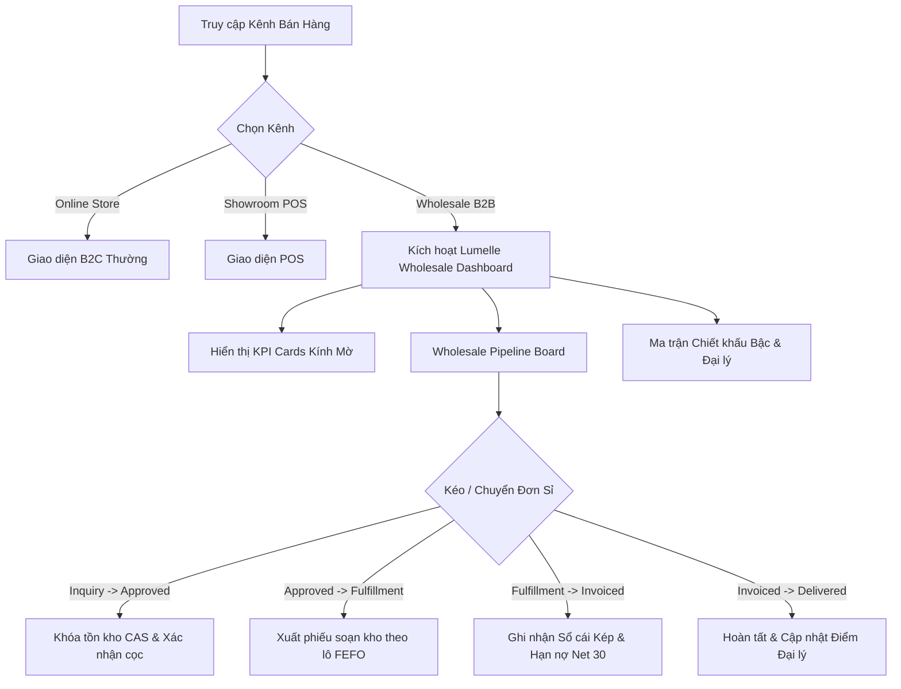
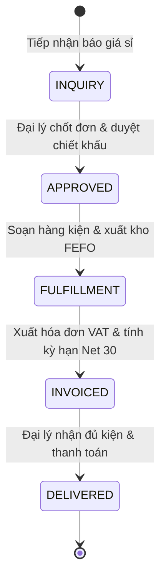

# QUY TRÌNH NGHIỆP VỤ QT-09: PHÂN HỆ DASHBOARD BÁN SỈ & KÊNH ĐA NĂNG (LUMELLE WHOLESALE CHANNEL DASHBOARD)
> **Phiên bản**: 1.0.0 | **Chuẩn Vibe Coding**: DDD + Luxury Frosted Glass iPhone Aesthetic (Code and Chill Lumelle)
> **Phạm vi tác động**: `frontend/src/components/WholesaleDashboard.jsx`, `frontend/src/components/SellerZone.jsx`, `frontend/src/hooks/useBrowserHistorySync.js`

---

## 1. MỤC TIÊU & BỐI CẢNH NGHIỆP VỤ
Tái hiện trung thực giao diện và hiệu ứng cao cấp của **Lumelle Dashboard (`/channels/wholesale`)**:
1. **Phong cách Kính mờ iPhone (Frosted Glass / Glassmorphism)**: Thẻ card trong suốt `backdrop-blur-xl`, viền mờ `border-white/30`, đổ bóng ánh kim mềm mại, bảng màu Luxury Monochrome kết hợp Rose/Emerald.
2. **Thanh chuyển kênh bán hàng (Channel Switcher)**: Chuyển đổi trạng thái giữa `Online Store (B2C)`, `Showroom/POS (Retail)` và `Wholesale (B2B)`.
3. **Wholesale KPI Metrics**: 4 thẻ chỉ số doanh thu sỉ, giá trị đơn bình quân (AOV), công nợ đại lý chờ thu (Net 30/60) và tỷ lệ tái đặt hàng (Reorder Rate).
4. **Wholesale Pipeline Board (Kanban 5 chặng)**: Luồng xử lý đơn sỉ trực quan:
   - `INQUIRY`: Mới tiếp nhận & Báo giá
   - `APPROVED`: Đã duyệt đơn & Nhận cọc B2B
   - `FULFILLMENT`: Đang soạn kiện hàng & Kiểm lô FEFO
   - `INVOICED`: Đã xuất hóa đơn & Chờ thanh toán công nợ
   - `DELIVERED`: Hoàn tất giao hàng cho đại lý / chuỗi Spa
5. **Ma trận chiết khấu theo bậc (Tier Pricing Matrix)** & **Danh bạ Đại lý B2B**.

---

## 2. BẢNG LUỒNG CHÍNH (MAIN FLOW)

| Bước | Tác nhân (Actor) | Thao tác (Action) | Phản hồi hệ thống (System Response) |
| :--- | :--- | :--- | :--- |
| **S1** | Người bán (Seller) | Chọn kênh "Bán sỉ (Wholesale)" trên thanh Channel Switcher | Giao diện kích hoạt hiệu ứng trượt mượt mà (Framer Motion), tải dữ liệu tổng quan B2B. |
| **S2** | Người bán | Xem các thẻ chỉ số KPI bán sỉ | Hiển thị 4 thẻ KPI kính mờ với NumberTicker và biểu đồ tăng trưởng. |
| **S3** | Người bán | Thao tác trên Pipeline Board (chuyển trạng thái đơn sỉ) | Thẻ đơn hàng di chuyển mượt mà giữa các cột, cập nhật số dư công nợ và trạng thái kho. |
| **S4** | Người bán | Nhấn nút "+ Tạo Đơn Sỉ Mới" | Mở Modal kính mờ, tự động tính chiết khấu theo số lượng (Tier Discount), kiểm tra tồn kho CAS. |
| **S5** | Người bán | Xem ma trận bảng giá chiết khấu sỉ & danh bạ đại lý | Đối chiếu hạn mức tín dụng (Credit Limit), tải hóa đơn mẫu B2B VAT. |

---

## 3. CÁC LUỒNG LỖI & NGOẠI LỆ (EXCEPTION FLOWS)

- **E1 - Không đủ quyền hạn (Forbidden Access)**: Khách vãng lai hoặc tài khoản BUYER truy cập kênh Wholesale $\rightarrow$ Hệ thống hiển thị Modal chặn quyền kèm hướng dẫn đăng nhập tài khoản SELLER/ADMIN.
- **E2 - Đại lý vượt quá hạn mức công nợ (Credit Limit Exceeded)**: Tạo đơn sỉ khi công nợ hiện tại + giá trị đơn mới > Hạn mức tín dụng $\rightarrow$ Bật cảnh báo màu hổ phách, yêu cầu thanh toán công nợ cũ hoặc duyệt ngoại lệ.
- **E3 - Tồn kho sỉ không đủ số lượng tối thiểu MOQ (Stock Insufficient)**: Số lượng đặt vượt quá tồn kho khả dụng $\rightarrow$ Cảnh báo tức thì, gợi ý đặt trước (Backorder) hoặc giảm số lượng.

---

## 4. SƠ ĐỒ QUY TRÌNH (MERMAID)

---

## 5. TIÊU CHÍ NGHIỆM THU (ACCEPTANCE CRITERIA)
- **Cho (Given)**: Người dùng đăng nhập tài khoản SELLER hoặc truy cập tab Bán sỉ.
- **Khi (When)**: Mở giao diện Wholesale Dashboard hoặc chuyển đổi kênh.
- **Thì (Then)**:
  1. Hiệu ứng Frosted Glass (backdrop-blur-xl, border-white/30, soft glow) render chuẩn 60 FPS, không giật lag.
  2. Bảng Pipeline Board hiển thị đủ 5 chặng, cho phép tương tác chuyển trạng thái đơn hàng.
  3. Có đầy đủ 4 trạng thái (Loading, Empty, Error, Data), không bao giờ trắng trang.
  4. Các thao tác tạo đơn, xuất hóa đơn đều có phản hồi trực quan (Toast, disabled + spinner).
