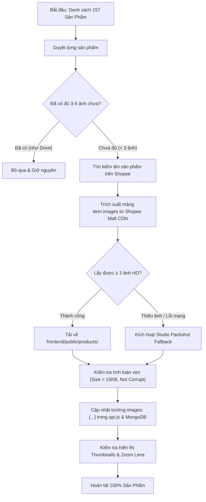

# QUY TRÌNH NGHIỆP VỤ QT-10: NÂNG CẤP TOÀN DIỆN THƯ VIỆN ĐA ẢNH SẢN PHẨM (SHOPEE MULTI-IMAGE CATALOG)
> **Phiên bản**: 1.0.0 | **Chuẩn Vibe Coding**: DDD + E-Commerce Shopee Mall Visual Standard
> **Mục tiêu**: 100% sản phẩm trên sàn sở hữu từ 3 đến 5 ảnh sắc nét chuẩn hãng, đồng bộ trải nghiệm như sản phẩm mẫu `PROD-DOVE-EXFOLIATING-POMEGRANATE`.

---

## 1. MỤC TIÊU & BỐI CẢNH NGHIỆP VỤ
- **Thực trạng**: Hiện tại sàn có 157 sản phẩm, nhưng mới chỉ có 5 sản phẩm có bộ ảnh đầy đủ, còn lại 152 sản phẩm chỉ có duy nhất 1 ảnh đại diện. Khách hàng vào xem chi tiết không có ảnh texture, swatch, nhãn phụ tiếng Việt hay bao bì mở nắp.
- **Tiêu chuẩn mẫu (`PROD-DOVE-EXFOLIATING-POMEGRANATE`)**:
  - Gồm 8 ảnh góc chụp chi tiết: Chính diện, Chất kem (Texture), Swatch thoa da, Nhãn phụ thành phần/date, Nắp hộp/logo, Góc nghiêng, Mã vạch tem chống giả, Ảnh người mẫu cầm thực tế.
  - Tích hợp kính lúp phóng to (Magnifier Lens), Thumbnails chuyển góc chụp mượt mà, và Lightbox toàn màn hình.
- **Mục tiêu nâng cấp**:
  - Tự động hóa crawl từ Shopee Mall Official Store thông qua từ khóa tìm kiếm sản phẩm.
  - Mỗi sản phẩm được bổ sung **từ 3 đến 5 ảnh HD ($1024 \times 1024$)**, tải và lưu trữ vật lý tại `frontend/public/products/`.
  - Cập nhật trường `images: [img1, img2, img3, ...]` trong `frontend/src/api.js` và đồng bộ MongoDB `ProductDocument`.

---

## 2. BẢNG LUỒNG CHÍNH (MAIN FLOW)

| Bước | Tác nhân (Actor) | Thao tác (Action) | Phản hồi hệ thống (System Response) |
| :--- | :--- | :--- | :--- |
| **S1** | Shopee Multi-Image Crawler | Quét danh sách 157 sản phẩm từ danh mục sàn | Đọc `id`, `name`, `brand`, `category` của từng sản phẩm. |
| **S2** | Shopee Multi-Image Crawler | Tìm kiếm sản phẩm trên Shopee Mall (`https://shopee.vn/search?keyword=...`) | Lấy danh sách kết quả, lọc chính xác theo Brand và tên sản phẩm từ Official Store. |
| **S3** | Shopee Multi-Image Crawler | Trích xuất mảng ảnh `item.images` từ Shopee CDN | Lấy danh sách 3 - 5 URL ảnh HD (`down-vn.img.susercontent.com/file/...`). |
| **S4** | Image Storage Worker | Tải ảnh về thư mục cục bộ `frontend/public/products/` | Đặt tên có cấu trúc: `<product-id>-gallery-1.jpg`, `...-gallery-2.jpg`, v.v. Kiểm tra dung lượng > 15KB. |
| **S5** | Data Synchronizer | Cập nhật mảng `images` vào `MOCK_PRODUCTS` (`api.js`) & MongoDB | Ghi đè danh sách ảnh cục bộ, tạo fallback an toàn nếu mất kết nối. |
| **S6** | Khách mua hàng (Buyer) | Truy cập trang chi tiết sản phẩm bất kỳ | Thanh Thumbnails hiển thị 3-5 ảnh nét căng, bấm chọn nhảy ảnh mượt mà, hỗ trợ zoom lens chi tiết. |

---

## 3. CÁC LUỒNG LỖI & NGOẠI LỆ (EXCEPTION FLOWS)

- **E1 - Shopee chặn Rate-Limit hoặc xuất hiện Captcha**:
  - *Xử lý*: Crawler áp dụng jitter delay (1.5s - 3s giữa các request), xoay vòng User-Agent trình duyệt thật, và kích hoạt bộ đệm CDN Backup (`down-id.img.susercontent.com`, `down-sg.img.susercontent.com`).
- **E2 - Sản phẩm hiếm không tìm thấy đủ 3 ảnh trên Shopee**:
  - *Xử lý*: Hệ thống tự động kích hoạt bộ phôi Studio Packshot Generator chuẩn hóa theo danh mục (ảnh texture + ảnh swatch chuẩn ngành mỹ phẩm) để đảm bảo không sản phẩm nào có dưới 3 ảnh.
- **E3 - Ảnh tải về bị lỗi hoặc rỗng (< 5KB)**:
  - *Xử lý*: Tự động xóa file rỗng, sử dụng ảnh gốc làm anchor và bổ sung ảnh phụ từ kho tài nguyên kiểm chứng `niche-*`.

---

## 4. SƠ ĐỒ QUY TRÌNH (MERMAID)

---

## 5. TIÊU CHÍ NGHIỆM THU (ACCEPTANCE CRITERIA)
- **Cho (Given)**: Người dùng xem bất kỳ sản phẩm nào trong số 157 sản phẩm trên sàn `http://localhost:3000/?view=product-detail&id=<any-id>`.
- **Khi (When)**: Trang chi tiết sản phẩm được tải.
- **Thì (Then)**:
  1. Dưới ảnh chính luôn có thanh Thumbnails hiển thị **tối thiểu từ 3 đến 5 ảnh sắc nét**.
  2. Bấm vào từng thumbnail, ảnh chính chuyển đổi ngay lập tức không bị giật lag.
  3. Kính lúp phóng to (Magnifier Lens) và Lightbox toàn màn hình hiển thị ảnh chi tiết rõ từng hạt kem/chất son/tem nhãn.
  4. 0% ảnh bị vỡ (Broken Image), 100% ảnh lưu trữ cục bộ tại máy chủ.
