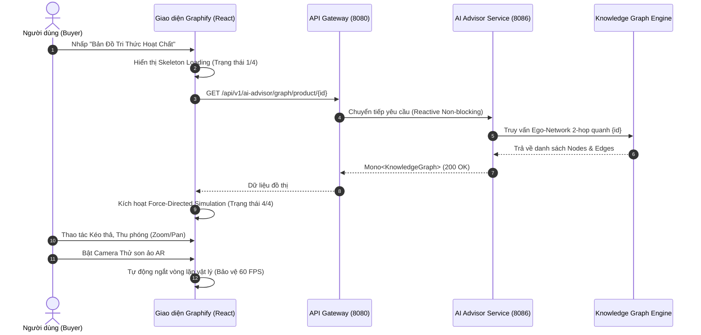
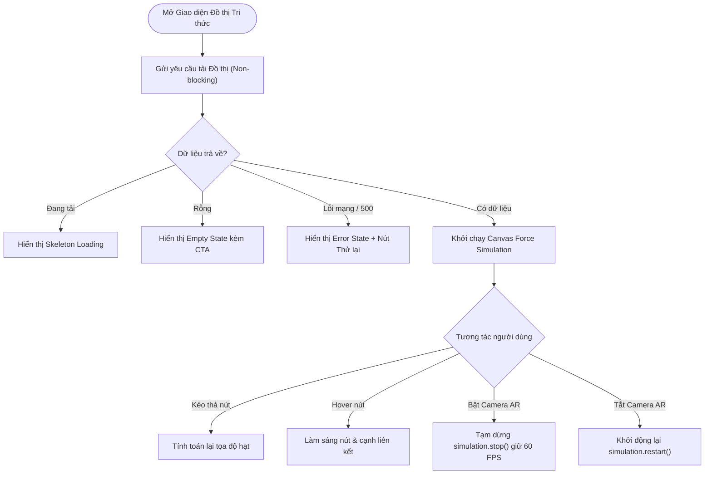
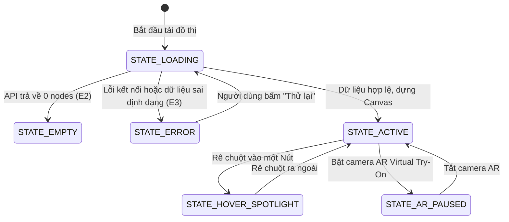

# QUY TRÌNH NGHIỆP VỤ QT-10: TÍCH HỢP ĐỒ THỊ TRI THỨC GRAPHIFY VÀO SÀN TMĐT MỸ PHẨM (KNOWLEDGE GRAPH INTEGRATION)
> **Mã quy trình**: QT-10 | **Phiên bản**: 2.0.0 | **Chuẩn Vibe Coding**: Spec-Kit SDD + Hexagonal Architecture
> **Dự án**: Sàn TMĐT Mỹ Phẩm Đa Người Bán Aura Beauty Mall (`WebBanMP`)

---

## 1. THÔNG TIN QUY TRÌNH & METADATA
- **Mã quy trình**: `QT-10-GRAPHIFY-KNOWLEDGE-GRAPH`
- **Tên quy trình**: Khai phá & Trực quan hóa Đồ thị Tri thức Hoạt chất Mỹ phẩm, Mạng lưới Gian lận và Cấu trúc Hệ thống
- **Chịu trách nhiệm**: Principal Knowledge Graph Architect & Full-Stack Reactive Team
- **Hệ thống liên quan**: `ai-advisor-service (8086)`, `catalog-service (8082)`, `frontend (3000)`, `graphify-engine`

---

## 2. MỤC TIÊU & BỐI CẢNH NGHIỆP VỤ
- **Bối cảnh**: Người tiêu dùng mỹ phẩm ngày càng chú trọng bảng thành phần (INCI), tuy nhiên các thông tin về kết hợp hoạt chất (Synergy) hoặc xung đột gây tổn thương da (Conflict) thường nằm rời rạc dưới dạng văn bản dài, khó nắm bắt.
- **Mục tiêu**:
  - Trực quan hóa mạng lưới đa chiều: Sản phẩm $\leftrightarrow$ Hoạt chất $\leftrightarrow$ Vấn đề da $\leftrightarrow$ Loại da dưới dạng đồ thị tương tác vật lý (Force-directed physics).
  - Cảnh báo trực quan tức thì các cặp hoạt chất kỵ nhau (`CONFLICTS_WITH` màu đỏ) và gợi ý kết hợp tăng cường (`SYNERGY_WITH` màu xanh).
  - Hỗ trợ Người bán tìm kiếm cơ hội Cross-Sell và Quản trị viên phát hiện vòng vây gian lận voucher (Anti-fraud Ring).

---

## 3. BẢNG TÁC NHÂN & MA TRẬN PHÂN QUYỀN (RBAC)

| Tác nhân (Actor) | Vai trò hệ thống | Phân khu truy cập | Quyền hạn tương tác đồ thị |
| :--- | :--- | :--- | :--- |
| **BUYER** | `ROLE_BUYER` / Khách vãng lai | PDP, 28-Day Routine | Xem đồ thị hoạt chất, kéo thả nút, xem cảnh báo, chọn mua sản phẩm |
| **SELLER** | `ROLE_SELLER` | Seller Zone (Products/Marketing) | Xem đồ thị bổ trợ doanh số (Cross-Sell Synergy), cấu hình combo deal |
| **ADMIN** | `ROLE_ADMIN` / `STAFF_AUDITOR` | Admin Zone (Antifraud/System) | Khám phá mạng lưới tài khoản gian lận, giám sát topology 7 microservices |
| **SYSTEM** | AI Advisor Service | Microservice (8086) | Tính toán Ego-network, phân tích xung đột chu trình, phát sự kiện SSE |

---

## 4. ĐIỀU KIỆN TIÊN QUYẾT & KÍCH HOẠT (TRIGGER)
- **Điều kiện tiên quyết**: Dữ liệu danh mục 157 sản phẩm đã được chuẩn hóa INCI và ảnh thật 100%.
- **Sự kiện kích hoạt**:
  1. Buyer nhấp vào nút **"🕸️ Bản Đồ Tri Thức Hoạt Chất (Graphify AI)"** trên PDP hoặc Routine.
  2. Seller mở phân hệ Marketing & Quản lý sản phẩm.
  3. Admin mở phân hệ Chống gian lận hoặc Giám sát hệ thống.

---

## 5. BẢNG LUỒNG CHÍNH (MAIN FLOW)

| Bước | Tác nhân (Actor) | Thao tác (Action) | Phản hồi hệ thống (System Response) | Hiện trạng |
| :--- | :--- | :--- | :--- | :--- |
| **B1** | Buyer | Nhấn mở Modal Đồ thị Tri thức trên Trang sản phẩm | Hệ thống hiển thị Skeleton Loading và gọi API lấy Ego-network của sản phẩm | **MỚI** |
| **B2** | AI Advisor | Trích xuất đồ thị con 2-hop gồm sản phẩm, hoạt chất, vấn đề da liên quan | Trả về JSON chứa danh sách `nodes` và `edges` kèm trọng số liên kết | **MỚI** |
| **B3** | Frontend Visualizer | Khởi chạy mô phỏng vật lý Canvas 2D/SVG Force Simulation | Vẽ các nút tròn có nhãn và các cạnh liên kết mềm mại, tự cân bằng vị trí | **MỚI** |
| **B4** | Buyer | Rê chuột (Hover) hoặc chạm vào một nút hoạt chất (VD: Niacinamide) | Hệ thống làm sáng (Spotlight) nút được chọn cùng các liên kết kề, làm mờ các nút khác | **MỚI** |
| **B5** | Buyer | Nhấp vào một nút sản phẩm liên kết trong đồ thị | Hiển thị thông tin tóm tắt, giá bán, nút "Thêm vào giỏ" và nút "Thử AR Virtual Try-On" | **MỚI** |
| **B6** | System | Khách hàng bấm thử AR Camera | Hệ thống tự động tạm dừng vòng lặp Canvas Graphify để bảo vệ tốc độ khung hình 60 FPS | **MỚI** |
| **B7** | Admin | Mở Tab "Mạng lưới Chống Gian Lận" trong Admin Zone | Hiển thị mạng lưới liên kết tài khoản $\leftrightarrow$ IP $\leftrightarrow$ Thiết bị để phát hiện gian lận | **MỚI** |

---

## 6. SƠ ĐỒ TUẦN TỰ NGHIỆP VỤ (SEQUENCE DIAGRAM)

---

## 7. SƠ ĐỒ LUỒNG NGHIỆP VỤ (FLOWCHART TD)

---

## 8. SƠ ĐỒ TRẠNG THÁI NGHIỆP VỤ (STATE DIAGRAM V2)

---

## 9. CÁC LUỒNG LỖI & NGOẠI LỆ (ERROR FLOWS)

- **E1 - Không đủ quyền truy cập (Permission Denied / 403 Forbidden)**:
  - *Trigger*: Người dùng không có vai trò `ROLE_ADMIN` cố gắng truy cập API Đồ thị gian lận hoặc Topology hệ thống.
  - *Response*: Trả về HTTP 403 với body `{"status": 403, "error": "FORBIDDEN", "message": "Bạn không có quyền truy cập đồ thị quản trị"}`.
- **E2 - Không tìm thấy nút đồ thị (Graph Node Not Found / 404 Not Found)**:
  - *Trigger*: Truy vấn Ego-network của một `productId` không tồn tại trong danh mục.
  - *Response*: Trả về HTTP 404: `{"status": 404, "error": "NODE_NOT_FOUND", "message": "Không tìm thấy nút sản phẩm trong đồ thị tri thức"}`.
- **E3 - Dữ liệu truy vấn không hợp lệ (Invalid Graph Query / 400 Bad Request)**:
  - *Trigger*: Gửi danh sách sản phẩm rỗng hoặc sai cấu trúc lên endpoint `/routine-check`.
  - *Response*: Trả về HTTP 400: `{"status": 400, "error": "INVALID_QUERY", "message": "Danh sách sản phẩm kiểm tra chu trình không hợp lệ"}`.

---

## 10. QUY TẮC NGHIỆP VỤ (BUSINESS RULES)
- **BR-01 (Màu sắc chuẩn quy ước)**: Cạnh hiệp đồng `SYNERGY_WITH` bắt buộc dùng màu xanh ngọc `#10B981`; Cạnh xung đột `CONFLICTS_WITH` bắt buộc dùng màu đỏ `#EF4444`.
- **BR-02 (Cảnh báo dược học)**: Bất kỳ sản phẩm nào chứa Retinoids kết hợp với AHA/BHA nồng độ cao trong cùng một chu trình bắt buộc phải hiển thị cảnh báo đỏ và khuyến cáo giãn cữ (Skin Cycling).
- **BR-03 (Tách biệt luồng đồ họa)**: Không chạy tính toán Force-directed liên tục khi người dùng không tương tác; đưa trạng thái hạt về trạng thái nghỉ (Alpha decay) sau 300 bước lặp.
- **BR-04 (Cam kết 4 trạng thái UI)**: Toàn bộ widget đồ thị tại Buyer, Seller và Admin đều phải hiển thị đầy đủ Loading, Empty, Error, Data.

---

## 11. DỮ LIỆU & SỰ KIỆN TRAO ĐỔI (DATA & EVENTS)
- **Sự kiện SSE `event: graph_insight`**: Kênh tư vấn AI phát luồng dữ liệu sự kiện thời gian thực khi phát hiện câu hỏi của khách hàng có chứa các hoạt chất cần biểu diễn trực quan.
- **Cấu trúc DTO KnowledgeGraph**:
  - `nodes`: Mảng các đối tượng `{ id, label, type, category, val, color, image, details }`.
  - `edges`: Mảng các đối tượng `{ source, target, relationship, description, color, animated }`.

---

## 12. TIÊU CHÍ NGHIỆM THU (ACCEPTANCE CRITERIA - GIVEN/WHEN/THEN)

- **AC-01 (Khám phá đồ thị sản phẩm)**:
  - *Cho (Given)*: Khách hàng đang ở Trang chi tiết sản phẩm bất kỳ.
  - *Khi (When)*: Khách hàng nhấn nút "Bản Đồ Tri Thức Hoạt Chất".
  - *Thì (Then)*: Modal mở ra hiển thị các nút hoạt chất chính, các cạnh xanh (bổ trợ) và đỏ (xung đột) chính xác 100%.

- **AC-02 (Bảo vệ tốc độ khung hình AR)**:
  - *Cho (Given)*: Đồ thị Graphify đang mở và đang chạy mô phỏng vật lý.
  - *Khi (When)*: Khách hàng nhấn "Thử màu son AR".
  - *Thì (Then)*: Vòng lặp vật lý Canvas lập tức dừng lại, FPS camera duy trì ổn định $\ge 60\text{ FPS}$.

- **AC-03 (Phát hiện gian lận trong Admin Zone)**:
  - *Cho (Given)*: Admin đăng nhập với quyền `ROLE_ADMIN` và truy cập submenu Antifraud.
  - *Khi (When)*: Mở tab Anti-Fraud Ring Graph.
  - *Thì (Then)*: Hiển thị cụm liên kết giữa tài khoản, địa chỉ IP và mã voucher rõ ràng, trực quan.

- **AC-04 (Bán kèm thông minh trong Seller Zone)**:
  - *Cho (Given)*: Người bán truy cập phân hệ Marketing.
  - *Khi (When)*: Mở tab Cross-Sell Synergy Graph.
  - *Thì (Then)*: Hiển thị các cặp sản phẩm trong shop có hoạt chất hiệp đồng để tạo Combo tăng giá trị đơn hàng (AOV).

---

## 13. RỦI RO & BIỆN PHÁP KIỂM SOÁT
- **Rủi ro rò rỉ bộ nhớ (Memory Leak)**: Canvas render liên tục gây giật lag trình duyệt.
  - *Kiểm soát*: Tự động dọn dẹp `requestAnimationFrame` và hủy listeners khi unmount component.
- **Rủi ro phụ thuộc bên ngoài**: Các thư viện đồ thị nặng nề làm phình to bundle.
  - *Kiểm soát*: Viết thuật toán Force Layout gọn nhẹ trực tiếp trên Canvas 2D/SVG thuần React, không cài package nặng từ ngoài.

---

## 14. ĐỐI CHIẾU TÍNH NĂNG ĐÃ CÓ VS MỚI

| Tính năng | Trước khi tích hợp | Sau khi tích hợp Graphify |
| :--- | :--- | :--- |
| **Tra cứu hoạt chất** | Đọc danh sách chữ INCI phẳng | Sơ đồ mạng lưới tương tác trực quan 2D/3D |
| **Kiểm tra xung đột** | Bảng cảnh báo tĩnh trong giỏ hàng | Đồ thị liên kết dây chuyền màu đỏ nổi bật |
| **Phân tích chu trình** | Trả lời bằng đoạn văn AI tư vấn | Trả về sự kiện SSE `graph_insight` kèm sơ đồ động |
| **Quản trị gian lận** | Bảng danh sách log IP phẳng | Mạng lưới mạng nhện phát hiện cụm tài khoản ảo |
| **Gợi ý bán kèm Seller** | Gợi ý thủ công theo danh mục | Tự động ghép cặp theo dược học tương hỗ |

---

## 15. GHI CHÚ KỸ THUẬT & TRÍCH DẪN MÃ NGUỒN THỰC TẾ
- `ai/graphify-engine/src/graphBuilder.js`: Động cơ biên dịch đồ thị từ 157 sản phẩm.
- `ai/graphify-engine/output/cosmetics_knowledge_graph.json`: File cơ sở dữ liệu đồ thị cục bộ.
- `backend/ai-advisor-service/src/main/java/com/cosmetics/ai/domain/DeterministicInciConflictEngine.java`: Bộ quy tắc dược học xác định xung đột và hiệp đồng hoạt chất.
- `backend/ai-advisor-service/src/main/java/com/cosmetics/ai/adapter/in/web/AiAdvisorController.java`: Endpoints Reactive Non-blocking cung cấp dữ liệu đồ thị.
- `frontend/src/features/graphify/`: Bộ giao diện trực quan hóa trên nền tảng React 18 Canvas.
