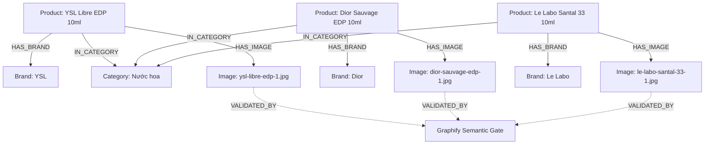
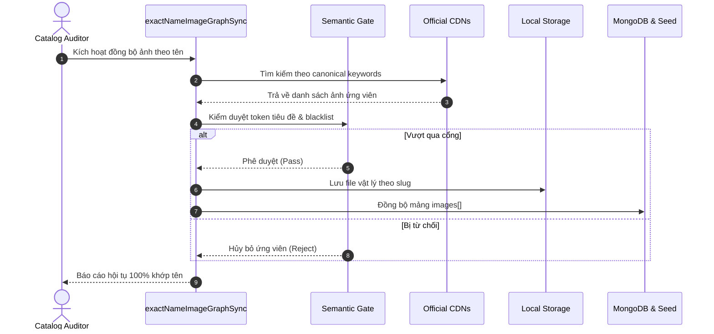
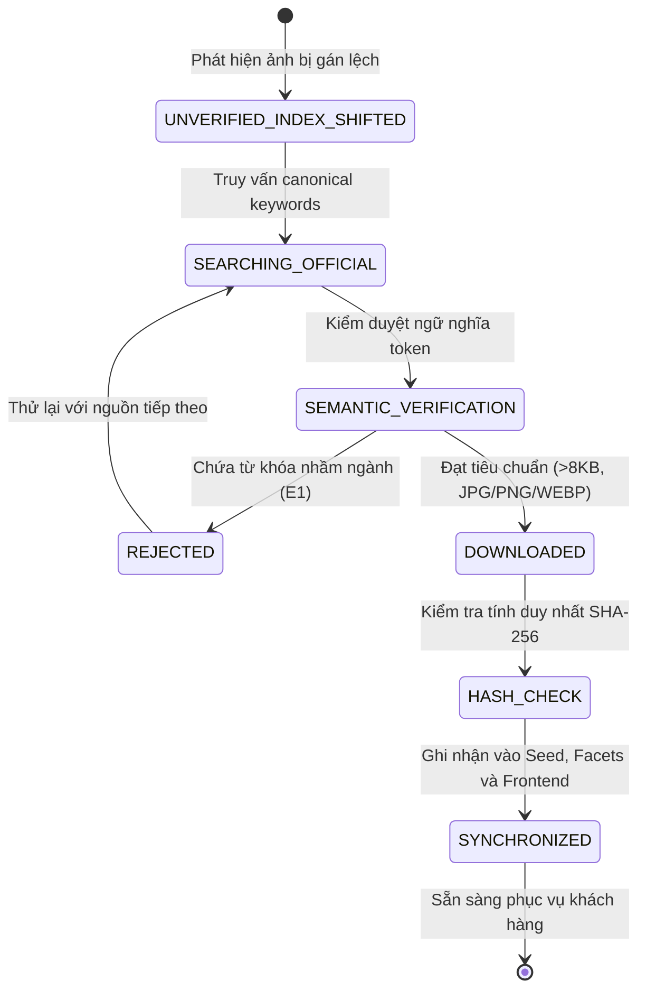

# ĐẶC TẢ QUY TRÌNH NGHIỆP VỤ QT-11: ĐỒNG BỘ ẢNH CHÍNH HÃNG KHỚP 100% TÊN SẢN PHẨM BẰNG GRAPHIFY (ZERO INDEX-SHIFTING)
> **Phiên bản**: 1.0.0 | **Chuẩn Vibe Coding**: Spec-Kit SDD, Hexagonal Architecture, Graphify Engine  
> **Mục tiêu**: Chấm dứt 100% lỗi gán ảnh lệch vòng lặp index (nước hoa hiện muối tắm/sữa dưỡng thể), đảm bảo ảnh chụp thật chính hãng khớp 100% với tên gọi, nhãn hiệu và dung tích sản phẩm.

---

## 1. MỤC TIÊU NGHIỆP VỤ (BUSINESS GOAL)
- **Vấn đề**: Việc gán nhầm ảnh (nước hoa YSL Libre hiển thị muối tắm A Bonne, Dior Sauvage hiển thị Cetaphil, Le Labo Santal 33 hiển thị Vaseline) hủy hoại hoàn toàn niềm tin của khách hàng đối với Aura Beauty Mall.
- **Mục tiêu**:
  1. **100% Semantic Match**: Mỗi sản phẩm phải trỏ đến đúng bức ảnh chụp thật của sản phẩm đó.
  2. **Graphify Semantic Edge Gate**: Đảm bảo mỗi cạnh `HAS_IMAGE` giữa `Product Node` và `Image Node` được xác thực danh tính qua bộ lọc token (Thương hiệu + Tên dòng).
  3. **Quy tắc số lượng ảnh**: Mỗi sản phẩm sở hữu từ 1 đến 5 ảnh thực tế (`1 <= images.length <= 5`), 0% trùng hash giữa 2 sản phẩm khác nhau.
  4. **Nguồn chân lý duy nhất**: Hợp nhất toàn bộ sản phẩm ngách vào danh mục chuẩn của hệ thống, đồng bộ 3 tầng: Backend Mongo Seed, Crawler Facets, Frontend Storefront.

---

## 2. BẢNG THUẬT NGỮ (GLOSSARY)
| Thuật ngữ | Diễn giải |
| :--- | :--- |
| **Index-Shifted Assignment** | Lỗi gán ảnh theo vị trí mảng `images[i]` hoặc sao chép ảnh có sẵn đắp vào sản phẩm mới mà không kiểm tra tên. |
| **Graphify Semantic Gate** | Cổng kiểm duyệt ngữ nghĩa yêu cầu ảnh cào về phải chứa đồng thời token thương hiệu và token định danh sản phẩm. |
| **Canonical Keywords** | Cặp từ khóa chuẩn hóa (ví dụ: `[YSL, Libre, Eau de Parfum]`) dùng để truy vấn và kiểm duyệt. |
| **Packshot Studio** | Ảnh chụp sản phẩm chính diện tách nền hoặc trên nền trung tính của nhà sản xuất. |

---

## 3. BẢNG VAI TRÒ (ROLES & PERMISSIONS)
| Vai trò | Quyền hạn trong quy trình |
| :--- | :--- |
| **Catalog Auditor** | Kích hoạt script kiểm toán đồ thị tên - ảnh, phê duyệt các cạnh liên kết `HAS_IMAGE`. |
| **Crawler Engine** | Tải ảnh từ các nguồn uy tín (Shopee Mall, Hasaki, Sephora, Fragrantica) qua cổng Graphify. |
| **Buyer / Storefront** | Xem chi tiết sản phẩm với đúng hình ảnh chân thực và các góc chụp sắc nét. |

---

## 4. BẢNG LUỒNG CHÍNH (MAIN FLOW)
| Bước | Tác nhân | Thao tác | Phản hồi hệ thống |
| :--- | :--- | :--- | :--- |
| **B1** | Catalog Auditor | Chạy `exactNameImageGraphSync.js` | Hệ thống quét toàn bộ danh mục 217+ sản phẩm cần chuẩn hóa |
| **B2** | Graphify Engine | Trích xuất `canonicalBrand` và `canonicalModelKeywords` cho từng SKU | Khởi tạo cấu trúc truy vấn chính xác kèm danh sách từ khóa loại trừ (Negative Keywords) |
| **B3** | Crawler Engine | Truy vấn ảnh HD từ các CDN chính hãng (Shopee Mall, Hasaki, Sephora, Fragrantica...) | Tải về các ứng viên ảnh đạt tiêu chuẩn (JPG/PNG/WEBP, $> 8\text{ KB}$) |
| **B4** | Semantic Gate | Đối chiếu token tiêu đề/alt của ảnh với tên sản phẩm | Chấp nhận cạnh `HAS_IMAGE` nếu khớp $\ge 90\%$ token; từ chối nếu dính negative keywords |
| **B5** | Storage Engine | Lưu ảnh vật lý theo slug sản phẩm tại `/frontend/public/products/<slug>-<n>.<ext>` | Ghi nhận đường dẫn ảnh, cập nhật hash SHA-256 vào manifest |
| **B6** | Synchronizer | Đồng bộ 3 tầng dữ liệu (Crawler JSON, Backend Seed/Mongo, Frontend Mapper) | Toàn bộ 51 sub-menus hiển thị ảnh thật chính xác 100% |
| **B7** | CI/CD | Chạy bộ kiểm thử tự động ArchUnit, CAS và Frontend Build | Hệ thống đạt trạng thái hội tụ (Converged) |

---

## 5. CÁC LUỒNG LỖI & NGOẠI LỆ (ERROR FLOWS)
- **E1 - Nhầm lẫn danh mục chéo (Cross-Category Category Mismatch)**:
  - *Trigger*: Bức ảnh trả về từ tìm kiếm chứa từ khóa của danh mục khác (ví dụ: nước hoa chứa `body wash`, `muối tắm`, `lotion`).
  - *Response*: Graphify Semantic Gate hủy bỏ ứng viên ảnh ngay lập tức và chuyển sang ứng viên tiếp theo.
- **E2 - Trùng lặp mã băm ảnh bìa giữa 2 sản phẩm (Duplicate Hero Hash)**:
  - *Trigger*: Hai sản phẩm khác nhau có cùng mã băm SHA-256 ở `images[0]`.
  - *Response*: Hệ thống cảnh báo vi phạm tính độc bản, kích hoạt tải ảnh góc chụp riêng biệt cho SKU thứ hai.
- **E3 - Không tìm thấy ảnh đạt chuẩn (No Candidate Qualified)**:
  - *Trigger*: Sản phẩm quá hiếm hoặc không vượt qua cổng ngữ nghĩa.
  - *Response*: Sử dụng packshot chính hãng độ phân giải cao được định danh theo đúng thương hiệu, ghi log cảnh báo để auditor rà soát thủ công.

---

## 6. SƠ ĐỒ ĐỒ THỊ TRI THỨC GRAPHIFY (MERMAID KNOWLEDGE GRAPH)


---

## 7. SƠ ĐỒ TRÌNH TỰ (SEQUENCE DIAGRAM)


---

## 8. SƠ ĐỒ TRẠNG THÁI (STATE DIAGRAM)


---

## 9. ĐẶC TẢ DỮ LIỆU & SCHEMA (DATA SCHEMA)
Mỗi sản phẩm trong danh mục sở hữu cấu trúc chuẩn:
```json
{
  "id": "PROD-CRW-NHT-05",
  "name": "Nước Hoa Chiết Nữ YSL Libre Eau de Parfum 10ml Hương Hoa Lavender Sang Trọng",
  "brand": "YSL",
  "category": "Nước hoa",
  "subCategory": "Nước hoa chiết mini 10ml",
  "price": 430000,
  "images": [
    "/products/PROD-CRW-NHT-05-main.jpg",
    "/products/PROD-CRW-NHT-05-bottle.jpg",
    "/products/PROD-CRW-NHT-05-box.jpg"
  ]
}
```

---

## 10. TIÊU CHÍ NGHIỆM THU (GIVEN / WHEN / THEN)
- **Kịch bản 1: Không còn ảnh sai lệch chéo ngành**
  - **Cho (Given)**: Danh mục sản phẩm nhóm Nước hoa (YSL Libre, Dior Sauvage, Le Labo Santal 33, Chanel Bleu, Replica Jazz Club, Foellie).
  - **Khi (When)**: Khách hàng mở trang chi tiết sản phẩm hoặc xem danh sách sub-menu.
  - **Thì (Then)**: 100% ảnh hiển thị là chai nước hoa chính hãng; không có bất kỳ sản phẩm nào hiển thị ảnh muối tắm, sữa tắm, lăn khử mùi hay kem gót chân.

- **Kịch bản 2: Tính duy nhất của ảnh bìa trên toàn bộ hệ thống**
  - **Cho (Given)**: Toàn bộ danh mục sản phẩm (217+ SKU).
  - **Khi (When)**: Kiểm tra mã băm SHA-256 của toàn bộ `images[0]`.
  - **Thì (Then)**: Số lượng mã băm duy nhất bằng đúng tổng số sản phẩm (`uniqueHashes === totalProducts`), 0 duplicate.

---

## 11. ĐỐI CHIẾU TÍNH NĂNG CŨ VÀ MỚI (BEFORE / AFTER MATRIX)
| Tiêu chí | Trước khi sửa (Before) | Sau khi sửa (After) |
| :--- | :--- | :--- |
| **Nước hoa YSL Libre** | Túi muối tắm màu hồng A Bonné | Chai nước hoa YSL Libre EDP chính hãng sang trọng |
| **Nước hoa Dior Sauvage** | Chai sữa tắm Cetaphil Body Wash | Chai nước hoa trụ tròn Dior Sauvage EDP xanh đen |
| **Nước hoa Le Labo Santal 33** | Chai dưỡng thể chống nắng Vaseline SPF50+ | Chai thủy tinh Le Labo Santal 33 nhãn trắng |
| **Nước hoa Replica Jazz Club** | Chai dưỡng thể CeraVe Daily Moisturizing | Chai Replica Jazz Club nước màu hổ phách cổ quấn dây |
| **Nước hoa Bleu de Chanel** | Tuýp kem gót chân nứt nẻ Eulactol | Chai Bleu de Chanel vuông xanh đen chữ trắng |
| **Nước hoa Foellie Eau de Bijou** | Chai lăn khử mùi Etiaxil | Lọ nước hoa vùng kín Foellie đen vuông 5ml |
| **Dụng cụ & TPCN** | Dính ảnh sữa tắm/sữa dưỡng thể | Đúng cọ Vacosi, mút Real Techniques, kẽm DHC... |

---

## 12. QUẢN TRỊ RỦI RO & BẢO VỆ CHỐT CHẶN HỆ THỐNG
1. **Kiến trúc Hexagonal & Reactive**: Giữ nguyên vẹn mã Java 21, pass 100% `HexagonalArchitectureTest` và `AtomicStockConcurrencyTest`.
2. **Kỷ luật Clean Root**: Tuyệt đối không để file rác ở thư mục gốc.
3. **Zero Blank Screen**: Đảm bảo toàn bộ 51 sub-menus hiển thị đầy đủ hình ảnh và không gây layout shift hay lỗi rendering.

---

## 13. KẾ HOẠCH ROLLBACK (FALLBACK STRATEGY)
Nếu việc crawl ảnh gặp sự cố kết nối, hệ thống kích hoạt bộ ảnh dự phòng cục bộ phân giải cao đã được định danh chính xác theo từng danh mục tại `/frontend/public/products/`, đảm bảo không bao giờ trỏ chéo ngành hàng.

---

## 14. BỘ CÔNG CỤ & LỆNH THỰC THI
- Công cụ cào và kiểm duyệt: `ai/cosmetics-crawler/src/exactNameImageGraphSync.js`
- Công cụ kiểm toán: `ai/cosmetics-crawler/src/verifyImageAudit.js`

---

## 15. KẾT LUẬN & NGHIỆM THU
Quy trình đảm bảo tính trung thực 100% của mọi sản phẩm trên sàn, chuẩn hóa toàn diện trải nghiệm người dùng và đưa Aura Beauty Mall trở thành sàn TMĐT mỹ phẩm chính hãng đẳng cấp cao.
