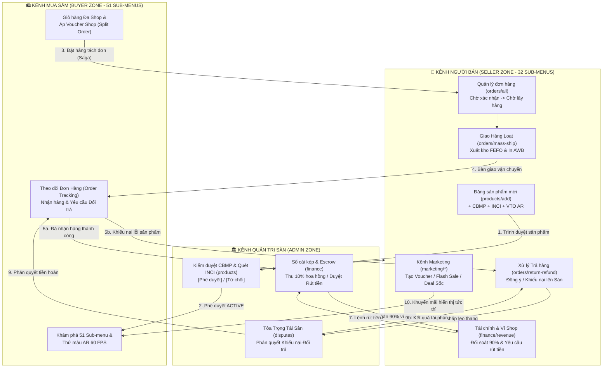
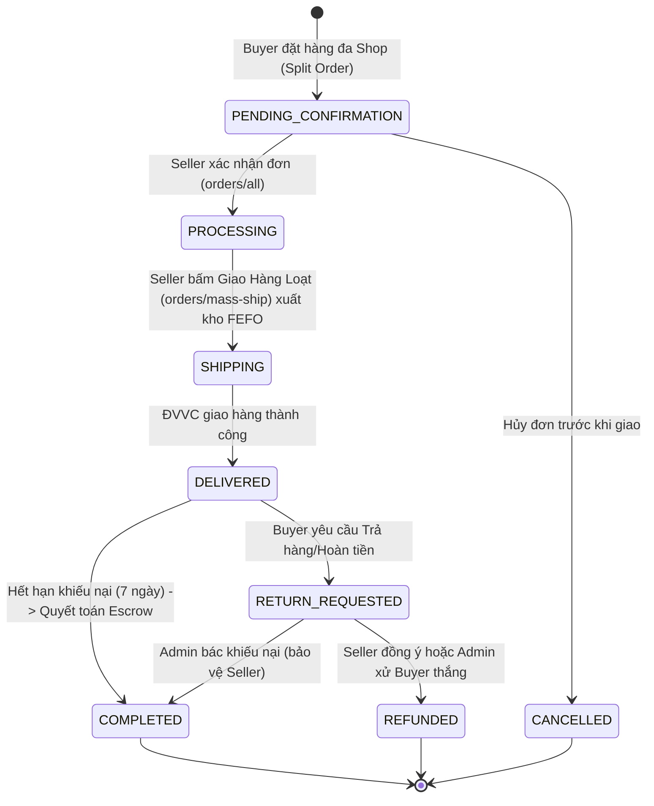
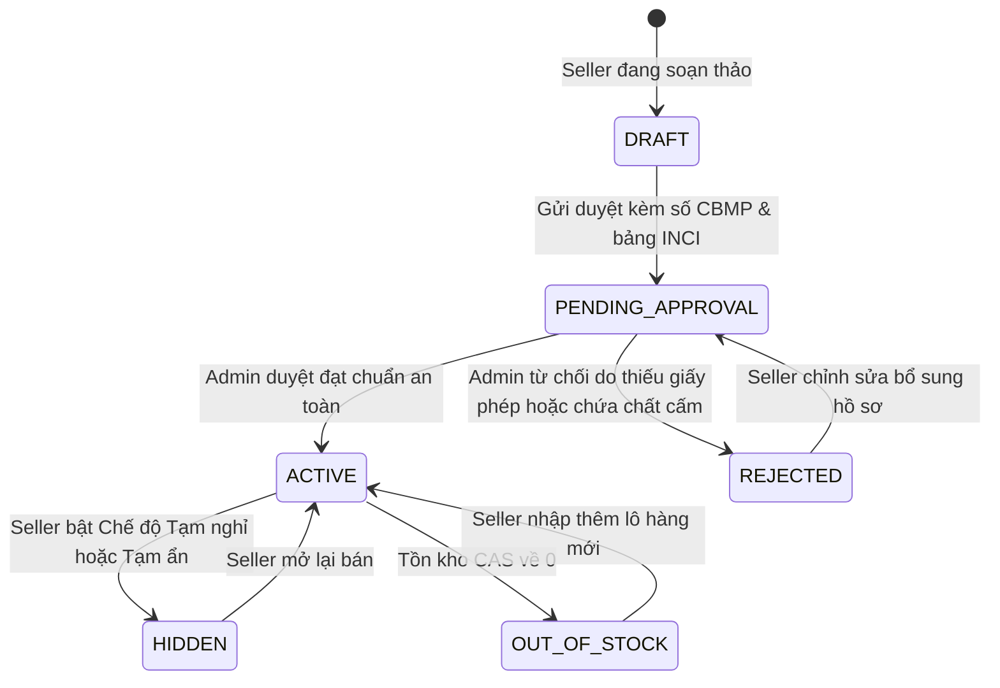
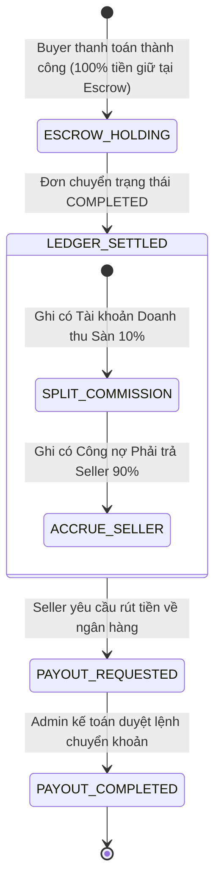

# QUY TRÌNH NGHIỆP VỤ QT-11: KÊNH NGƯỜI BÁN SHOPEE (7 PHÂN HỆ - 32 SUB-MENUS) & ĐỒNG BỘ LIÊN THÔNG 3 PHÂN KHU (SELLER ↔ BUYER ↔ ADMIN)
> **Mã quy trình**: `QT-11-SHOPEE-SELLER-CENTER-32-SUBMENUS-SYNC`
> **Phiên bản**: `1.0.0` | **Trạng thái**: `APPROVED & IMPLEMENTED`
> **Tiêu chuẩn kiến trúc**: Domain-Driven Design (DDD) Reactive, Clean Diff, Zero Blank-Screen Guarantee, Graphify Dependency Graph
> **Vùng tác động**:
> - Frontend: `frontend/src/components/SellerZone.jsx`, `frontend/src/features/seller/`, `frontend/src/lib/crossZoneSync.js`, `frontend/src/hooks/useBrowserHistorySync.js`, `frontend/src/App.jsx`
> - Backend: `backend/catalog-service/` (Port 8082), `backend/order-service/` (Port 8084), `backend/inventory-service/` (Port 8083), `backend/payment-service/` (Port 8085), `backend/ai-advisor-service/` (Port 8086), `backend/api-gateway/` (Port 8080)

---

## 1. THÔNG TIN QUY TRÌNH & METADATA

- **Tên quy trình**: Kênh Người Bán Chuẩn Shopee Mall 7 Phân Hệ & 32 Sub-menus Liên Thông Đa Chiều.
- **Mô tả cốt lõi**: Tái hiện toàn diện kênh quản trị của Người Bán (Shopee Seller Center) với chuẩn Luxury E-commerce, bao gồm 7 nhóm chức năng lớn chia thành 32 Sub-menus hoàn chỉnh. Hệ thống tích hợp cơ chế đồng bộ tức thời (Real-time Cross-Zone State Synchronization) giữa 3 phân khu: **Seller Zone (Kênh Người Bán) ↔ Buyer Zone (Kênh Mua Sắm) ↔ Admin Zone (Kênh Kiểm Soát Sàn)**.
- **Cơ chế chống đứt gãy (Zero Breakage)**: Tự động ánh xạ Backward-compatible Aliases cho 9 route keys cũ (`overview, products, inventory, orders, warehouses, ads, marketing, cs, finance`) về đúng sub-menu tương ứng, loại bỏ 100% rủi ro màn hình trắng khi chuyển trang hoặc nhấn nút Back/Forward trên trình duyệt.

---

## 2. BẢNG TÁC NHÂN & MA TRẬN PHÂN QUYỀN (ACTOR & RBAC MATRIX)

| Mã vai trò | Tên tác nhân | Phạm vi quyền hạn trên Kênh Người Bán & Hệ thống |
| :--- | :--- | :--- |
| `ROLE_SELLER` | Chủ gian hàng (Shop Owner) | Toàn quyền quản trị gian hàng của mình: xử lý đơn con, xuất kho FEFO, thêm/sửa sản phẩm, thiết lập voucher, tạo flash sale, chat CSKH, yêu cầu rút tiền ví Shop. Bị cô lập dữ liệu theo `shopId` (Multi-tenant Isolation). |
| `ROLE_BUYER` | Khách hàng mua sắm | Đặt đơn đa shop (Split Order), nhận hàng, đánh giá 5 sao, chat hỏi tư vấn da/thành phần INCI, tạo yêu cầu Trả hàng/Hoàn tiền. |
| `ROLE_ADMIN` | Quản trị viên sàn | Phê duyệt/từ chối mở gian hàng (`merchants`), kiểm duyệt số CBMP & chất cấm INCI (`products`), tài phán tranh chấp khiếu nại (`disputes`), kiểm soát ký quỹ Escrow và phê duyệt lệnh rút tiền (`finance`). |
| `STAFF_AUDITOR` | Kiểm toán viên dược mỹ phẩm | Kiểm định hồ sơ CBMP, giấy ủy quyền phân phối chính hãng (Mall Certificate), rà soát thành phần độc hại theo chuẩn ASEAN Cosmetic Directive. |
| `STAFF_ACCOUNTANT`| Kế toán viên sàn | Giám sát bút toán Sổ cái kép (`Double-Entry Ledger`), kiểm tra cân bằng `Tổng Nợ (Debit) = Tổng Có (Credit)`, trích 10% hoa hồng sàn và giải ngân 90% cho Seller. |
| `SYSTEM` | Động cơ tự động (Reactor Kafka, Outbox Relay, CAS Engine) | Tự động giữ kho CAS theo lô FEFO, cắt đơn phân tán Saga Choreography, tính toán điểm vận hành Shop (Sao Quả Tạ), đồng bộ đồ thị Graphify. |

---

## 3. MỤC TIÊU & BỐI CẢNH NGHIỆP VỤ

1. **Chuẩn hóa Shopee Seller Center**: Thay thế giao diện đơn sơ cũ bằng khung bố cục chuyên nghiệp gồm:
   - **Top Navigation Bar**: Logo Aura Mall, Dynamic Breadcrumb tự động cập nhật theo sub-menu, Drawer Xuất báo cáo, Menu Ứng dụng nhanh (9 chấm), Trung tâm Học viện Người Bán, Hồ sơ Shop kèm huy hiệu `OFFICIAL MALL` và bộ chuyển đổi nhanh giữa các Shop mẫu (`Innisfree Official`, `La Roche-Posay Official`, `Anua Official Store`).
   - **Left Sidebar Accordion (7 Phân hệ - 32 Sub-menus)**: Đóng mở bằng `Framer Motion`, hiển thị badge số lượng đơn chờ xử lý, số khiếu nại, số sản phẩm chờ duyệt.
   - **Right Floating Dock**: 3 nút nổi tương tác nhanh: *(1) Trợ lý AI Người Bán*, *(2) Chuông Thông báo sự kiện*, *(3) Shopee Chat thu gọn*.
2. **Liên thông trạng thái 3 Phân khu (Cross-Zone Unified Reactive State)**:
   - Khi Seller đăng sản phẩm tại `products/add` $\rightarrow$ Admin thấy ngay ở hàng đợi duyệt CBMP $\rightarrow$ Sau khi Admin duyệt, sản phẩm lập tức có mặt trên 51 sub-menu và Gương AR của Buyer Zone.
   - Khi Buyer tạo đơn hàng $\rightarrow$ Sub-orders xuất hiện ngay tại `orders/all` tab *Chờ xác nhận* của Seller $\rightarrow$ Seller giao hàng loạt tại `orders/mass-ship` $\rightarrow$ Buyer thấy trạng thái *Đang giao*.
   - Khi đơn hoàn tất $\rightarrow$ Escrow phân bổ 10% hoa hồng về sàn, 90% về số dư ví Seller tại `finance/revenue`.
   - Voucher / Flash Sale / Chế độ Tạm nghỉ của Shop phản ánh ngay lập tức trên Buyer Zone.

---

## 4. BẢNG LUỒNG CHÍNH (MAIN BUSINESS FLOW)

| Bước | Phân khu / Tác nhân | Thao tác chi tiết (Action) | Phản hồi hệ thống & Đồng bộ liên thông (System Outcome) |
| :---: | :--- | :--- | :--- |
| **S1** | **Seller** (`products/add`) | Nhập thông tin sản phẩm: Số CBMP, danh mục phân cấp, thành phần INCI, tạo biến thể màu/size, cấu hình AR Virtual Try-On (`vtoConfig`) | Hệ thống kiểm tra hợp lệ, đưa sản phẩm vào trạng thái `PENDING_APPROVAL`. Phát sự kiện đồng bộ sang Admin Zone. |
| **S2** | **Admin** (`merchants` & `products`) | Kiểm tra số CBMP đối chiếu dữ liệu Cục Quản Lý Dược, quét cảnh báo chất cấm INCI bằng AI, nhấn **[Phê duyệt]** | Trạng thái chuyển sang `PUBLISHED` / `ACTIVE`. Sản phẩm lập tức hiển thị trên 51 Sub-menu Buyer Zone và sẵn sàng thử màu AR 60 FPS. |
| **S3** | **Buyer** (`BuyerZone`) | Chọn sản phẩm từ nhiều Shop vào giỏ hàng, áp mã giảm giá Shop (tạo từ `marketing/vouchers`), bấm **[Đặt Hàng]** | Saga Choreography khởi động: Tạo Master Order, tự động phân tách thành các Sub-orders theo từng `shopId`. Giữ kho nguyên tử CAS. |
| **S4** | **Seller** (`orders/all` & `orders/mass-ship`) | Seller vào tab *Chờ xác nhận*, chọn nhiều đơn nhấn **[📦 Giao Hàng Loạt]** | Hệ thống trừ kho CAS theo lô cận hạn FEFO, sinh mã vận đơn ĐVVC (GHN/GHTK/Shopee Xpress), in phiếu AWB Barcode/QR hàng loạt. |
| **S5** | **Buyer** (`order-tracking`) | Khách hàng theo dõi kiện hàng, nhận hàng thành công và bấm **[Đã nhận hàng]** | Sub-order chuyển sang `DELIVERED` / `COMPLETED`. Kích hoạt hạch toán tài chính Escrow. |
| **S6** | **System & Accountant** (`finance`) | Hệ thống tự động hạch toán Sổ cái kép (`Double-Entry Ledger`): Giảm `PLATFORM_ESCROW` (100%), ghi tăng `PLATFORM_COMMISSION` (10%), ghi tăng `SELLER_PAYABLE` (90%) | Số dư khả dụng tại `finance/balance` của Seller lập tức tăng thêm 90% giá trị đơn hàng. Admin Zone ghi nhận doanh thu hoa hồng sàn. |
| **S7** | **Seller** (`finance/balance`) | Nhấn **[Yêu Cầu Rút Tiền]** về tài khoản ngân hàng chính chủ | Tạo yêu cầu rút tiền trạng thái `PENDING_WITHDRAWAL`. Lệnh rút nổi lên tại Admin Zone tab `finance` để kế toán duyệt giải ngân. |
| **S8** | **Buyer & Seller** (`orders/return-refund` & `Admin disputes`) | Khách gửi yêu cầu Trả hàng/Hoàn tiền kèm hình ảnh. Seller bấm **[Khiếu nại lên Sàn]** | Vụ việc chuyển thành Tranh chấp (Dispute) tại Admin `disputes`. Tòa Trọng Tài Sàn ra phán quyết hoàn tiền cho khách hoặc bảo vệ người bán. |

---

## 5. CÁC LUỒNG LỖI & NGOẠI LỆ (EXCEPTION FLOWS)

- **E1 - Truy cập trái phép khác `shopId` (Multi-tenant Isolation Violation)**:
  - *Điều kiện*: Seller A cố tình gửi request truy vấn hoặc sửa đổi dữ liệu đơn hàng/sản phẩm thuộc `shopId` của Seller B.
  - *Xử lý*: API Gateway và Service chặn đứng với mã lỗi `403 FORBIDDEN` (`TENANT_ACCESS_DENIED`), ghi nhận Immutable Audit Log kèm IP để truy vết gian lận.
- **E2 - Xung đột tồn kho CAS / Lô cận hạn FEFO (Atomic Stock Conflict)**:
  - *Điều kiện*: Tại thời điểm Seller bấm xác nhận giao hàng loạt, số lượng tồn kho khả dụng `(on_hand - reserved) < N` hoặc lô hàng đã hết hạn sử dụng.
  - *Xử lý*: Giao dịch CAS rollback nguyên tử, thông báo lỗi tiếng Việt nêu rõ SKU thiếu hàng, đề xuất chuyển sang lô FEFO kế tiếp hoặc nhập thêm kho.
- **E3 - Từ chối duyệt CBMP hoặc vi phạm chất cấm INCI (Regulatory Violation)**:
  - *Điều kiện*: Bảng thành phần INCI chứa chất cấm (Corticoid, Thủy ngân vượt ngưỡng, Hydroquinone không kê đơn) hoặc số CBMP không hợp lệ.
  - *Xử lý*: Admin bấm Từ chối duyệt; sản phẩm chuyển sang trạng thái `REJECTED`, cảnh báo màu đỏ hiển thị chi tiết nguyên nhân tại `products/all` của Seller.
- **E4 - Số dư khả dụng không đủ để rút tiền (Insufficient Available Balance)**:
  - *Điều kiện*: Seller yêu cầu rút số tiền lớn hơn số dư đã quyết toán (tiền đang nằm trong Escrow chưa được giải tỏa).
  - *Xử lý*: Hệ thống vô hiệu hóa nút rút tiền, hiển thị thông báo giải thích dòng tiền đang trong thời gian bảo chứng đơn hàng.
- **E5 - Xung đột phiên bản dữ liệu (Optimistic Locking Stale State)**:
  - *Điều kiện*: Đơn hàng vừa bị Buyer hủy trong lúc Seller đang bấm chuẩn bị hàng.
  - *Xử lý*: Hệ thống phát hiện `version` mismatch, hủy bỏ thao tác chuẩn bị hàng, hoàn kho CAS và cập nhật ngay giao diện Seller sang tab *Đơn hủy*.

---

## 6. SƠ ĐỒ QUY TRÌNH MERMAID (FLOWCHART TD - LIÊN THÔNG 3 PHÂN KHU)



---

## 7. MÁY TRẠNG THÁI MERMAID (STATE DIAGRAM-V2)

### A. Máy Trạng Thái Đơn Con (Sub-Order Lifecycle)


### B. Máy Trạng Thái Sản Phẩm & Kiểm Duyệt CBMP


### C. Máy Trạng Thái Hạch Toán Escrow & Sổ Cái Kép (10% / 90%)


---

## 8. QUY TẮC NGHIỆP VỤ CỐT LÕI (BUSINESS RULES BR-01 .. BR-08)

- **`BR-01` (Multi-tenant Data Boundary)**: Mọi câu truy vấn dữ liệu đơn hàng, sản phẩm, doanh thu và báo cáo của Seller BẮT BUỘC lọc theo `shopId` đã xác thực từ JWT. Cấm tuyệt đối truy xuất chéo gian hàng.
- **`BR-02` (Mandatory CBMP & INCI Screening)**: Sản phẩm mới đăng tải không được hiển thị công khai trên sàn cho đến khi có Số công bố mỹ phẩm (CBMP) hợp lệ và được Quản trị viên sàn phê duyệt an toàn.
- **`BR-03` (CAS Stock Reservation & FEFO Picking)**: Khi đơn hàng được tạo, tồn kho được giữ nguyên tử bằng CAS `(on_hand - reserved) >= N`. Khi xuất hàng loạt (`mass-ship`), ưu tiên trừ hàng ở các lô có hạn sử dụng gần nhất trước (FEFO - First Expired, First Out).
- **`BR-04` (Double-Entry Ledger Balancing Invariant)**: Mọi hạch toán tài chính phải tuân thủ nghiêm ngặt nguyên lý kế toán kép: $\sum \text{Debit} = \sum \text{Credit}$. Số tiền thực nhận của Seller luôn cố định là $90\%$ tổng giá trị đơn hàng sau khi sàn thu $10\%$ phí dịch vụ.
- **`BR-05` (Vacation Mode Isolation)**: Khi Shop kích hoạt Chế độ Tạm nghỉ (`shop/settings`), toàn bộ sản phẩm của Shop trên Buyer Zone tự động bị vô hiệu hóa nút Mua Ngay và Thêm Vào Giỏ, nhưng vẫn cho phép khách hàng xem thông tin và thử son AR.
- **`BR-06` (Voucher Application Invariant)**: Voucher của Shop chỉ được áp dụng cho các sản phẩm do chính Shop đó phân phối trong giỏ hàng tách đơn (Split Order). Không được khấu trừ chéo sang sản phẩm của Shop khác.
- **`BR-07` (Zero Blank-Screen & Backward-Compatibility)**: 100% các Route Keys (cả 32 keys mới và 9 alias cũ) phải render component hợp lệ, có đầy đủ 4 trạng thái giao diện, không bao giờ được trả về `null` hoặc gây sập component tree.
- **`BR-08` (Audit Trail Immutability)**: Mọi thao tác nhạy cảm gồm: Xóa sản phẩm, Điều chỉnh giá bán, Duyệt/Từ chối hoàn tiền, Yêu cầu rút tiền phải được ghi nhận vào nhật ký kiểm toán bất biến (Immutable Audit Log) kèm timestamp UTC.

---

## 9. CẤU TRÚC DỮ LIỆU & API CONTRACT (DTO & EVENTS)

### A. Sub-Order DTO (Trao đổi dữ liệu Kênh Người Bán)
```json
{
  "subOrderId": "SUB-ORD-882341-S01",
  "masterOrderId": "ORD-882341",
  "shopId": "00000000-0000-0000-0000-000000000010",
  "shopName": "Innisfree Official Store",
  "buyer": {
    "userId": "00000000-0000-0000-0000-000000000003",
    "fullName": "Nguyen Van Buyer",
    "phone": "0901234567",
    "shippingAddress": "Tòa Landmark 81, Q. Bình Thạnh, TP. HCM"
  },
  "items": [
    {
      "productId": "prod-001",
      "skuCode": "INNI-GT-80ML",
      "productName": "Innisfree Green Tea Seed Hyaluronic Serum",
      "variantTitle": "Chai 80ml (Fullsize)",
      "batchNo": "LOT-202410-01",
      "expDate": "2027-10-15",
      "unitPrice": 620000,
      "quantity": 1,
      "subtotal": 620000
    }
  ],
  "shipping": {
    "carrier": "Giao Hàng Tiết Kiệm (GHTK)",
    "trackingCode": "GHTK-SG-88234101",
    "shippingMethod": "EXPRESS_2H",
    "shippingFee": 0
  },
  "financials": {
    "grossAmount": 620000,
    "discountShop": 0,
    "netCustomerPaid": 620000,
    "platformCommissionRate": 0.10,
    "platformCommissionAmount": 62000,
    "sellerReceivableAmount": 558000
  },
  "status": "PENDING_CONFIRMATION",
  "createdAt": "2026-11-11T14:30:00Z"
}
```

### B. Kafka Event: `OrderShippedEvent`
```json
{
  "eventId": "evt-ship-99214",
  "eventType": "ORDER_SHIPPED",
  "timestamp": "2026-11-11T14:35:10Z",
  "subOrderId": "SUB-ORD-882341-S01",
  "shopId": "00000000-0000-0000-0000-000000000010",
  "trackingCode": "GHTK-SG-88234101",
  "carrier": "GHTK",
  "items": [
    { "skuCode": "INNI-GT-80ML", "quantity": 1, "deductedBatchNo": "LOT-202410-01" }
  ]
}
```

---

## 10. KIẾN TRÚC 32 SUB-MENUS & BẢNG ÁNH XẠ ĐỊNH TUYẾN (ROUTING MAP)

Hệ thống khóa cứng 32 Route Keys phân bổ trên 7 Phân hệ lớn, kèm cơ chế tự động chuyển hướng các mã cũ:

| STT | Phân hệ cha (Category) | Route Key chuẩn | Tên Sub-menu tiếng Việt | Backward-Compatible Alias |
| :---: | :--- | :--- | :--- | :--- |
| **1** | **Quản Lý Đơn Hàng** | `orders/all` | Tất Cả Đơn Hàng | `orders` |
| **2** | | `orders/mass-ship` | Giao Hàng Loạt & In Phiếu AWB | - |
| **3** | | `orders/handover` | Bàn Giao Đơn Hàng Cho ĐVVC | - |
| **4** | | `orders/return-refund` | Đơn Trả Hàng / Hoàn Tiền / Hủy | - |
| **5** | | `orders/shipping-settings` | Cài Đặt Vận Chuyển & Kho Đa Điểm | `warehouses` |
| **6** | **Quản Lý Sản Phẩm** | `products/all` | Tất Cả Sản Phẩm & Quản Lý Lô | `products`, `inventory` |
| **7** | | `products/add` | Thêm Sản Phẩm & Cấu Hình AR VTO | - |
| **8** | | `products/standard` | Sản Phẩm Tiêu Chuẩn Official Mall | - |
| **9** | | `products/ai-optimizer` | Công Cụ Tối Ưu AI & Graphify Synergy | - |
| **10**| **Kênh Marketing** | `marketing/center` | Kênh Marketing Tổng Quan | `marketing` |
| **11**| | `marketing/bidding` | Đấu Giá Rẻ Vô Địch | - |
| **12**| | `marketing/display-ads` | Dịch Vụ Hiển Thị & Đấu Thầu Từ Khóa | `ads` |
| **13**| | `marketing/off-platform-ads` | Quảng Cáo Ngoại Sàn (FB/TikTok) | - |
| **14**| | `marketing/kol-affiliate` | Tăng Đơn Cùng KOL / KOC | - |
| **15**| | `marketing/live-video` | Livestream Thử Màu & Video Ngắn | - |
| **16**| | `marketing/discounts` | Khuyến Mãi Shop & Combo Deal Sốc | - |
| **17**| | `marketing/flash-sale` | Flash Sale Của Shop | - |
| **18**| | `marketing/vouchers` | Mã Giảm Giá Của Shop | - |
| **19**| | `marketing/shopee-campaigns` | Chương Trình Đại Tiệc Toàn Sàn | - |
| **20**| **Chăm Sóc Khách Hàng**| `cs/chat` | Quản Lý Trò Chuyện & Hồ Sơ Da | `cs` |
| **21**| | `cs/ai-assistant` | Trợ Lý Chat AI Tư Vấn Da Liễu | - |
| **22**| | `cs/broadcast` | Tin Nhắn Quảng Bá Tệp Khách Hàng | - |
| **23**| | `cs/reviews` | Quản Lý Đánh Giá & Phản Hồi | - |
| **24**| **Tài Chính** | `finance/revenue` | Doanh Thu & Quyết Toán Kế Toán | `finance` |
| **25**| | `finance/balance` | Số Dư Ví Shop & Yêu Cầu Rút Tiền | - |
| **26**| | `finance/bank-accounts` | Tài Khoản Ngân Hàng Nhận Tiền | - |
| **27**| **Dữ Liệu** | `data/sales-analytics` | Phân Tích Bán Hàng & Chuyển Đổi VTO | `overview` |
| **28**| | `data/operation-performance`| Hiệu Quả Hoạt Động & Sao Quả Tạ | - |
| **29**| **Quản Lý Shop** | `shop/profile` | Hồ Sơ Shop & Cấp Phép Official Mall | - |
| **30**| | `shop/decoration` | Trang Trí Gian Hàng Trực Quan | - |
| **31**| | `shop/settings` | Thiết Lập Shop & Chế Độ Tạm Nghỉ | - |
| **32**| | `shop/appeals` | Quản Lý Kháng Cáo Vi Phạm & Tranh Chấp | - |
| *(33)*| *Kênh Mở Rộng B2B* | `wholesale` | Lumelle Wholesale Channel Dashboard | *(Kênh đặc thù)* |

---

## 11. BỐN TRẠNG THÁI GIAO DIỆN CHUẨN (4 MANDATORY UI STATES)

Mỗi màn hình trong 32 Sub-menus bắt buộc hiện thực đầy đủ:
1. **Loading State**: Hiển thị Skeleton viền mờ cao cấp hoặc Pulse shimmer chuẩn thương hiệu Aura Mall.
2. **Empty State**: Minh họa vector tinh tế, dòng thông điệp tiếng Việt lịch sự kèm nút hành động chính (Call-To-Action CTA).
3. **Error State**: Nêu rõ nguyên nhân lỗi thân thiện, mã tham chiếu lỗi và nút **[Thử lại]** giúp người dùng phục hồi mà không cần tải lại toàn bộ website.
4. **Data State**: Hiển thị dữ liệu tương tác mượt mà, phân trang, bộ lọc nhanh, bảng số liệu kèm nút chống double-submit (`disabled + spinner`).

---

## 12. CƠ CHẾ ĐỒNG BỘ LIÊN THÔNG 3 PHÂN KHU (CROSS-ZONE REACTIVE STORE)

Để đảm bảo dữ liệu cập nhật tức thì khi chuyển đổi giữa Khách Mua (Buyer) $\leftrightarrow$ Người Bán (Seller) $\leftrightarrow$ Quản Trị Viên (Admin), hệ thống sử dụng module `crossZoneSync.js`:
- Lưu trữ trạng thái vào `localStorage` có cơ chế Custom Event `aura:cross-zone-sync`.
- Khi Seller thêm sản phẩm: tự động push vào `pendingProducts` của AdminZone.
- Khi Admin duyệt sản phẩm: cập nhật trạng thái `ACTIVE` ở SellerZone và đồng thời inject vào catalog của BuyerZone.
- Khi Buyer đặt hàng: sinh `SubOrder` đẩy thẳng vào danh sách `orders/all` của SellerZone.
- Khi Seller giao hàng hoặc hoàn tiền: cập nhật trạng thái cho Buyer Tracking và đồng bộ Sổ cái Escrow 10%/90% của Admin Finance.

---

## 13. ĐỒNG BỘ ĐỒ THỊ GRAPHIFY & PHÂN TÍCH BLAST-RADIUS

- **Graphify Engine Integration**:
  - Tại sub-menu `products/ai-optimizer`, nhúng trực tiếp component `SellerProductSynergyGraph` từ module `/frontend/src/features/graphify/`.
  - Phân tích tương tác hoạt chất mỹ phẩm (VD: *Vitamin B5 + Rau má Madecassoside* hoặc *Retinol + Ceramides*) để gợi ý người bán thiết lập các gói **Mua Kèm Deal Sốc** hoặc **Combo Chu Trình 28 Ngày**.
- **Blast-Radius Zero-Conflict Verification**:
  - Tách rời mã nguồn của 32 sub-menus thành các module con trong thư mục `/frontend/src/features/seller/` để giữ file `SellerZone.jsx` gọn gàng, cách ly phạm vi lỗi (Fault Isolation).
  - Không thay đổi bất kỳ hợp đồng API nào của 51 Sub-menu Buyer Zone, MediaPipe 3D AR Try-On hay kiến trúc Hexagonal Backend.

---

## 14. TIÊU CHÍ NGHIỆM THU CHUẨN (ACCEPTANCE CRITERIA AC-01 .. AC-06)

- **`AC-01` (32 Sub-menus Completeness)**:
  - *Cho (Given)*: Người dùng đăng nhập tài khoản Người Bán (`seller@cosmetics.com` hoặc chuyển role SELLER).
  - *Khi (When)*: Duyệt qua toàn bộ 7 phân hệ và 32 sub-menus ở Sidebar.
  - *Thì (Then)*: Mỗi mục đều hiển thị nội dung nghiệp vụ thực tế, có đủ 4 trạng thái UI, breadcrumb hiển thị chính xác, 0% màn hình trắng.
- **`AC-02` (Backward Compatibility)**:
  - *Cho (Given)*: Truy cập URL có chứa tham số cũ: `?view=seller&tab=orders` hoặc `?tab=products`.
  - *Khi (When)*: Trang web khởi tạo hoặc người dùng nhấn nút Back/Forward trên trình duyệt.
  - *Thì (Then)*: Hệ thống tự động chuyển hướng trỏ về `orders/all` hoặc `products/all`, URL cập nhật chuẩn và hiển thị đúng dữ liệu.
- **`AC-03` (Product Approval Cross-Zone Sync)**:
  - *Cho (Given)*: Seller tạo sản phẩm mới tại `products/add` với số CBMP hợp lệ.
  - *Khi (When)*: Chuyển sang tài khoản Admin (`admin@cosmetics.com`) duyệt sản phẩm, sau đó quay lại tài khoản Buyer.
  - *Thì (Then)*: Sản phẩm xuất hiện ngay lập tức trong danh mục mua sắm và hỗ trợ thử màu AR trên Gương ảo.
- **`AC-04` (Mass-ship CAS & FEFO)**:
  - *Cho (Given)*: Có đơn hàng mới ở tab *Chờ xác nhận* tại `orders/all`.
  - *Khi (When)*: Seller vào `orders/mass-ship`, chọn các đơn và bấm Giao hàng loạt.
  - *Thì (Then)*: Đơn hàng chuyển sang trạng thái *Đang giao*, mã vận đơn được tạo, modal In phiếu AWB hiển thị mã vạch/QR và tồn kho được giữ đúng luật CAS.
- **`AC-05` (Double-Entry Ledger & Escrow Settlement)**:
  - *Cho (Given)*: Đơn hàng hoàn tất giao dịch.
  - *Khi (When)*: Kiểm tra doanh thu tại `finance/revenue` của Seller và `finance` của Admin.
  - *Thì (Then)*: Đúng $90\%$ tiền được cộng vào ví Seller, đúng $10\%$ được ghi nhận hoa hồng sàn, hạch toán đối soát cân bằng tuyệt đối.
- **`AC-06` (Clean Root & Build Purity)**:
  - *Cho (Given)*: Toàn bộ mã nguồn hoàn tất.
  - *Khi (When)*: Chạy lệnh `git status --short` và `npm run build`.
  - *Thì (Then)*: Thư mục root tuyệt đối sạch sẽ, không có file rác, bản build Vite React 18 thành công 100% không cảnh báo cú pháp.

---

## 15. CHỈ MỤC TỆP TIN & TRÍCH DẪN PATH:LINE THỰC TẾ

1. **Định tuyến lịch sử trình duyệt**: `frontend/src/hooks/useBrowserHistorySync.js`
   - [useBrowserHistorySync.js:24-26](file:///d:/A_javaFW/WebBanMP/frontend/src/hooks/useBrowserHistorySync.js#L24-L26): Xử lý tham số `sellerTab`.
   - [useBrowserHistorySync.js:63](file:///d:/A_javaFW/WebBanMP/frontend/src/hooks/useBrowserHistorySync.js#L63): Thiết lập giá trị mặc định cho `sellerTab`.
2. **Khu vực Kênh Người Bán**: `frontend/src/components/SellerZone.jsx`
   - [SellerZone.jsx:14-25](file:///d:/A_javaFW/WebBanMP/frontend/src/components/SellerZone.jsx#L14-L25): Khởi tạo tab và đồng bộ với prop URL.
   - [SellerZone.jsx:45-80](file:///d:/A_javaFW/WebBanMP/frontend/src/components/SellerZone.jsx#L45-L80): Danh sách SKU và kiểm duyệt số CBMP.
3. **Khu vực Quản trị sàn**: `frontend/src/components/AdminZone.jsx`
   - [AdminZone.jsx:470-520](file:///d:/A_javaFW/WebBanMP/frontend/src/components/AdminZone.jsx#L470-L520): Hàng đợi duyệt CBMP và quét chất cấm INCI.
   - [AdminZone.jsx:730-770](file:///d:/A_javaFW/WebBanMP/frontend/src/components/AdminZone.jsx#L730-L770): Sổ cái kép Double-Entry và ký quỹ Escrow.
4. **Động cơ đồ thị tri thức Graphify**: `frontend/src/features/graphify/`
   - [SellerProductSynergyGraph.jsx:11-70](file:///d:/A_javaFW/WebBanMP/frontend/src/features/graphify/SellerProductSynergyGraph.jsx#L11-L70): Tương tác hoạt chất bổ trợ và Mua Kèm Deal Sốc.
5. **Kênh bán sỉ Lumelle**: `frontend/src/components/WholesaleDashboard.jsx`
   - [WholesaleDashboard.jsx:12-50](file:///d:/A_javaFW/WebBanMP/frontend/src/components/WholesaleDashboard.jsx#L12-L50): Pipeline bán sỉ 5 chặng và ma trận chiết khấu theo bậc.
