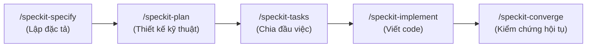
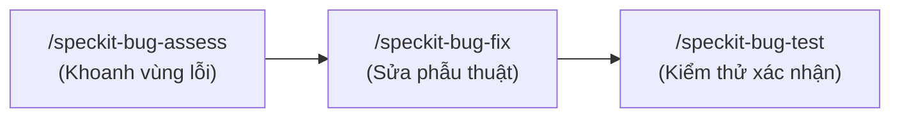

# 📘 CẨM NANG HƯỚNG DẪN SỬ DỤNG BỘ CÔNG CỤ SPEC KIT
## DỰ ÁN: AURA BEAUTY MALL (WEBBANMP)

> **Mục tiêu**: Hướng dẫn chi tiết cách thức người dùng (Product Owner / Developer) tương tác với AI Agent thông qua hệ thống lệnh **Spec Kit** để xây dựng tính năng mới, sửa lỗi phẫu thuật và thẩm định kiến trúc mà **không bịa đặt (Zero Hallucination)**, **không làm bẩn thư mục gốc (Clean Root)** và **không làm gãy hệ thống (Zero Breakage)**.

---

## I. TỔNG QUAN VỀ TRIẾT LÝ SPEC KIT

Khác với cách "Vibe Coding" truyền thống (gõ prompt chung chung khiến AI tự ý sinh code lan man, phá vỡ cấu trúc có sẵn), **Spec Kit** vận hành theo nguyên tắc:
1. **Spec-First & Simplicity First**: Mọi thay đổi code đều phải xuất phát từ một bản đặc tả rõ ràng (Actor, Trigger, Outcome, Luồng lỗi, Tiêu chí nghiệm thu).
2. **Surgical Changes**: Sửa đúng điểm cần sửa, giữ nguyên mã nguồn và kiến trúc Hexagonal / Non-blocking.
3. **Goal-Driven Execution**: Từng bước thực hiện đều có câu lệnh kiểm chứng tự động (`Verify: [Lệnh]`).

---

## II. 3 QUY TRÌNH THỰC THI CHÍNH

### 🛠️ QUY TRÌNH 1: PHÁT TRIỂN TÍNH NĂNG MỚI (SPEC-DRIVEN DEVELOPMENT — SDD)
Dùng khi bạn muốn thêm một chức năng mới (ví dụ: Tích hợp ví điện tử, Flash Sale, Routine Da Liễu, Mini Game...).



#### Bước 1: Khởi tạo đặc tả nghiệp vụ
- **Cú pháp**:
  ```text
  /speckit-specify [mô tả ngắn gọn tính năng bạn muốn]
  ```
- **Ví dụ thực tế**:
  ```text
  /speckit-specify Tích hợp cổng thanh toán VNPay QR cho đơn hàng mỹ phẩm
  ```
- **Cách Agent xử lý**:
  - Agent chạy *Silent Project Learning* quét mã nguồn hiện tại.
  - Nếu thiếu thông tin, Agent sẽ **dừng lại hỏi bạn tối đa 5 câu hỏi** có sẵn phương án khuyến nghị.
  - Tự động xuất bản đặc tả vào `docs/flows/QT-<nn>-<slug>.md` (và `.specify/specs/<slug>/spec.md`) đủ 15 mục và 12 luật chuẩn `/business-flow`.

#### Bước 2: Lập thiết kế kỹ thuật
- **Cú pháp**:
  ```text
  /speckit-plan [các ràng buộc công nghệ nếu có]
  ```
- **Ví dụ thực tế**:
  ```text
  /speckit-plan Sử dụng Reactive WebClient trong payment-service, webhook xác thực chữ ký SHA-256
  ```
- **Cách Agent xử lý**:
  - Tạo `docs/flows/<slug>-plan.md` liệt kê chính xác các file backend, frontend, schema database R2DBC/MongoDB cần can thiệp.

#### Bước 3: Chia nhỏ đầu việc (Work Breakdown)
- **Cú pháp**:
  ```text
  /speckit-tasks
  ```
- **Cách Agent xử lý**:
  - Tạo `tasks.md` với danh sách việc tuần tự T1, T2, T3... Mỗi task đều kèm lệnh kiểm thử `Verify: [lệnh chạy]`.

#### Bước 4: Thực thi viết code
- **Cú pháp**:
  ```text
  /speckit-implement
  ```
- **Cách Agent xử lý**:
  - Viết code tuần tự theo từng task. Bảo đảm: Backend không có blocking call, Frontend có đủ 4 trạng thái UI (Loading, Empty, Error, Data), không tạo file rác ở thư mục gốc.

#### Bước 5: Kiểm chứng hội tụ toàn diện
- **Cú pháp**:
  ```text
  /speckit-converge
  ```
- **Cách Agent xử lý**:
  - Tự động chạy: `mvn clean test-compile`, kiểm thử `ArchUnit`, `CAS Concurrency`, `npm run build` frontend và quét sạch thư mục gốc.
  - Trả về kết quả: **`Converged`** (100% đạt chuẩn) hoặc chỉ rõ file còn lỗi.

---

### 🐛 QUY TRÌNH 2: CHẨN ĐOÁN & SỬA LỖI PHẪU THUẬT (BUG FIXING)
Dùng khi phát hiện lỗi giao diện, sai lệch logic, lỗi API hoặc rò rỉ dữ liệu.



#### Bước 1: Phân tích nguyên nhân gốc rễ (Root Cause Analysis - RCA)
- **Cú pháp**:
  ```text
  /speckit-bug-assess "[mô tả triệu chứng hoặc ảnh lỗi]" slug=[tên-lỗi-ngắn]
  ```
- **Ví dụ thực tế**:
  ```text
  /speckit-bug-assess "Thanh tìm kiếm Header không ra kết quả khi nhập full name sản phẩm" slug=search-fullname
  ```
- **Cách Agent xử lý**:
  - Agent khảo sát code thực tế từ giao diện đến backend MongoDB, xác định chính xác dòng gây lỗi (`path:line`), lưu hồ sơ tại `docs/modules/bugs/<slug>/assessment.md` **mà chưa vội sửa code**.

#### Bước 2: Sửa lỗi phẫu thuật
- **Cú pháp**:
  ```text
  /speckit-bug-fix slug=[tên-lỗi-ngắn]
  ```
- **Cách Agent xử lý**:
  - Chỉ sửa đúng các dòng mã gây lỗi, không reformat, không đổi style, không gây hiệu ứng phụ (side-effects).

#### Bước 3: Kiểm thử xác nhận
- **Cú pháp**:
  ```text
  /speckit-bug-test slug=[tên-lỗi-ngắn]
  ```
- **Cách Agent xử lý**:
  - Chạy build và test case để xác nhận lỗi đã biến mất. Báo cáo trạng thái: **`verified`**, **`partial`**, hoặc **`failed`**.

---

### 💡 QUY TRÌNH 3: THẨM ĐỊNH Ý TƯỞNG & BÓC TÁCH OPEN SOURCE (OSS)

#### 1. Đánh giá tính khả thi của ý tưởng mới (`/speckit-assess-*`):
Thực hiện tuần tự 5 bước trước khi quyết định viết spec hay hủy bỏ:
1. `/speckit-assess-intake "[mô tả ý tưởng]" slug=[tên-ý-tưởng]`: Tiếp nhận đề xuất và xác định phạm vi.
2. `/speckit-assess-research slug=[tên-ý-tưởng]`: Nghiên cứu thị trường và giải pháp kỹ thuật tương tự.
3. `/speckit-assess-define slug=[tên-ý-tưởng]`: Định nghĩa giá trị cốt lõi và các rủi ro kỹ thuật.
4. `/speckit-assess-shape slug=[tên-ý-tưởng]`: Phác thảo kiến trúc giải pháp tối giản (MVP).
5. `/speckit-assess-decide slug=[tên-ý-tưởng]`: Đưa ra phán quyết:
   - **`go`**: Ý tưởng khả thi $\rightarrow$ Tự động chuyển tiếp sang `/speckit-specify`.
   - **`needs-clarification`**: Cần làm rõ thêm yêu cầu nghiệp vụ.
   - **`kill`**: Từ chối ý tưởng kèm lý do cụ thể (không phù hợp kiến trúc, tốn kém tài nguyên).

#### 2. Bóc tách mã nguồn mở an toàn (`/oss-blueprint`):
Dùng khi bạn tìm thấy một repo GitHub hay ho (ví dụ: engine AR, chatbot da liễu, thuật toán gợi ý mỹ phẩm) và muốn học hỏi kiến trúc đưa vào dự án.
- **Cú pháp**:
  ```text
  /oss-blueprint [link-repo-github]
  ```
- **Quy tắc an toàn**: Agent chỉ đọc tĩnh (Read-only), tuyệt đối không chạy script lạ gây nguy hiểm cho máy tính. Phân tích giấy phép (License Gate: MIT, Apache vs GPL/AGPL) và bóc tách thành bản thiết kế 17 mục tại `docs/blueprints/OSS-BLUEPRINT-<tên-dự-án>.md`.

---

## III. BẢNG PHÍM TẮT & CÚ PHÁP TRA CỨU NHANH (CHEAT SHEET)

| Mục đích công việc | Lệnh chat thực thi | File đầu ra chính |
| :--- | :--- | :--- |
| **Cập nhật hiến pháp** | `/speckit-constitution [nội dung]` | `AGENTS.md`, `GEMINI.md`, `.specify/memory/constitution.md` |
| **Bắt đầu tính năng mới**| `/speckit-specify [mô tả]` | `docs/flows/QT-<nn>-<slug>.md` |
| **Lập thiết kế kỹ thuật**| `/speckit-plan` | `docs/flows/<slug>-plan.md` |
| **Lập danh sách việc** | `/speckit-tasks` | `.specify/specs/<slug>/tasks.md` |
| **Tiến hành viết code** | `/speckit-implement` | Các file tại `frontend/`, `backend/` |
| **Kiểm thử nghiệm thu** | `/speckit-converge` | Báo cáo kiểm thử tự động toàn diện |
| **Chẩn đoán lỗi** | `/speckit-bug-assess "[lỗi]" slug=[tên]` | `docs/modules/bugs/<slug>/assessment.md` |
| **Thực hiện sửa lỗi** | `/speckit-bug-fix slug=[tên]` | File mã nguồn chứa lỗi |
| **Xác nhận sửa lỗi** | `/speckit-bug-test slug=[tên]` | Báo cáo kiểm thử `verified` |
| **Bóc tách repo mở** | `/oss-blueprint [link-repo]` | `docs/blueprints/OSS-BLUEPRINT-<project>.md` |

---

## IV. VÍ DỤ MINH HỌA: TỪ YÊU CẦU ĐẾN HOÀN THÀNH

Khi bạn muốn thêm tính năng **"Đăng nhập bằng Google OAuth2"**:

1. **Bạn gõ**: `/speckit-specify Thêm tính năng đăng nhập nhanh bằng Google cho Khách mua hàng (Buyer)`
2. **AI phản hồi**:
   - Quét `account-service` và `api-gateway`.
   - Nếu cần làm rõ: Hỏi bạn 2 câu về việc xử lý tạo tài khoản mới tự động và gán role `ROLE_BUYER`.
   - Tạo file `docs/flows/QT-06-dang-nhap-google-oauth2.md` đủ luồng chính, luồng phụ, sơ đồ Mermaid và tiêu chí Given/When/Then.
3. **Bạn duyệt xong, gõ**: `/speckit-plan`
4. **AI phản hồi**: Lập kế hoạch can thiệp `account-service` (WebFlux OAuth2 Client) và `AuthModal.jsx` ở Frontend.
5. **Bạn gõ**: `/speckit-tasks` $\rightarrow$ AI chia việc T1..T4.
6. **Bạn gõ**: `/speckit-implement` $\rightarrow$ AI viết code sạch.
7. **Bạn gõ**: `/speckit-converge` $\rightarrow$ Toàn bộ test xanh 100%, tính năng hoàn tất!
